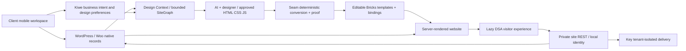

25 October — AP126 production migration accepted: National and Dharwad run signed physical Core436 with native Store1.0.0/SEO1.0.0 and Woo11.2.1 after the separate named Woo/database approval. Original commerce, authored content, settings and roles remain; guest cart/checkout/empty-cart cleanup and recovery retirement pass. AP01–AP06 are accepted for the qualified platform and named rollout; fresh browser capture remains unverified. Ascendants/Rank Math, feeds and deferred work are unchanged. [Live evidence and recovery](APPS-RC436-LIVE-2026-10-25.md).

24 October — The founder authorizes completing the original AP01–AP06 Apps platform. AP124/unsigned RC428 is in implementation/source qualification: versioned providers, explicit physical package ownership, signed native installation/update and Core data/recovery separation. No AP outcome is accepted from local switches alone. Native installation/update/recovery, physical Core matrix, browser review and reviewed publication remain. Lab/National/Dharwad stay RC427; Ascendants stays RC55.5/Rank Math. [Current original-ID ledger](AP-PLATFORM-2026-10-24.md).

24 October — Complete authoring-context independence is accepted on signed RC425 on the lab. Core retains the full Design Context, guided setup, Site Graph/MCP/Start handoff and Seam/Bricks bindings with SEO off. Fourteen context families and ten complete hashes match across three native boot modes; inactive full exports load no SEO namespace files/hooks. Composed 177 source gates, native/client review and 1,150 final retirement checks pass; zero owned helpers/jobs, eight protected inputs and exact RC424 recovery remain. Production stays National/Dharwad RC421 and Ascendants RC55.5 with Rank Math retained. Actual-source Ascendants recovery/provider qualification is next; CSS/shared-host work and Ecommerce extraction follow later. No production upload is authorized. [Evidence and limits](CONTEXT-INDEPENDENCE-RC425-2026-10-24.md).

24 October — Founder-approved RC421 is live on National and Dharwad. Each passes 651 installation/seven boot checks and 574 final native preservation checks; exact content, settings, plugin choices, stock and role rows remain. Six current routes and both signed public assets pass; actual guest Add/Cart/Checkout/removal passes with both original carts restored empty. Retirement 1,289, independent zero-helper/sole-original-cron inventory and 16 protected inputs pass. Exact immediate RC417 rollback remains per site. This release and inherited conditional-commerce publication are closed; large inline CSS/shared-host waits and prior National outlier remain open. Ascendants/Rank Math, SEO isolation, Apps and Google/MCP stay separate. [Live acceptance and limits](PERFORMANCE-RC421-LIVE-2026-10-24.md).

24 October — APP118 final signed RC421 is accepted on the lab, including original-source Bricks 2.3.4/2.3.11 qualification. Three fixed serial pairs per case preserve exact CSS/content/state and reduce median Home CPU 7.9–13.3%, Shop 15.6–23.4%; every outlier is retained. Composed 175 baseline plus nine current gates, 651 install/seven boot/42 cart,133 native runtime checks and 569 final preservation pass. Actual guest Add/Checkout/removal passes. Final 5,948 retirement checks, 2,180 fixture/1,125 obsolete code removals, 20 protected inputs and independent zero-helper/sole-original-cron inventory pass. Both stores remain RC417 pending named approval; shared-host waits/large inline CSS remain unresolved. Ascendants/Rank Math, SEO isolation, Apps and Google/MCP stay separate. [Final candidate and limits](PERFORMANCE-APP118-RC421-2026-10-24.md).

23–24 October APP118: native invariant Bricks-loop CSS reuse is signed RC419 and accepted on the modern-Bricks lab, with exact native state/CSS and reduced measured CPU. Production remains RC417. Actual live Bricks2.3.11/2.3.4 compatibility is now being qualified before a rollout recommendation; long shared-host waits remain separate. [Evidence and limits](PERFORMANCE-APP118-RC419-2026-10-23.md).

23 October — APP119 conditional-commerce implementation/lab qualification is accepted on signed RC418, without an Apps split. Zero scoped engineering/lab/cleanup steps remain; named production approval is separate. APP118 cold/personalized response, complete SEO-provider isolation, Google/MCP and four deferred Ascendants milestones remain open or queued under their existing contracts. [Acceptance and limits](CONDITIONAL-RUNTIME-RC418-2026-10-23.md).

23 October — Apps platform is proposed, not implemented or approved for rollout: close the scoped Ascendants incident-mitigation and existing APP118 reliability outcomes, then forecast six AP01–AP06 outcomes. Founder clarification prioritizes Core-only/Rank-Math isolation so Ascendants can upgrade Core before a separate SEO handover; the six IDs are not a fixed execution order. Default SEO inclusion respects the existing provider. Google/MCP25+2 stays queued at zero accepted; its whole programme and four deferred Ascendants milestones are not prerequisites. Existing Woo acceptance remains closed. [Source-backed proposal and staged handover](decisions/2026-10-23-kiwe-apps-platform.md).

23 October — Ascendants read-only diagnosis records136 HTTP503s/two500s after09:00 IST at shared CPU/2GB RAM/80-process peaks. Old RC55.5 has avoidable non-Woo startup work; exact offending processes and possible maintenance contribution are unproven. Prioritize a scoped, qualified non-Woo load correction and provider fault attribution; no live change is made. APP118 remains one queued, unstarted performance batch; four Ascendants migration milestones remain deferred. [Incident](ASCENDANTS-503-INCIDENT-2026-10-23.md), [queued batch](PERFORMANCE-APP118-BATCH-2026-10-23.md).

23 October APP117 accepted on signed RC417: startup overlap and empty guest Saved-read removal pass full current173 gates, native/browser verification and complete cleanup. Next performance gate: actual FPM cold/personalized traces, including the National34.75s outlier, then measured render/bootstrap reduction while preserving native commerce and cache exclusions. Google/MCP25+2 remains queued, zero accepted; four Ascendants milestones deferred and Woo closed. [Evidence and limits](STARTUP-OVERLAP-APP117-2026-10-23.md).

23 October APP116: native public caching on National and original-byte Home Media delivery on Dharwad are accepted, with exact CSS-trial reversal and complete helper/job cleanup. RC416 remains current. Next performance gate is cold/private frontend profiling and design-preserving CSS delivery; no capacity or complete speed claim. [Native delivery evidence](NATIVE-PAGE-DELIVERY-APP116-2026-10-23.md).

**23 October — current performance checkpoint:** APP115 is accepted as signed RC416 on lab/National/Dharwad with final recovery/cleanup. APP116 separately qualifies existing native public page caching, rejects a visually regressing Bricks CSS mode and reviews byte-identical native media delivery. Finish its exact native/browser preservation and cleanup before the queued G01 Google/MCP foundation. Google/MCP25+2 remains zero accepted, four Ascendants milestones deferred and Woo closed. [Current runtime evidence](APP115-RESPONSIVENESS-RC416-2026-10-23.md).

**22 October — APP109 before Google/MCP:** Signed RC400 is native-tested on the lab (648 installation, 12 boot, 54 App checks; 48 recovery checks). Home has one visibility choice, an independent before-load introduction and a 10-second inactivity default. Plain settings and stacked Daily/notification cards replace the inconsistent layouts; saved-cart notifications retain the full collection. Start9.6 is public. The revised browser review remains pending because tools report disabled after the founder enabled them. National/Dharwad stay signed RC392; no new live approval or Google/MCP acceptance. [Current evidence and continuation](APP-WORKSPACE-AND-ADOPTION-2026-10-22.md).

**22 October — DAILY108 accepted, work run108:** Founder-approved signed RC392 is live on National and Dharwad. Saved-cart capture is core without a switch; both native owners have schema4/hourly maintenance. Forms and all six Daily destinations have role-scoped arrivals; green/yellow cards show actual contact and truthful checkout stages. Lab37 native/15 acceptance plus responsive review, each live644 install/11 boot, exact159-document/515-control/all-role/taxonomy preservation, six current public routes and actual private UI pass. National's Forms badge shows2; Dharwad preserves99 cart rows. Retirement4,695 and independent27-root-entry/sole-original-cron checks pass; zero owned helpers/jobs or lab examples remain. Four offline originals authenticate before1,668 superseded runtime files retire; immediate RC390 code recovery and20 protected local inputs remain. **Zero Daily/capture batches and zero Woo launch milestones remain. Next queued development: G01 Google connection foundation; four Ascendants milestones remain deferred.** No order/send/feed/third-party upgrade/commit/push. [Acceptance and limits](DAILY-ARRIVALS-AND-CART-JOURNEY-2026-10-22.md).

**22 October — WO107/task22 accepted:** The founder-approved signedRC390 is live on Dharwad and National; each passes644 installation/seven boot and independent native preservation of159 authored records,515 settings and all captured roles/taxonomy/configuration. Fourteen public routes and both actual private checkout redirects pass after cache invalidation. The actual-source native restore/exact preboot reversal/51 paused Store checks and complete newer-state offline custody are accepted; strict guards remain intact. Live retirement5,718 and independent zero-helper/job/sole-original-cron checks pass; one exactRC389 rollback per site remains and1096 superseded runtime files retire after original offline signature verification. **Zero Woo launch milestones remain; next batch G01 Google connection foundation.** Four Ascendants milestones remain deferred; Google/MCP25+2 stays separate, zero accepted. [Acceptance and limits](KIWE-RC390-ROLLOUT-2026-10-22.md).

**22 October — WO107 restore rehearsal and RC390 lab qualification accepted:** Actual-source native staging, migrated database/ownership, isolated activation, exact preboot reversal and51 paused Store checks pass. Newer-state inspection/reversal correctly refuse after boot; complete postboot custody authenticates on server and laptop before explicit disposable-fixture retirement. All178 pre-existing tables/83 lab authored records remain;118 test tables retire. Final3,378 and independent27-root-entry/sole-original-cron checks pass; zero owned helpers/jobs and15 protected inputs. SignedRC390 passes171 source gates and644 lab installation/seven boot checks; both live sites remain signedRC389. **Next: approve the exact RC390 live recovery-fix handover, then final task22 monitored-pilot disposition.** One Woo/four deferred Ascendants milestones remain; Google/MCP25+2 stays queued. [Evidence](WOO-RESTORE-REHEARSAL-2026-10-21.md), [live review](KIWE-RC390-LIVE-REVIEW-2026-10-22.md).

**21 October — current gate:** SC01–SC04, CL105 and the approved SC106 runtime rollout are accepted. Both live sites and the lab run signedRC389; Start9.5/Seam2.18 are public. Requalify the remaining Woo restore destination using fresh capacity after cleanup; do not treat the old quota blocker or new free space as restore acceptance. Keep the obsolete template-reference rename follow-up and G01/Ascendants scope distinct. [Current rollout](KIWE-RC389-ROLLOUT-2026-10-21.md).

**21 October — current gate:** SC01–SC04 source/lab qualification and shared Start9.5/Seam2.18 publication are accepted; CL105 obsolete-copy cleanup is complete. The exact signed RC389 runtime is lab-only. Next is named live approval and target-specific rollout/readback; do not restart the accepted compiler/publication work or force additional native-style moves. G01 Google/MCP, the external Woo restore and deferred Ascendants retain their separate scope. [Evidence](SEAM-DEPENDENCY-CONSOLIDATION-2026-10-21.md), [review](KIWE-RC389-LIVE-REVIEW-2026-10-21.md).

**21 October — current SC01–SC04:** SC01 compiler source and SC03 Start9.5 source/kit are verified. SC02 native lane passes on signed lab RC389:171 source gates,644 deployment/seven boot,118 native import/recovery and102 untouched compiler-ZIP roundtrip checks, with exact recovery and zero owned transport/jobs. Both live sites/public tools are unchanged. **Next batch SC04:** current-design lab consolidation/responsive review, declared clean snapshot synchronization and release qualification. Browser use is disabled;44 retained native documents have a read-only inventory ready. Fresh named production approval follows concrete lab review. [Current evidence](SEAM-DEPENDENCY-CONSOLIDATION-2026-10-21.md).

**20 October — S1 shared publication accepted, work run96:** Start9.4-44455e077234 and compiler2.17.3/v38 are public on Hostinger and existing Sites version43. Shared rules cover complete storefront/native handoff; the compiler also fixes a browser-found default-px Checkout payment-description comparison. Both final builds, composed357 tests,68 exact Start responses, independent71-member kit/CLI and all10 members from four actual cross-host exports pass. Recovery is retained, all owned transport/jobs retire, eight inputs have verified DPAPI custody and the unrelated PR template stays exact/untracked. No client site or Kiwe runtime changes. **S1 is closed; one shared follow-up remains: D1 Dharwad product-card corrections, prepared on the lab before live review/approval.** [Release, evidence and limits](SHARED-START-SEAM-PUBLICATION-2026-10-20.md).

19 October run95 — Checkout is part of storefront design coverage, including its configured native page/shortcode and Bricks template. Include every intended rail inside its explicit SEAM boundary, bind category media/title/links to the same native term, and resolve all Shop aliases to the actual Woo page before publication. These two National omissions are accepted live with shared compiler fixes; S1 publication then D1 remain. [Acceptance](NATIONAL-CHECKOUT-SHOP-2026-10-19.md).

19 October run94 — N4–N6 guest policy, shared modal continuity, National design and live acceptance are complete on lab/National RC383. Zero new batches remain; S1 Start/compiler distribution then D1 Dharwad cards remain the existing two shared follow-ups. External Woo recovery, Ascendants and Google/MCP retain their scope. [Acceptance and limits](NATIONAL-EXPERIENCE-RC382-2026-10-19.md).

**18 October — Contact WhatsApp and National FSSAI accepted, work run 85:** [Shared correction, source and custody](CONTACT-WHATSAPP-RC381-2026-10-18.md). Signed RC381 is on the lab and National. The separate WhatsApp card follows the saved public-phone choice through the existing native projection, renderer and writer; both paths and restoration pass in Chrome. National’s existing invoice-footer FSSAI number is saved in its current Design Context field, with validity unverified and public product-display choices retained. One complete 167-gate baseline, exact signed package/delta, native boots, client readbacks, exact context/settings preservation and zero-helper/sole-original-cron retirement pass. Private recovery has verified DPAPI custody; immediate RC380 reversal remains available. **Zero batches remain for these two corrections. Next: National dependency and Dock/account review.** Dharwad stays RC379; the external Woo restore, four deferred Ascendants milestones and Google/MCP remain separate. No feed, compiler/Start publication, commit or push.

**18 October — National Design Context filled, work run 84:** [Sourced client brief and owner-review limits](NATIONAL-CHIKKI-DESIGN-CONTEXT-2026-10-18.md). The founder authorizes acting as National’s client to fill the existing brief from its public website and internet sources, using Dharwad as the coverage benchmark. Native UI saves and fresh readbacks take National from 44% to 100% (19/19 active checks); Dharwad is 95% (19/20). Identity/logo, story, audience, sales SEO goal, contact/social channels, design/page guidance and three public media selections are saved. Existing store setup is reviewed without rate/tax/payment changes. Testimonials and registrations remain for later; strategy and proposed colours are labelled. Native colour swatches remain unchanged because automated colour edits did not enable Save; colour values are in saved notes. **Zero brief-filling batches remain. Next: National dependency qualification and Dock/account review.** RC380 runtime, Dharwad RC379 and separate Woo/Ascendants/Google work are unchanged; no deployment, feed, commit or push.

**18 October — National Chikki onboarding accepted, work run 83:** [Runtime, snippet retirement and ownership](NATIONAL-CHIKKI-ONBOARDING-2026-10-18.md). National now runs signed RC380 and WordPress 7.1.3. All 21 legacy snippets and their evaluator are natively removed after recovery and coverage; existing Munaf ID1 is Kiwe technical Super Admin without a password change. Optional native weight shipping and Bricks filter images preserve the existing storefront; six previously inert bestseller flags are cleared across three exact documents. The composed 167 source gates, actual lab qualification, 2,361 install checks, 17+469 uninstall and 17+15 final native checks pass. Live cart/quantity/checkout and the signed-in dashboard pass; no order or test email is sent. All 34 retirement checks and independent zero-helper/sole-original-cron inventory pass; 60 private inputs have verified DPAPI custody. **Zero onboarding batches remain. Next batch: qualify National’s Bricks/Woo updates and review site/Dock setup.** Existing public Dock remains disabled; its Account launcher needs review. Dharwad stays RC379; separate Woo restore/Ascendants/Google work is unchanged. No feed, compiler publication, commit or push.

**17 October — approved Start/Forms rollout accepted:** [Live Start 9.2 and Dharwad RC379](START-FORMS-RC379-ROLLOUT-2026-10-17.md) complete the reviewed command/library and native owner-only Forms additions. Dynamic Contact recipient/save order, actual served/browser evidence, exact preservation, offline previous-state recovery and retirement pass. Zero batches remain for this scope; National Chikki discovery follows. Keep native Bricks storage/mail authority and all separate Woo/Ascendants/Google limits.

**17 October — F3 continuation, work run 78:** [Current native reuse evidence](NATIVE-REUSE-F3-2026-10-17.md). Canonical/signed candidate RC377 passes 334 compiler tests; lab RC376 has accepted native saves and the bounded native amendments. Final RC377 lab acceptance and cleanup await Hostinger maintenance (HTTP 503; hPanel confirms updates in progress). No owned cron or local process remains; two CLI-only lab helpers and one candidate ZIP await final execution/retirement. **Two framework batches remain, including F3 acceptance; F4 follows.** Dharwad remains RC372 with no production changes. No compiler publication, feed, commit or push. The report and work/framework78 checkpoint own the continuation.

**17 October — F2 accepted on the lab, work run 77:** [Public runtime and Search evidence](LEAN-RUNTIME-F2-2026-10-17.md). Signed RC374 has a reusable canonical catalog, requested diagnostics and deferred registry inspection; the same Home boot is 49.1% smaller, while measured cold combined transfer is essentially unchanged and the catalog is cached across routes. Classic/Sheet desktop/phone scrolling, stable native cart refresh, private preferences and 57 isolated Chrome continuity checks pass. The composed 161-gate baseline, 630 deployment/seven boot/24 native checks, exact settings/cart restoration and independent cleanup pass. Six inputs are protected; exact RC373 recovery remains. **Two framework batches remain; next: F3 native page/compiler reuse and selector boundary.** Dharwad independently remains RC372; production requires review and new approval at F4. No feed, compiler publication, commit or push. Separate Woo/Ascendants/Google and National Chikki scope is unchanged.

**16 October — F1 accepted on the lab, work run 76:** [Shared dashboard foundation and evidence](WORKSPACE-FOUNDATION-F1-2026-10-16.md). Signed RC373 shares task CSS across 17 apps and completes private token roots while preserving the recorded appearance. The composed 159-gate source check, 627 deployment/seven boot/200 native style checks and thirteen desktop/phone views pass. Combined CSS artifacts shrink 41.7%; actual cache reuse is observed, with a 5.3 KB cold Posts cost increase. RC372 recovery is retained; all owned helpers/jobs are retired, the temporary Hostinger login file is privately quarantined and seven inputs are protected. **Three framework batches remain; next: F2 lean Dock/runtime and shared scrolling.** Dharwad remains RC372. No production change, feed, compiler publication, commit or push. Separate Woo/Ascendants/Google and National Chikki scope remains unchanged.

**16 October — work run 75, Seam reuse audit complete:** [Findings and four proposed batches](SEAM-REUSE-AUDIT-2026-10-16.md). All 34 shipped CSS/41 JS files, 36 retained accepted native documents and representative real dashboard/dock/page views are reviewed. Common styles recur across 17 apps; token-root gaps, public runtime/metadata cost, repeated compiler bridge payloads, legacy Search scrolling, a malformed native selector and an older handoff vocabulary gap are documented. Existing adoption/token guards pass; fresh Start and final modern Search acceptance are explicitly limited. **Zero audit batches remain; four new implementation batches are proposed. Recommended next: F1 shared dashboard foundation.** RC372 code/settings and accepted D03 layouts remain unchanged. National Chikki and separate Woo/Ascendants/Google work retain their scope; no new live rollout approval is inferred.

**16 October — work run 74 accepted:** [Saved icons and dock](SAVED-ICON-STATE-RC372-2026-10-16.md) installs signed RC372 on lab and founder-approved Dharwad. The composed 158-gate source acceptance, 625 native checks plus seven boot checks per site, exact served stylesheet and desktop/390px Chrome checks pass. Wishlist/bookmark attributes colour saved SVGs automatically; un-save restores authored colours. Dock Notifications is hidden while the header inbox works. Lab test states are restored; live saved items are untouched. Helpers/jobs are retired, seven inputs protected, and RC370 recovery retained. **Zero follow-up or D03 development batches remain. Next: National Chikki discovery and lab plan.** Separate external Woo restore, four Ascendants milestones and Google/MCP remain open.

**16 October — work run 73, D03 accepted:** [Publication and browser closure](D03-PUBLICATION-AND-BROWSER-2026-10-16.md). Dharwad RC370 desktop/phone interactions and native category rails pass. Seam source e326b2b is pushed and live on Hostinger and existing Sites v40; both builds/328 tests, six rendered parity cases and all six accessibility-package members/closure text pass. Actual Chrome Home editing/save is verified on the lab and the original text is restored, including its cached public copy. Contact also displays in the recovered Bricks canvas. The earlier failures remain documented. **Zero D03/Dharwad development batches remain. Next: National Chikki discovery and lab plan.** No further Dharwad runtime/content deployment is made. Separate Woo restore, four Ascendants milestones and Google/MCP gates retain their own scope.

16 October D72: the founder-approved RC370/native delta rollout is on Dharwad; 18 changed/18 preserved documents, exact routes/globals and native rollback readiness pass. Fresh browser smoke remains pending Work access. No further deployment batch is planned for these repairs. Next D03 work is tested public Seam publication, actual Chrome save and external parity; existing Woo/Ascendants/Google gates are unchanged. [Evidence and limits](DHARWAD-RC370-ROLLOUT-2026-10-16.md).

**16 October — approved D03 live deployment, work run 70:** [Evidence and remaining gates](DYNAMIC-CONTENT-DELIVERY-2026-10-15.md). D03 remains one open batch, not accepted as a whole. The founder explicitly approved the reviewed lab candidate: “i have reviewed the lab you can go ahead”. Dharwad now runs signed RC368: runtime 624+7, v9 preflight 396 and apply 678 pass. Nineteen documents change through 20 native field writes; 17 documents, endpoints, globals, site choices and both manual Home loop roots are preserved. The first 237-check apply failed and rolled back; all 36 originals were independently confirmed before retry. Two read-only edit-lock preflight failures remain failed; no roles change. Live desktop five moods/five pairs and phone five moods pass after preview readiness, with visible hero and no overflow; instant startup is not established. Seam/Start publication and earlier source/native-handler proof retain their documented scope. Production retirement passes 144 checks, lab retirement seven and final approved cleanup 85, all with cleanup; the final helper self-retires and removes the two remaining capture/reversal helpers. Independent inventory confirms 26 lab/30 live root entries, zero owned helpers/jobs and the sole original WordPress cron preserved. Private reversal custody and active lab review fixtures remain retained. All 24 new approved-deployment authentication/configuration inputs are DPAPI-protected with verified readback and plaintext removed; the earlier 28 protected inputs remain separate historical custody. External Sites/cross-runtime parity and actual Chrome editing/save remain open. One external Woo restore gate, four deferred Ascendants milestones and Google/MCP 25+2 remain separate.

15 October — D02 accepted on signed RC364, work run 69: [Native commerce/offer bindings and complete record conversion](DYNAMIC-CONTENT-DELIVERY-2026-10-15.md) reuses Woo relationships and existing pair metadata, exposes stable configured selectors and native tag-group evidence, and binds accessible labels with the same current record. Full RC363 baseline 154/154 plus affected RC364 guards; 139 compiler tests, 97 final lab checks and 214 independent final checks. All 36 authored layouts/configuration/globals are preserved; synthetic records and owned helpers/jobs are retired. One dynamic-content batch remains: D03 all-page/native-editing bindings and public Seam/Start publication. One external Woo restore gate, four deferred Ascendants milestones and queued Google/MCP 25+2 are unchanged. No commit, push or public feed publication.

**15 October — task22 attempt2, current recovery/cache accepted; full restore still open:** [Evidence and exact blocker](WOO-RELIABILITY-RC360-2026-10-15.md). Current offline source covers the real paid HPOS order; public caching and actual private sessions pass. Native preservation/retirement passes 40 checks; nine helpers, all owned jobs and the VM are retired. Shared hosting has 17,522 free entries versus the conservative 60,000-entry/6 GB rehearsal requirement; the founder confirms no separate Linux destination yet. Keep task22 open and reuse this evidence. **67 work runs; one Woo and four deferred Ascendants milestones remain. Google/MCP 25+2 is queued before Ascendants; zero accepted.** RC360 unchanged; no feed, commit or push.

**14 October — Design Context SEO and Dharwad Rank Math handover accepted on signed RC360, work run 66:** [Behavior, evidence and recovery](SEO-CONTEXT-RC360-2026-10-14.md). Publication identity enables bounded News XML; Design Context owns the shared SEO goal, its review card is in SEO, and Story has no site-wide indexing writer. Dharwad imports 31 supported defaults and 11 empty metadata fields without overwriting 39 native choices; Rank Math is removed with exact private recovery and historical data retained. The composed 153-gate baseline, 114 native lab checks, live rollout, Chrome and final 3,338 core/533 signed-file checks pass. A temporary operator core-file collision was repaired against the official checksum and documented. All owned helpers/jobs are retired. **66 actual work runs; five launch milestones remain: one Woo task22 recovery/performance and four deferred Ascendants, including its own SEO handover. Next batch: task22.** Ascendants remains RC55.5 with Rank Math active. No feed, commit or push.

**14 October — Ascendants search/AdSense incident, work run 65:** [Scoped repairs and recovery](ASCENDANTS-SEO-ADSENSE-INCIDENT-2026-10-14.md). Rank Math remains active and updated to 1.0.280; LiteSpeed is 7.9.1. Google processed the main sitemap successfully (5,652 pages); the obsolete News submission was retired without restoring a dedicated News feed. Duplicate AdSense loaders are removed and the automatic Bricks ad popup is Draft, with exact recovery retained. No Kiwe-caused traffic/ad fraud is established; Google’s serving limit and traffic recovery remain pending. All five owned helpers and all owned jobs are retired. Ascendants Kiwe stays RC55.5; latest source/lab/Dharwad stay RC358. **65 actual work runs; one Woo and four deferred Ascendants milestones remain. Next batch: task22 current recovery/running-destination and public cache/performance acceptance.** No runtime release, feed, commit or push.

**14 October — core inbox and Daily saved carts accepted on signed RC358:** [Behavior and evidence](SAVED-CART-INBOX-RC358-2026-10-14.md). Role-eligible Kiwe updates are always on; preferences choose optional delivery only. Private saved carts show known shopper identity or Unknown, separate readable amounts and stacked status cards. Daily owns their arrival badge and first-abandonment admin notice. The composed 152-gate baseline, 31 native checks, 15 lab acceptance checks, 82 live rollout checks plus 7 boot checks and Chrome acceptance pass. Exact RC357 rollback and external choices are retained; all owned helpers/jobs are retired. Fixture failures and isolated PhoneKey/SecureTrack schema warnings are explicitly scoped in the report. **64 actual work runs; one Woo reliability/recovery milestone and four deferred Ascendants milestones remain. Next: task22 current recovery/running-destination and public cache/performance acceptance.** No order/payment/send, Ascendants change, feed, commit or push.

**14 October — shared DSA, Checkout and private preferences accepted on signed RC357:** [Behavior and evidence](CHECKOUT-PREFERENCES-RC357-2026-10-14.md). Shared Sheet refreshes preserve chrome, focus and scroll. Checkout hides/disables unused shipping fields, retains the separate draft, serializes saves and follows Cart amount policy. Alert choices use fresh private role catalogs; inbox defaults stay separate from external delivery and saved opt-outs. PhoneKey step layout is source-bound verified without sending a code. 151 composed release gates, 53 native feature checks, 13 lab acceptance checks, 40 live rollout checks plus 7 boot checks, and desktop/phone Chrome flows pass. Original cart, shipping choice, preferences and exact RC356 recovery pair are preserved; owned helpers/jobs are retired. **63 actual work runs; one Woo reliability/recovery milestone and four deferred Ascendants milestones remain. Next: task22 fresh recovery/running-destination and public cache/performance acceptance.** No order/payment/send, Ascendants change, feed, commit or push.

**14 October — automatic product offers and actionable Notifications accepted on signed RC356:** [Behavior and live acceptance](AUTOMATIC-OFFERS-NOTIFICATIONS-RC356-2026-10-14.md). Companions/discounts follow product configuration; Cart FBT defaults on with a separate display choice. Notifications share deduplicated pending-action badges and native-checkout reminders across Dock and custom icons. Both continuity defects found in RC355 are repaired. 146 release gates, 38 native lab cases, 28 live rollout checks and focused Chrome flows pass; unchanged responsive evidence is reused explicitly. Original latest cart/settings, RC355 rollback custody and owned-job/helper cleanup are verified. **62 actual work runs; one Woo reliability/recovery milestone and four deferred Ascendants milestones remain. Next: task22 fresh recovery/running-destination and public cache/performance acceptance.** No order/payment/send, Ascendants change, feed, commit or push.

**14 October — first Woo live operations accepted on existing RC351:** [Current acceptance and explicit limits](WOO-LIVE-OPERATIONS-RC351-2026-10-14.md) closes task 21 using the real paid receipt, source-bound native finance tests and current role/phone/native authoring checks. **59 actual work runs; one Woo milestone remains: task 22 current recovery/running-destination and public cache/performance acceptance. Four Ascendants milestones remain deferred.** All owned helpers/jobs are retired. Do not treat an edge DYNAMIC response as a cache hit or the older full-site recovery point as coverage of recent orders.

**13 October — owner dashboard admission accepted on signed RC344:** [Acceptance and recovery](DASHBOARD-ACCESS-RC344-2026-10-13.md) corrects the designated owner’s Home denial and default wp-admin entry without changing roles or granting permissions. An owner-only Setup shortcut preserves WordPress technical work. One 142-gate baseline, 262 native lab checks, owner Chrome entry/return and exact lab/live inventory/custody pass; all owned helpers/jobs are retired. **56 actual work runs; two Woo milestones and four deferred Ascendants milestones remain. Next batch: task 21 live buying/operations and wider-role UI; then task 22 reliability/monitoring.**

**13 October — status, visibility and role-safe Trash accepted on signed RC343:** [Acceptance and recovery](STATUS-VISIBILITY-RC343-2026-10-13.md) completes Media Public/Private views, scoped Trash entrances and semantic stacked Orders/Campaigns/Feedback, and repairs the Products render failure. The composed 142-gate baseline, 187 native lab checks, desktop/390/320px Chrome and exact signed lab/live inventory/custody pass. Settings and original profile choices are preserved; all owned helpers/jobs are retired. **55 actual work runs; two Woo milestones and four deferred Ascendants milestones remain. Next batch: task 21 live buying/operations and wider-role UI; then task 22 reliability/monitoring.**

**13 October — Media and Trash accepted on signed RC342:** [Acceptance, tests and recovery](MEDIA-CONTEXT-TRASH-RC342-2026-10-13.md) completes inherited-image locks, explicit upload selection and readiness, and Organize → Trash with native restore and reviewed deletion. Final affected checks, 107 native lab checks, signed lab/live installation, desktop/390/320px Chrome and exact cleanup pass. Original profiles/configuration and previous live RC338 recovery remain intact. **54 actual work runs; two Woo milestones and four deferred Ascendants milestones remain. Next batch: task 21 live buying/operations and wider role UI; then task 22 reliability/monitoring.**

**12 October — Design Context journey accepted on signed RC338:** [Acceptance and recovery](DESIGN-CONTEXT-JOURNEY-RC338-2026-10-12.md) adds shared persistent saved progress and Resume, links canonical brief/content families to their original editors, supports optional/later choices and retained Services/Team applicability, and includes native Woo products/store review. The composed 140-gate local baseline, final affected checks, 81 native lab cases, signed lab/live installation and desktop/390/320px Chrome checks pass. Exact lab browser-test profile restoration and all 527 signed members are verified; all owned helpers/jobs/overrides are retired. Dharwad shows 94% (18/19), with Store review remaining; Services/Team stay off and optional Media/Testimonials stay for later. **53 actual work runs; two Woo milestones and four deferred Ascendants milestones remain. Next batch: task 21 buying/operations and role UI acceptance; then task 22 reliability/monitoring.**

**Current priority, 12 October — Cart and native Bricks loops accepted on signed RC334:** [Acceptance and recovery](CART-AJAX-RC334-2026-10-12.md) fixes mobile Cart refresh/reopening, native plus-only loop actions, homepage overflow and disabled-button keyboard focus. The composed 138-gate baseline, final affected gates, 38 Chrome fixture checks, 43 final native lab checks, signed lab/live installs and live 320/390px/desktop interactions pass. Original configuration and code recovery remain protected; all owned public helpers/jobs and local fixtures are retired. Bricks is 2.3.11 with global AJAX enabled; downloaded latest is 2.4.2. **50 actual work runs / 31 planned acceptances plus two accepted repairs; two Woo milestones and four deferred Ascendants milestones remain. Next batch: task 21 live buying/operations and role UI acceptance; then task 22 reliability and monitoring.** This accepts the reported UI subscope. No feed, commit or push.

**Prior accepted checkpoint, 12 October — Dock and Links on signed RC331:** [Acceptance and recovery](DOCK-LINKS-RC331-2026-10-12.md) fixes Dock separation, uses Place order for Checkout, preserves complete social names and opens missing social links in the existing native dashboard field for authorized admins. The composed 137-gate baseline, final affected checks, 108 native lab checks, signed lab/live installation and live desktop/320px Chrome checks pass. Exact prior code/configuration is recoverable; all owned rollout helpers/jobs and local fixtures are retired. **49 actual work runs / 31 planned acceptances plus two accepted repairs; two Woo milestones and four deferred Ascendants milestones remain. Next batch: task 21 live buying/operations and role UI acceptance; then task 22 reliability and monitoring.** This accepts a task 21 UI subscope; the prior RC328 continuity scope remains accepted. No feed, commit or push.

**Prior accepted checkpoint, 11 October — frontend repair on signed RC318:** [Restricted Bricks save recovery](BRICKS-FRONTEND-REPAIR-RC318-2026-10-11.md) restores two proven header sanitation losses and protects unchanged approved HTML without granting code privileges. Fifteen focused checks, 133 composed baseline gates, 31 native lab checks, signed lab/live installation, 81 final native checks and six Chrome routes pass. Prior code and user edits are recoverable; all owned helpers/jobs are retired. **45 actual attempts / 30 planned acceptances plus one accepted repair; two Woo milestones and four deferred Ascendants milestones remain. Next batch: task 21, live store operations and role/UI acceptance; then task 22, reliability and monitoring.** One existing repair reserve slot is consumed; the planned forecast is unchanged. No public feed, commit or push.

**Prior accepted checkpoint, 11 October — Bricks dynamic tags on signed RC317:** [Native tags and identity acceptance](BRICKS-DYNAMIC-TAGS-RC317-2026-10-11.md) restores the chooser for existing builder users, adds Services and automatic tag-category choices, and binds live logos/contact fields to dashboard owners. All 132 baseline gates are accepted with a documented inventory-only recheck; 62 native lab, 96 authoring and 56 final native checks plus Chrome and exact retirement pass. Previous RC316 code and original layouts are recoverable. **44 actual attempts / 30 accepted units; two Woo milestones and four deferred Ascendants milestones remain. Next batch: task 21, live store operations and role/UI acceptance; then task 22, reliability and monitoring.** Seam compiler dynamic binding remains deferred; no public feed, commit or push.

**Prior accepted checkpoint, 11 October — Dock theme on signed RC316:** [Theme controls and live acceptance](DOCK-THEME-RC316-2026-10-11.md) completes Setup → Dock → Appearance with installed theme, light/dark and screen behaviour controls, retaining native menu/layout/brand settings. Tawk.to is removed from Dharwad Pedha. Final acceptance passes 95 local checks, the complete 131-gate baseline, 65 native lab checks, signed lab/live rollout, served hashes, phone interaction and exact helper/job retirement. Failed intermediate receipts remain retained; previous live RC313 code is recoverable. **43 actual attempts / 29 accepted tasks; two Woo milestones and four deferred Ascendants milestones remain. Next batch: task 21, live store operations and role/UI acceptance; then task 22, reliability and monitoring.** Ascendants and public Key/Seam are unchanged; no feed, commit or push.

**11 October — R53 generated production layouts accepted:** [Dharwad regeneration](SEAM-R53-PRODUCTION-2026-10-11.md) deploys the common native adapters while preserving approved authoring and business state. Fresh rollback and exact helper retirement are retained; public Seam release remains separate. Next is Woo task 21, then task 22; four Ascendants milestones remain deferred.

**11 October — native compiler R53 acceptance:** Common Seam grid text/font and image adaptations are locally and natively verified; source design remains unchanged. Public Seam deployment and target regeneration are separate release work. [Acceptance and maintained rule](SEAM-COMPILER-R53-2026-10-11.md). This added compiler task leaves two Woo and four deferred Ascendants milestones; next is Woo task 21.

**Current priority, 11 October — Dharwad design accepted:** [Native authored migration](DHARWAD-DESIGN-MIGRATION-2026-10-11.md) publishes the preserved R49B/R52 layouts and enables the existing requested Munaf account through native Kiwe ownership. Product/article bindings, shop filters, homepage recommendations/pairings and phone/header behavior pass scoped native/Chrome checks; original business hashes and recovery custody remain intact. Signed RC311 is unchanged, and all migration helpers/jobs are retired. **39 actual attempts / 25 accepted tasks; two Woo milestones and four deferred Ascendants milestones remain. Next batch: task 21, live store operations and role/UI acceptance; task 22 follows with reliability and monitoring readiness.** Lab RC277 and Ascendants RC55.5 remain unchanged. No customer charge/send, feed publication, commit or push.

**Prior capture/cleanup and original forecast checkpoint — historical subset:**

**Current continuation, 6 October — run 7 cleanup checkpoint:** [Authorized file/plugin cleanup and retired transfer](ASCENDANTS-CLEANUP-2026-10-06.md) pass; website files are 11.94 GB. AH pre-cleanup recovery remains protected; complete offline authentication is deferred for the founder's mobile connection and actual-source restore/reversal needs capacity. Run 7 stays in progress, six tasks accepted; two planned tasks through Ascendants upload and sixteen overall, four repair slots unused. [Current ledger](generated/kiwe-delivery-run-ledger-2026-10-05.json) owns the counts. [Shared-host aggregate retention and full SEO handover](decisions/2026-10-06-shared-hosting-history-and-seo-ownership.md) are explicit unimplemented work requiring isolated native acceptance; no live Rank Math handover tests. Ascendants remains RC55.5, lab RC277, candidate RC284; no runtime upgrade, new signing, commit or push. The launch forecast is not a guarantee that network/capacity or newly identified acceptance concerns are resolved.

**Earlier dated scheduling evidence — superseded for current counts:**

**Current delivery scheduling, 6 October — run 5 accepted:** [Run 5 / RC275](WHOLE-SITE-ROUNDTRIP-RC275-2026-10-06.md) is accepted source, unsigned and uninstalled: actual encrypted offline files authenticate independently and re-uploaded native non-Woo WordPress/Bricks recovery boots, renders and completes shutdown. Exact preboot reversal, source/package verification and independent retirement/root/sole-cron readback pass. RC275 fixes the real native no-payload shutdown TypeError. Combined release coverage is 113/113 after the failed 110/113 full run and three corrected focused metadata gates; it is not one full green run. Failed native attempts A–H stay failed. Full-site readiness remains false; next run 6 covers required withheld native settings/history adapters and current combined non-Woo/preservation/client acceptance. Actual Ascendants offline capture is run 7; approved upload is run 8. Five actual work runs/five accepted tasks; 17 planned runs remain, three through Ascendants upload, four repair slots unused. Nine fixture attempts were inside this fifth work turn. Lab RC268, recorded Ascendants RC55.5 and Key/Seam unchanged; no commit, push or signing.

**5 October continuation — RC270 native inactive database writer:** [Completed unit and remaining work](INACTIVE-DATABASE-RECOVERY-RC270-2026-10-05.md). Supported table definitions are parsed and rebuilt, exact cells recover into a fresh inactive prefix, encrypted receipts bind state, and locked retirement refuses unknown/newer data. Current PHP 8.2.33/MariaDB proof passes 35 SQL checks, 56 parser checks and nine original-state checks; the first surrounding readback failure remains separate. All 109 local release gates pass in one run; the immutable 486-file/489-entry candidate and complete native fixture/helper/cron retirement are verified. Candidate not installed; lab stays RC268, Ascendants recorded RC55.5, Woo paused. Next: serialized URL/prefix mapping and copied-state quarantine, then combined file/database activation and full interrupted reversal. Earlier original-site offline/source-policy/capacity/preservation and combined launch acceptance remain. No commit, push or signing.

**Earlier completed private preparation boundary:**

**5 October continuation — RC269 source candidate, independent private destination preparation:** [Completed implementation and remaining acceptance](PRIVATE-RECOVERY-STAGE-RC269-2026-10-05.md). All 108 local baseline gates pass in one run; 38 local staging checks, 39 Linux/PHP 8.2.33 preflight checks and 440 affected parser/capture checks pass. Preparation works without WordPress booting and preserves the prepared public root, with matching archive/observation authentication, inert private files/records, expanded-capacity checks, nonblocking leases and changed/unknown-data refusal. This is not website activation, URL/prefix migration or full rollback. The candidate is not installed; lab remains RC268 with its earlier partial acceptance, Ascendants remains recorded RC55.5, and Woo stays paused. Continue reviewed destination activation/quarantine and reversal; earlier preservation, verified original-site offline delivery/source policy/capacity and combined non-Woo acceptance remain open. No fresh release-batch countdown is inferred. No commit, push or signing.

**Earlier installed lab boundary (still applicable):**

**Current continuation, 5 October 2026 — RC268 installed lab test, partial acceptance:** [Installed capture, exact remaining work and retained failures](PROTECTED-CAPTURE-RC268-2026-10-05.md). The actual client-created native capture and independent verification pass (179,051,622-byte recovery / 843-byte encrypted report). Authenticated HTTP headers and missing/invalid-nonce denial pass; a saved Chrome file was not verified. The installation's options aggregate failed, while six native account/content/taxonomy tables remain exact. Cache-owner observation reproduces two LiteSpeed housekeeping changes without reconstructing or resetting either aggregate failure. All 107 baseline gates have combined coverage from 99 original passes plus eight corrected reruns; this is not one full green RC268 run. Main retirement passes 510 checks; a retained heartbeat readback failure is followed by a 21-check quiet-cycle retirement. Final API readback restores the original twenty-five root entries and sole WordPress cron, with default-off preview. RC266's complete previous code pair is private; Ascendants was not changed and remains recorded RC55.5. No commit, push or signing.

**Progress reporting:** L1–L5 are five broad acceptance conditions, not five new code batches. Report completed pieces and concrete blockers rather than an unchanged countdown. Remaining: aggregate/owner readiness; verified local delivery plus accepted source/dependency policy, capacity and original-site offline set; independent live destination activation (inactive database writer accepted; complete migration/reversal unimplemented); complete reversal/failure recovery; combined non-Woo acceptance. Source-policy and destination staging/recovery are the next implementation work. Optional website-owned Drive/history/deletion follow the protected pilot; Woo #4–8/B3 remain paused. [Named-target sequencing](ASCENDANTS-PILOT-AND-PORTABLE-RECOVERY-2026-10-04.md).

## Earlier dated checkpoints — superseded for current status and countdown

**Current RC265 account profile backups, 4 October:** [Accepted scope and evidence](BACKUPS-ACCOUNTS-RC265-2026-10-04.md) add editable native names, biographies, public links and team details to the encrypted settings task. Existing Users writers, identity/role checks, field review, before-copies and automatic rollback preserve newer people and current credentials, consent, verification and access. Chrome found and RC265 corrected lost focus during asynchronous popup transitions through the common WorkspaceDialog; the coverage sentence also distinguishes profiles from full account/security state. All 106 current local gates, 41 native checks, 20 Chrome observations, thirty exact served assets, 59 preservation/retirement checks and public health pass. Both RC264 and current RC265 prove actual downloaded-file changed-data recovery, with separate attribution; current Chrome also verifies the corrected popup. Original authored settings/content/terms/all account state remain intact, owned records/copies/helpers/replicas/jobs are retired, and previous code pairs remain private. **B4 stays partial; four non-Woo Backup units remain (B4/B5/B6/B7), five including paused B3.** Configuration, consent and history adapters, reviewed complete recovery, website-owned Drive and combined acceptance remain. The overlapping launch estimate stays about six preparation batches (five to eight), plus two live passes. Woo #4–8/B3 remain paused; Ascendants RC55.5 and Key are untouched. RC242 remains the last complete browser baseline.

**Historical RC263 organization backups, 4 October:** [Accepted scope and evidence](BACKUPS-ORGANIZATION-RC263-2026-10-04.md) add Tags, custom User groups and existing-menu policy to the encrypted settings task, with detailed review, native permissions, preservation of newer memberships and automatic rollback. RC262 passes all 105 local gates and 33 behavior checks; RC263 passes six affected gates, 39 current native checks, 18 current Chrome observations, thirty exact served assets, 45 preservation/retirement checks and public health. RC262 separately proves actual browser download/upload and changed menu recovery. Original authored settings/content/terms/all account state are intact; owned copies/helpers/replicas/jobs are retired, exact previous code pairs are private, and only the original WordPress cron remains. **B4 stays partial; five Backup units remain overall, four non-Woo** (B4/B5/B6/B7). Continue accounts/configuration/consent/history scope, then complete recovery, website-owned Drive and combined acceptance. The overlapping launch estimate remains about six preparation batches (five to eight), plus two live passes; it is not a one-unit/one-release promise. Woo #4–8/B3 remain paused. Ascendants RC55.5 is untouched. RC242 remains the last complete browser baseline.

**Historical RC261 combined Bricks design package, 4 October:** [Accepted scope and evidence](BACKUPS-DESIGN-PACKAGE-RC261-2026-10-04.md) closes bounded B2: one native same-site design package, copy recovery before separate live settings review, and corrected shared client REST/download access. RC260 covers all 104 local gates after metadata repair; RC261 passes eight affected gates, 41 installed native checks, 16 current Chrome observations, thirty exact served assets and 94 preservation/retirement checks. RC260 design/font regression retains its 38/51 attribution. Public health and complete helper/job retirement pass; original authored settings/content/client/activation are intact, previous code pairs are private, and only the original WordPress cron remains. Continue B4/B5/B6 and combined B7 non-Woo acceptance. **Five Backup units remain overall, four non-Woo**; launch forecast about **six preparation batches (five to eight), plus two live passes**. Woo #4–8/B3 paused; Ascendants RC55.5 untouched. RC242 remains the last complete browser baseline. Earlier checkpoints are historical.

**Historical RC260 combined design package candidate, 4 October:** [Scope and pending acceptance](BACKUPS-DESIGN-PACKAGE-RC260-2026-10-04.md) add one same-site package around native settings, templates and referenced images/fonts, with copy recovery before a separate live settings review. Native candidate preflights pass 36/37 checks and preserve original data; they do not prove an RC260 installation. Six Backup units remain overall, five non-Woo until B2 acceptance. Woo stays paused and Ascendants RC55.5 untouched.

**Historical RC259 native design dependency recovery, 3 October:** [Accepted scope and evidence](BACKUPS-DESIGN-RECOVERY-RC259-2026-10-03.md): RC258 covers all 103 local gates across one full run and two corrected metadata gates; 34 actual non-Woo recovery, 38 design regression and 51 font/context native checks pass. RC259 changes one coverage sentence and release metadata only: all five affected checks, 43 native maintenance/retirement checks, 9 current Chrome observations, thirty exact served assets, 33 public endpoints and 15 homepage resources pass. Eight earlier dialog/phone/scroll observations retain RC258 attribution. Original authored data/client/activation are preserved; helpers/jobs are retired, previous pairs are private, and only the original WordPress cron remains. Continue the B2 composite design package, B4/B5/B6 and combined B7 non-Woo acceptance. Six Backup units remain overall, five non-Woo; launch forecast remains about seven preparation batches (six to nine), plus two live passes. B2 remains partial, Woo #4-8/B3 paused and Ascendants RC55.5 untouched. RC242 remains the last complete browser baseline. Earlier checkpoints are historical.

**Historical RC257 Media, Feedback and native font recovery, 3 October:** [Accepted scope and evidence](CONTEXT-FONTS-RC257-2026-10-03.md): 102 local gates in one run, 51 native font/context checks, 38 native design checks, nine current Chrome observations, thirty exact served assets and 69 retirement checks pass. The 21 actual disposable Chrome marking/phone checks retain RC256 attribution. Original data/client/activation are preserved; owned records/files/helpers/jobs are retired, previous code pairs are private, and only the original WordPress cron remains. Continue B2 general composite design/dependency mapping, then B4/B5/B6 and B7 combined non-Woo acceptance. Six Backup units remain overall, five for non-Woo; launch forecast remains about seven preparation batches (six to nine), plus two live passes. B2 stays partial, Woo #4–8/B3 paused and Ascendants RC55.5. RC242 remains the last complete browser baseline. Earlier checkpoints are historical.

**Historical RC252 bounded B1 media recovery, 3 October:** [101 local gates, 50 actual non-Woo WordPress checks, 15 bounded Chrome observations, 41 saved-data checks plus 18 retirement-continuation checks, 30 exact served assets, 98 final retirement checks, 33 public endpoints and 15 normal-homepage resources pass](BACKUPS-MEDIA-RC252-2026-10-03.md). Actual Chrome downloads/uploads restore one media copy and reconnect it only in a new draft. Original settings/client/activation and private accepted RC249 recovery are verified; all owned synthetic data, files, helpers and jobs are retired, with only the original WordPress cron retained. Date-input browser interaction and native JavaScript confirmations remain unverified; this is not full browser or whole-site acceptance. Continue B2 global Bricks, B4 Kiwe/accounts/consent, B5 reviewed complete recovery, B6 website-owned Drive and B7 combined non-Woo launch acceptance. The [launch ledger](ASCENDANTS-NON-WOO-LAUNCH-2026-10-03.md) estimates about seven further pre-deployment batches (six to nine), plus two live passes. Woo #4–8 and B3 remain paused; Ascendants stays RC55.5. RC242 remains the last complete browser baseline. Earlier dated checkpoints are historical.

**Historical RC249 non-Woo checkpoint, 3 October:** Woo #4–8 and Store backup B3 remain paused. [RC249 Service writing history](SERVICE-HISTORY-RC249-2026-10-03.md) is installed on the lab: all 100 local gates are covered across the full run and two corrected metadata gates; 57 native checks, 21 bounded Chrome observations, 30 served assets, 83 retirement checks, 24 public endpoint checks and 15 homepage resources pass. Native recovery/restore/discard and exact editor proof are accepted; browser confirmation actions remain unverified because affected Chrome targets stalled. Original lab activation is retained, synthetic data/helpers/jobs are retired, and only the original WordPress cron remains. RC246/247/248 recovery pairs verify privately. Continue B1/B2/B4/B5/B6 and combined non-Woo acceptance, including RC244 confirmations, RC246 conversion interactions and common taxonomy/role/public/menu checks. The [launch ledger](ASCENDANTS-NON-WOO-LAUNCH-2026-10-03.md) estimates about eight further pre-deployment batches (seven to ten), plus two live passes. Ascendants remains RC55.5 without a named production go. RC242 remains the last complete browser baseline; earlier dated checkpoints are historical.

**Current RC242 native shipping classes accepted on the lab, 3 October:** [Lifecycle, tax disposition and evidence](WOO-SHIPPING-CLASSES-RC242-2026-10-02.md) close Woo launch batch #3. All 98 local gates, 47 native checks, 23 focused React and 27 current Chrome checks, the exact 456-file/459-entry pair, twelve served assets and 70 public checks pass. Native cleanup, existing client/Profile/identity preservation, whole PHP refresh and helper/job retirement pass; only the original WordPress cron remains and RC241 recovery stays private. [Remaining work](BACKUPS-REMAINING-BATCHES-2026-10-02.md): five Woo backend within thirteen launch batches, and seven Backups units estimated at six to eight releases. Next is native attributes #4 before remaining Woo and operational/composite recovery. Product archives explicitly exclude shipping/tax configuration pending B3. Ascendants remains RC55.5; no production rollout, real provider/payments/messages, Key deployment, signing, commit or push.

**Current RC241 backup expansion continuation, 2 October:** [Accepted graph repair and evidence](BACKUPS-COVERAGE-RC241-2026-10-02.md) supersede RC240's later dependency stress gap. Each dependency is validated once in request-local state; native owners, permissions, schemas and writers remain authoritative. All 97 local gates, 140 native checks, fresh Chrome/phone checks, exact package/assets and complete cleanup passed. [The extension contract](BACKUP-EXTENSION-CONTRACT.md) requires native capture/recovery acceptance when adding features; [the plan](BACKUPS-REMAINING-BATCHES-2026-10-02.md) retains seven Backups units and six Woo batches within fourteen launch batches. Next is native shipping-class lifecycle, then remaining Woo before transactional/composite recovery. RC240 remains private recovery and Ascendants stays RC55.5.

**Current RC240 continuation, 2 October:** [The backup expansion foundation is accepted](BACKUPS-COVERAGE-RC240-2026-10-02.md). Native module declarations make incomplete coverage visible without adding shadow storage or generic restore writers. Resume Woo batch #3 shipping classes and configured external-tax disposition, then #4–8; close each feature with its native recovery contract. [The planning ledger](BACKUPS-REMAINING-BATCHES-2026-10-02.md) separates six Woo batches within fourteen core-launch batches from seven remaining Backups units, estimated six to eight focused releases. Overall Backups and the named launch queue remain open. RC240 is lab-only; Ascendants stays RC55.5.

**Current Backups acceptance, 2 October:** [RC239 connected native Service archives](BACKUPS-SERVICES-RC239-2026-10-02.md) passed local, native, Chrome, native readback and retirement gates. Continue the remaining implementation units in [Backup strategy](BACKUP-AND-MEDIA-STRATEGY.md); client-owned provider acceptance is separate. Overall Backups is partial and the 14 / six Woo / zero non-Woo launch ledger is unchanged. Ascendants remains RC55.5.

**2 October media correction:** [RC225 lab and Ascendants RC55.5 record](MEDIA-DELETION-RC225-2026-10-02.md) closes the confirmed Kiwe route-guard defect that blocked native media deletion. A real disposable Shop Manager upload, WordPress REST deletion and cleanup passed on the lab; Ascendants received only a two-source-file RC55.5 backport with complete package verification and public health. The original client's exact account and file still require their own observed acceptance. This bug fix does not close or renumber the existing launch batches.

**RC224 accepted on the disposable lab, 29 September:** [Exact release evidence](TEMPLATES-ANALYTICS-RC224-2026-09-29.md) covers native Bricks Templates in Work, a constrained Web Designer role, contextual Analytics as the sixth Home tab, and Setup SEO/AI preferences. Analytics reads native aggregate owners and offers a human-saved AI strategy against the Design Context SEO goal. The full 92-gate baseline, native lab, signed-in Chrome/context, exact package/asset and cleanup checks passed. Live provider-quality and unavailable lab search/traffic data remain unverified. RC223 is private recovery; the 14-batch launch ledger and Ascendants RC55.4 production boundary are unchanged.

**Current RC223 lab authority, 28 September:** [Recovered acceptance and exact limits](LAB-ACCEPTANCE-RC223-2026-09-28.md) records the narrow shared Home-tab wrapping fix, 91 passing release gates and the installed 437-file package. The Administrator Campaigns/Users journey and Editor, Author, Subscriber and Shop Manager Home/Campaigns/Users permission tours passed in signed-in Chrome. All four temporary accounts, private credentials, entry helpers, fixture directory and temporary cron were removed; only the original WordPress cron remains. RC222 is private recovery. Native-confirmation completion remains unverified; live provider, AI/Rank Math, public DSA/Service and remaining task-specific role acceptance retain their documented boundaries. Batch #17 remains partial: **14 overall**, **six Woo backend**, **zero non-Woo backend**. Ascendants remains RC55.4 without a separately named production go; no production deployment, signing, commit or push. Earlier release entries below are historical and do not override this current evidence.

**28 September RC213, unified dashboard UI accepted on the disposable lab:** [Dashboard UI system and acceptance](DASHBOARD-UI-SYSTEM-RC213-2026-09-28.md) applies the shared screen grammar to the remaining collections, records the tag SEO policy and corrects the duplicate Services empty state found in RC212. The complete baseline, affected browser regression, full native fixture, exact served asset and signed-in desktop/phone checks pass. RC212 is private recovery; Ascendants stays RC55.4 until a separate named production go. Continue the existing provider, non-owner, visitor DSA/SEO and reviewed service-plan acceptance queue.

**28 September RC211, partial #17 accepted on the disposable lab:** [Dashboard contract, Organize and native tags](DASHBOARD-ORGANIZE-TAGS-RC211-2026-09-28.md) closes the four-tab Home model, Product collection consistency, native product tags and Kiwe tag folders in source, package, live native and signed-in browser evidence. Continue live provider quality, Rank Math readback, non-owner roles, public visitor DSA/SEO behavior and reviewed existing-plan Services conversion. Exactly **14 named launch batches** remain. RC210 is private lab recovery; Ascendants stays RC55.4 until a separate named production go.

**27 September RC210, partial #17 accepted on the disposable lab:** [Shared navigation and content cards](WORKSPACE-NAVIGATION-CARDS-RC210-2026-09-27.md) closes clean editor logo navigation, Pages task rhythm, aligned Post/Page controls and selected-sort ordering. Continue live provider quality, Rank Math readback, non-owner roles, public visitor DSA/SEO behavior and reviewed existing-plan Services conversion. Exactly **14 named launch batches** remain. Ascendants stays RC55.4 until a separate named production go.

**27 September RC208, partial #17 accepted on the disposable lab:** [Workspace presentation and route acceptance](WORKSPACE-UI-RC208-2026-09-27.md) closes the latest layout, editor and preview inconsistencies with 90-gate, focused and signed-in Chrome evidence. Continue live provider quality, Rank Math readback, non-owner roles, public visitor DSA/SEO behavior and reviewed existing-plan Services conversion. Exactly **14 named launch batches** remain. Ascendants stays RC55.4 until a separate named production go.

**27 September RC206, partial #17 accepted on the disposable lab:** [Page SEO role and Save route correction](SEO-PAGE-ROLE-RC206-2026-09-27.md) closes the client Page SEO failure found after RC205. Exact package/served-asset checks, the full local baseline and signed-in Chrome Save/readback with restoration passed. Continue live provider quality, Rank Math readback, non-owner roles, public visitor DSA/SEO behavior and reviewed existing-plan Services conversion. Exactly **14 named launch batches** remain. Ascendants stays RC55.4 until a separate named production go.

**27 September RC205 lab checkpoint:** [Unified editor and SEO workflow](SEO-EDITOR-WORKFLOW-RC205-2026-09-27.md) introduced the unified editor work; its signed-in Page SEO dead end was corrected in RC206.

**27 September RC200, partial #17:** Work/Daily Home semantics, one Categories task with a shared WordPress-menu pivot, concise category move and contextual public preview passed local gates. Disposable-lab role and served-asset acceptance remain before this candidate can be called installed. Existing-plan Services conversion and public SEO/menu behavior keep #17 open. The fixed remaining count is **14 named launch batches**; Woo backend resumes after this Ascendants-first non-Woo sequence. Ascendants remains RC55.4 and needs a separate named production go. [Evidence](WORK-CATEGORIES-RC200-2026-09-27.md).

**26 September RC192 partial batch #17:** [Native clean-site service/category source](NATIVE-SERVICE-SOURCE-RC192-2026-09-26.md) is accepted on the disposable lab. Existing plans and external service sources remain untouched. Next finish reviewed, reversible plan conversion and native-source public SEO/menu acceptance before closing #17; then resume the six Woo backend batches. Fourteen named launch batches remain. Ascendants stays RC55.4 without its separate production go.

**26 September RC190 partial batch #17:** [Native content-card controls](CONTENT-CARD-CONTROLS-RC190-2026-09-26.md) are accepted on the disposable lab for Posts, products and connected Services. Continue with the proposed native new-site service/category source and conversion acceptance before closing #17. The fixed remaining count is 14. Ascendants is RC55.4 and requires a separate production go.

**26 September RC189 partial batch #17:** [Creation-action and Home consolidation](WORKSPACE-NEW-ACTIONS-RC189-2026-09-26.md) is accepted on the disposable lab. Continue with eligible post/product/connected-service SEO and DSA menu card controls and native category source acceptance for plan-only new-site services before closing #17. The fixed remaining count stays 14. Ascendants is RC55.4 and separately approval-gated.

**25 September RC172 UI sequence:** [Guest and Notifications](WORKSPACE-METRO-TILES-RC172-2026-09-25.md) now share the private Metro workflow card primitive, which also reaches Store overview cards. Next refine Store's top controls and service/store detail navigation, then longer edit surfaces and authenticated Editor/Author/Guest/Store Manager phone journeys. Ascendants editorial/Rank Math deployment still requires a separate explicit production go; it remains RC55.4. Woo backend remains paused at RC158 (5–7 named batches). Allow roughly 1–3 focused UI acceptance passes before reassessing the workspace; overall launch forecast remains provisional.

**25 September RC171 UI sequence:** [Home, Pages and Feedback](WORKSPACE-METRO-TILES-RC171-2026-09-25.md) are accepted on the disposable lab with the shared private Metro tile source. Next review Guest, Notifications and service/store overviews, then long-form editors and authenticated non-owner role/device journeys. Keep the Ascendants editorial/Rank Math deployment a separate explicit production decision; its runtime remains RC55.4. Woo backend stays paused at RC158 (5–7 named batches). Roughly 2–4 focused UI passes remain before reassessing visual acceptance; overall launch forecast is provisional.

Current sequence after [RC163 client-brand refinement](WORKSPACE-BRAND-RC163-2026-09-25.md) passed source gates and disposable-lab acceptance: resume authenticated Editor and actual Rank Math acceptance gates before an independently approved Ascendants production batch. The UI refinement leaves the 5–7 paused WooCommerce backend packages and 13–21 overall forecast unchanged. Earlier [RC162 media SEO acceptance](MEDIA-SEO-ENTRY-RC162-2026-09-25.md) remains the prior lab baseline.

Current sequence after [RC162 client media SEO lab acceptance](MEDIA-SEO-ENTRY-RC162-2026-09-25.md): pause the 5–7 remaining WooCommerce backend packages until the Ascendants editorial pilot has authenticated Editor and actual Rank Math readback. RC160 passed client publishing/editing; RC161 added role-aware review/sort; RC162 passed the complete local baseline, authenticated client post/media navigation and 19 native lab checks. Prepare an exact RC55.4 rollback and target-specific Rank Math/Editor/public smoke for a distinct production go; Ascendants remains RC55.4 until that approval. Rank Math deactivation is a later parity project. WooCommerce resumes from RC158; the [batch forecast](LAUNCH-BATCH-FORECAST.md) still counts its named packages.

**RC135 accepted on test site, 19 September:** [Private WordPress post autosave recovery](WORDPRESS-POST-AUTOSAVE-RECOVERY-RC135-2026-09-19.md) shows only the signed-in writer's different WordPress autosave inside the on-demand Saved versions task. Another writer's copy remains private; native title/body recovery preserves publication, schedule, categories and featured image. All 83 local release gates, 20 responsive React checks and 469 native Hostinger lab checks pass; fixture cleanup, settings preservation and helper retirement verified. Lab RC135; Ascendants recorded RC55.4 untouched. Backend first; remaining backend 11–18 and overall 19–32. No commit/push/signing. Earlier checkpoints are historical.

**RC134 accepted on test site, 19 September:** [Native post scheduling and saved-version recovery](WORDPRESS-POST-SCHEDULING-REVISIONS-RC134-2026-09-19.md) adds website-local scheduled publishing and bounded revision review/restore in Posts. Native status/dates, category and image preservation, stale protection and permission boundaries passed. All 83 local release gates, 19 responsive React checks and 466 native Hostinger lab checks pass; fixture cleanup, settings preservation and helper retirement verified. Lab RC134; Ascendants recorded RC55.4 untouched. Backend first; remaining backend 11–18 and overall 19–32. No commit/push/signing. Earlier checkpoints are historical.

**RC133 accepted on test site, 19 September:** [Native WordPress account invitations and roles](WORDPRESS-ACCOUNT-LIFECYCLE-RC133-2026-09-19.md) adds secure password-setup invitations and bounded single-role changes inside People. Credentials stay private; owner, self, Guest, custom/multi-role, target-capability, stale and exact-route boundaries are enforced. All 83 local release gates, 24 responsive React checks and 458 native Hostinger lab checks pass; cleanup, settings preservation and helper retirement verified. Lab RC133; Ascendants recorded RC55.4 untouched. Backend first; remaining backend 11–18 and overall 19–32. No commit/push/signing. Earlier checkpoints are historical.

**Current continuation — RC130 installed, 19 September:** [Existing tax country/state](TAX-GEOGRAPHY-RC130-2026-09-19.md) adds paired native region edits while preserving rate values, class and location rows. All 82 release gates across the combined pass and corrected catalog/changelog gates, 216 combined PHP, 71 synthetic browser and 430 native checks passed. Native matching, failed-write preservation, role restrictions, settings preservation, fixture cleanup and helper retirement verified; debug off, published image sample intact, previous RC129 retained, jobs removed and fresh homepage HTTP 200. Ascendants recorded RC55.4 untouched; no commit/push/signing. Backend first; remaining backend 11–18, overall 19–32. Tax class/deletion lifecycle and product classification keep the broader tax item open. [Progress](BACKEND-PROGRESS.md) distinguishes partial areas from accepted tasks. Earlier checkpoints are historical.

**Current continuation — RC129 installed, 19 September:** [Existing tax location rules](TAX-LOCATION-RULES-RC129-2026-09-14.md) adds city/postcode additions and selected removals, preserving unseen rules and other-kind records. All 82 release gates, 186 combined PHP, 59 synthetic browser and 410 native checks passed. Native matching, failed-write rollback, role restrictions, settings preservation, fixture cleanup and helper retirement verified; debug off, published image sample intact, previous RC128 retained, temporary jobs removed and fresh homepage HTTP 200. Ascendants recorded RC55.4 untouched; no commit/push/signing. Backend first. Remaining backend 11–18, overall 19–32: country/state changes, deletion/class lifecycle and product classification keep the broader tax item open. [Progress](BACKEND-PROGRESS.md) records partial areas without inventing implementation percentages. Earlier checkpoints are historical.

**Current continuation — RC128 installed, 14 September:** [Native tax rate creation](TAX-RATE-CREATION-RC128-2026-09-14.md) adds country/state and city/postcode creation through native Woo writers with typed confirmation and transaction/readback. All 82 release gates in one run, 152 combined PHP, 46 synthetic browser and 392 native checks passed. Native matching/calculation, failed-location rollback, settings preservation, fixture cleanup and final helper retirement verified; debug off, published image sample intact, previous RC127 retained, temporary jobs removed and fresh public homepage HTTP 200. Ascendants recorded RC55.4 untouched; no commit/push/signing. Backend first. Remaining backend 11–18, overall 19–32: creation is accepted, while existing geography editing, deletion/class lifecycle and product classification keep the broader tax item open. [Progress](BACKEND-PROGRESS.md) retains scoped evidence and broad area limitations. Earlier checkpoints are historical.

**Current continuation — RC127 installed, 14 September:** [Saved tax rate choices](TAX-RATE-EDITING-RC127-2026-09-14.md) adds six native rate controls with single-field confirmation, preserved geography/class and stale/role protections. All 82 release gates across the combined run and corrected generated-catalog gate, 122 combined PHP, 34 synthetic browser and 376 native checks passed. Native matching/calculation, settings preservation, fixture cleanup and final helper retirement passed; debug off, published image sample intact, previous RC126 retained and temporary jobs removed. Fresh public homepage HTTP 200. Ascendants recorded RC55.4 untouched; no commit/push/signing. Backend first. Remaining backend 11–18, overall 19–32; saved-rate editing is accepted, while rate creation, class/geographic lifecycle and product classification keep the broader tax forecast item open. [Progress](BACKEND-PROGRESS.md) retains evidence-based area status. Earlier checkpoints are historical.

**Current continuation — RC126 installed, 14 September:** [Tax policy workspace](TAX-WORKSPACE-RC126-2026-09-14.md) connects nine native Woo options and bounded rate/location review, with one tax editing home and Design Context reading the same native values. All 82 release gates, 87 focused PHP, 17 synthetic browser and 353 native checks passed. Native cleanup/settings preservation, helper retirement, debug-off and retained sample checks passed; previous RC125 retained, jobs removed, fresh public homepage HTTP 200. Ascendants recorded RC55.4 untouched; no commit/push/signing. Backend first. Remaining: backend 11–18, DSA 2–3, delivery/final acceptance 4–7, shared repair allowance 2–4; overall 19–32. Next: remaining tax rate/class authoring and product tax classification, then advanced commerce and other backend journeys. [Backend progress](BACKEND-PROGRESS.md) records area status without inventing an implementation percentage. Earlier checkpoints are historical.

**Current continuation — RC125 installed, 14 September:** [Shipping-class price tiles](SHIPPING-CLASSES-RC125-2026-09-14.md) passed all 82 release gates across the full run and corrected route-count check, 165 focused PHP, 52 synthetic browser and 332 native checks. Native class/highest-class calculator results, protected formulas, native writes and role denials verified. Cleanup/settings preservation, exact helper retirement and final sample/debug checks passed; previous RC124 retained, jobs removed. Ascendants recorded RC55.4 untouched; no commit/push/signing. Backend first, then DSA, then design delivery and final launch acceptance. Remaining: backend 12–19, DSA 2–3, delivery/final acceptance 4–7, shared repair allowance 2–4; overall 20–33. Next backend batch: native tax setup, followed by remaining commerce and account/content/UI coverage. Earlier checkpoints are historical.

**Current continuation — RC124 installed, 14 September:** [Delivery creation and forecast correction](SHIPPING-CREATION-RC124-2026-09-14.md) passed all 82 release gates, 140 focused PHP, 43 synthetic browser and 321 native checks. Native transactional zone/first-method creation, disabled method addition and failed-creation rollback verified. Cleanup/settings preservation and helper retirement passed; previous RC123 retained, debug off, sample intact and cron inventory empty. Ascendants recorded RC55.4 untouched; no commit/push/signing. The recalculated dated ledger is now 21–34 current-size core-launch batches, after removing this completed item from 22–35. Next: shipping-class pricing and taxes, remaining commerce and grouped acceptance. Earlier estimates/checkpoints are historical.

**Current continuation — RC123 installed, 13 September:** [Delivery zone identity and regions](SHIPPING-ZONES-RC123-2026-09-13.md) passed all 82 release gates, 119 focused PHP, 34 synthetic browser and 309 native checks. Native zone name/priority and country/state/postcode add/remove preserve off-page rules and methods; bounded rewrite and role protections verified. Cleanup/settings preservation and helper retirement passed; previous RC122 retained, debug off, sample intact and cron inventory empty. Ascendants recorded RC55.4 untouched; no commit/push/signing. Next: zone/method creation, shipping-class pricing and tax setup, then grouped role/device/checkout acceptance. Roughly 9–19 core-launch batches remain; future modules separate. Earlier checkpoints are historical.

**Current continuation — RC122 installed, 13 September:** [Delivery charges and requirements](SHIPPING-RATES-RC122-2026-09-13.md) passed all 82 release gates, 96 focused PHP, 23 synthetic browser and 299 native lab checks. Native names, simple charges/tax status and free-shipping rules are connected; formulas/class settings preserved. Manager review and client/designer mutation verified. Cleanup/settings preservation and helper retirement passed, previous RC121 retained, debug off, sample intact and cron inventory empty. Ascendants recorded RC55.4 untouched; no commit/push/signing. Next: zone creation/order/regions, shipping-class pricing and taxes, then grouped role/device/checkout acceptance. Roughly 9–19 core-launch batches remain; future modules separate. Earlier checkpoints are historical.

**Current continuation — RC121 installed, 13 September:** [Delivery zones and availability](SHIPPING-WORKSPACE-RC121-2026-09-13.md) passed all 82 local gates, 74 combined focused PHP checks, 13 synthetic browser checks and 287 native lab checks. Clients/designers can toggle native built-in delivery availability; managers can review. Rates/settings/regions are preserved. Cleanup/settings preservation and final retirement passed, previous RC120 retained, debug off, sample post intact and cron inventory empty. Ascendants recorded RC55.4 untouched; no commit/push/signing. Next: zone/rate/region setup and taxes, then grouped role/device/checkout acceptance. Roughly 9–19 core-launch batches remain; future modules separate. Earlier checkpoints are historical.

**Current continuation — RC120 installed, 13 September:** [Coupon customer rules](COUPON-CUSTOMERS-RC120-2026-09-13.md) passed all 82 local gates, 34 synthetic browser checks and 274 native checks with cleanup/settings preservation. Private paged email/domain rules use native add/remove writes; last-rule removal warns of open eligibility. Helpers/jobs retired; previous RC119 retained, debug off and sample post intact. Ascendants recorded RC55.4 untouched; no commit/push/signing. Next: broader commerce, starting with native shipping/tax setup coverage, plus grouped role/device/checkout acceptance. Estimate: roughly 9–19 core-launch batches. Earlier checkpoints are historical.

**Current continuation — RC119 installed, 13 September:** [Coupon delivery and item allowance](COUPON-DELIVERY-RC118-2026-09-13.md) passed all 82 local gates across the full run and corrected generated-catalog gate, 25 synthetic browser checks and 262 native checks with cleanup/settings preservation. Free shipping and per-basket item controls use Woo fields; zero normalizes to native unlimited. RC118 was never installed. Helpers, unused RC118 staging and temporary jobs are retired; RC117 retained, debug off and sample post intact. Ascendants recorded RC55.4 untouched; no commit/push/signing. Next: remaining customer-coupon/business controls, then broader commerce and grouped role/device/checkout acceptance. Estimate remains roughly 10–20 core-launch batches. Earlier checkpoints are historical.

**Current continuation — RC117 installed, 13 September:** [Coupon targeting](COUPON-TARGETING-RC116-2026-09-13.md) passed 82 local gates, 19 synthetic browser checks and 248 native checks with cleanup/settings preservation. Included/excluded product, variation and category selectors preserve off-page choices and native rules. RC116 variation-mapping defect and RC117 test-filter correction remain documented. Helpers/jobs retired; RC115 accepted recovery and RC116 evidence retained. Ascendants recorded RC55.4 untouched; no commit/push/signing. Next: remaining coupon business controls, then broader commerce/grouped authenticated browser/checkout acceptance. Estimate: roughly 10–20 core-launch batches. Earlier checkpoints are historical.

**Current continuation — RC115 installed, 13 September:** [Coupon creation and availability](COUPON-LIFECYCLE-RC115-2026-09-13.md) passed all 82 local gates, 11 synthetic browser checks and 230 native lab checks with cleanup/settings preservation. Draft creation, activation/pause, website-local expiry, usage/spend and combination rules use native Woo fields. Helpers/jobs retired, RC114 retained, debug off and public sample intact. Next: product/category targeting and remaining commerce, then grouped authenticated browser/checkout acceptance. Ascendants recorded RC55.4 untouched; no commit/push/signing. Estimate: roughly 11–21 core-launch batches. Earlier checkpoints are historical.

**Current continuation — RC114 installed, 13 September:** [Existing coupon review/editing](COUPON-EDITING-RC114-2026-09-13.md) passed all 82 local gates and 216 native lab checks with cleanup/settings preservation. Client/manager saved-coupon search/pages and amount/description edits preserve native rules; managed coupons stay read-only. Deployment helpers and jobs retired, previous RC113 retained, debug off and public sample intact. Next: ordinary coupon creation/lifecycle and eligibility, then remaining commerce/grouped authenticated browser/checkout acceptance. Ascendants recorded RC55.4 untouched; no commit/push/signing. Estimate remains roughly 12–22 core-launch batches. Earlier checkpoints are historical.

**Current continuation — RC113 installed, 13 September:** [Category detail pagination](CATEGORY-PAGINATION-RC113-2026-09-13.md) passed all 82 local gates, 15 synthetic browser checks and 205 native lab checks with cleanup/settings preservation. Assigned-item and destination paging/search, off-page moves, permission filtering and phone layout correction are verified for the recorded scope. Follow the report for helper retirement. Next: native Woo coupon discovery/editing with extension-owned coupons preserved, then remaining commerce/grouped authenticated acceptance. Ascendants remains recorded RC55.4, untouched; no commit/push/signing. Estimate: roughly 12–22 core-launch batches. Earlier checkpoints are historical.

**Current continuation — RC112 installed, 13 September:** [Product category workspace](PRODUCT-CATEGORIES-RC112-2026-09-13.md) passed all 82 local gates and 197 native checks with cleanup/settings preservation. Product categories is retained for client/store-manager access; native create/rename/index/move and stale/role boundaries passed. Follow the report for helper retirement. Next: category detail pagination and move-destination search before calling this workflow complete, then remaining commerce/grouped UI acceptance. Ascendants remains recorded RC55.4, untouched; no commit/push/signing. Estimate remains roughly 13–23 core-launch batches. Earlier checkpoints are historical.

**Current continuation — RC111 installed, 13 September:** [Store-manager order access](STORE-MANAGER-RC111-2026-09-13.md) passed all 82 local gates and 183 native lab checks with cleanup/settings preservation. Shop Managers can use the existing Orders/fulfilment task through native Woo permissions; account/site/category/refund restrictions remain. Follow the report for final helper retirement. Next: store-category tasks and remaining commerce workflows, then grouped UI/role/checkout acceptance. Ascendants remains recorded RC55.4, untouched; no commit/push/signing. Estimate: roughly 13–23 core-launch batches. Earlier checkpoints are historical.

**Current continuation — RC110 installed, 13 September:** [Native product sales and schedules](PRODUCT-SALES-RC110-2026-09-13.md) passed all 82 local gates and 176 native lab checks with cleanup/settings preservation. Simple-product sales now support website-local dates, immediate/zero pricing and explicit removal through native Woo saves. Follow the report for helper retirement. Next: intended store-manager access and remaining commerce workflows, then grouped UI/role/checkout acceptance. Ascendants remains recorded RC55.4, untouched; no commit/push/signing. Estimate: roughly 14–24 core-launch batches. Earlier checkpoints are historical.

**Current continuation — RC109 installed, 13 September:** [Product nutrition label](PRODUCT-NUTRITION-RC109-2026-09-12.md) passed all 82 local gates and 166 native lab checks with cleanup/settings preservation. The client can select/remove the existing label in a private product task; product cards stay text-only. Native public projection, product-data preservation, role/stale/readback checks and absent-field legacy preservation passed. Follow the report for final helper retirement. Next: native product sale pricing/scheduling and remaining business workflows, then grouped UI/role/checkout acceptance. Ascendants remains recorded RC55.4, untouched; no commit/push/signing. Remaining estimate: roughly 15–25 core-launch batches. Earlier checkpoints are historical.

**Current continuation — RC108 installed, 12 September:** [Global cart offer policy](STORE-OFFER-POLICY-RC108-2026-09-12.md) passed all 82 local gates and 155 native lab checks with cleanup/settings preservation. Client Administrators can review and change the existing banner/discount switches; product-only staff can read policy. Shopping/COD context is read-only, and expensive cross-sell activation stays deferred. Follow the report for final helper retirement. Next: existing nutrition-label image and remaining product/business workflows, then grouped UI/role/checkout acceptance. Ascendants remains recorded RC55.4, untouched; no commit/push/signing. Remaining estimate: roughly 16–26 core-launch batches. Earlier checkpoints are historical.

**Current continuation — RC107 installed, 12 September:** [Bestseller category review](BESTSELLER-REVIEW-RC106-2026-09-12.md) passed all 82 local gates and 144 native lab checks, with cleanup/settings preservation. Category managers can explicitly approve one existing category; product-only staff retain read-only review. RC106's missing outer REST permission connection was corrected in RC107; failure evidence remains. Follow the report for final helper retirement. Next: existing global cart-offer controls and checkout-policy visibility, followed by remaining commerce/manager work and grouped UI/role acceptance. Ascendants remains recorded RC55.4, untouched; no commit/push/signing. Remaining estimate: roughly 17–27 core-launch batches. Earlier checkpoints are historical.

**Current continuation — RC105 installed, 12 September:** [Ranking and category ownership](BESTSELLER-OWNERSHIP-RC105-2026-09-12.md) passed all 82 local gates and native lab acceptance with cleanup/settings preservation. Missing analytics preserves memberships; genuinely empty periods stay empty; existing categories require explicit ownership. Follow the receipt for final helper retirement. Reviewed legacy-category adoption, query cost and manager setup remain pending. Ascendants remains recorded RC55.4, untouched; no commit/push/signing. Remaining estimate: roughly 18–28 core-launch batches. Earlier checkpoints are historical.

**Current continuation — RC104 installed, 12 September:** [Bounded bestseller cleanup](BESTSELLER-CLEANUP-RC104-2026-09-12.md) passed all 128 native lab checks and 82 local gates. Stale membership removals are capped at 50 per category/run; pending/failed attempts preserve the completed timestamp, Kiwe syncs use a nonwaiting database lock, and cached rankings validate the configured limit. The client status panel distinguishes attempts from completion. Cleanup/settings preservation passed; follow the receipt for helper retirement. Ranking scan cost, provenance/category adoption and client sync/setup remain pending. Next: close those boundaries and intended manager responsibilities. Ascendants remains recorded RC55.4, untouched; no commit/push/signing. Remaining estimate: roughly 18–28 core-launch batches; future modules separate. Earlier checkpoints are historical.

**Current continuation — RC103 installed, 12 September:** [Category cross-sells and saved bestseller status](CATEGORY-CROSS-SELLS-RC103-2026-09-12.md) passed all 121 native lab checks and 82 local gates. Administrators/product staff can preview own or selected categories and merge chosen cross-sells while preserving earlier links. Bestseller status reads saved categories without sync. Stale/proof/role boundaries and cleanup/settings preservation passed. Follow the receipt for helper retirement. Next: bounded bestseller setup/sync and the intended manager policy, then bulk mappings/co-purchase and remaining commerce tasks. Browser/checkout/public rendering acceptance remains pending. Ascendants remains recorded RC55.4, untouched; no commit/push/signing. Earlier checkpoints are historical.

**Current continuation — RC102 installed, 12 September:** [Existing cart offers](CART-OFFERS-RC102-2026-09-12.md) passed all 111 native lab checks and 82 local gates across the full run plus two corrected-gate reruns. Product staff and client Administrators can search companions and save existing pair discounts; native metadata, role/stale/proof denial and failed-write checks passed. [Commerce enhancement inventory](COMMERCE-ENHANCEMENTS-INVENTORY-2026-09-12.md) records the broader located and unlocated features, manager-policy gaps and rough phased estimate. Next: category cross-sell preview/apply and bestseller tasks, then broader commerce/role and grouped browser/checkout acceptance. Follow the receipt for final helper retirement. Ascendants remains recorded RC55.4, untouched; no commit/push/signing. Earlier checkpoints are historical.

**Current continuation — RC101 installed, 12 September:** [Product delivery task](PRODUCT-DELIVERY-RC101-2026-09-12.md) passed all 99 native lab checks and 82 local gates. Store now edits simple-product virtual/physical status, weight, dimensions and existing shipping classes through WooCommerce. Stock, SKU and price preservation, stale writes and role/proof denial passed. Package replacement and helper retirement are recorded in the report. Browser/device/checkout acceptance remains pending; shipping zones/rates, variations, sale schedules and remaining account tasks are still open. Next: continue essential commerce tasks, then grouped role/device acceptance. Ascendants remains recorded RC55.4, untouched; no commit/push/signing. Earlier checkpoints are historical.

**Current continuation — RC100 installed, 12 September:** [Client account profile tasks](ACCOUNT-PROFILES-RC100-2026-09-12.md) passed 91 native lab checks and all 82 local gates. People now includes bounded account/customer views and focused native name/biography, public-link and Woo billing/shipping editors. Login identity, owner boundaries and nonstaff team restrictions remain intact. Package/fixture/settings and final helper retirement evidence is in the report. Browser/device acceptance remains pending. Account email/security, role assignment, account lifecycle, portraits/locale and advanced commerce remain separate unfinished tasks. Ascendants remains recorded RC55.4, untouched; no commit/push/signing. Earlier checkpoints are historical.

**Current continuation — RC99 installed, 12 September:** [Paged Services and individual saves](SERVICES-PAGINATION-RC98-2026-09-12.md) passed all 81 native checks, including a 105-record catalog, page-six edits, off-page parents, unrelated-record/option preservation and creation beyond 100 records. All 82 local gates passed; 415 package files verified. RC98's fixture failure and catalog-transport correction remain recorded. Fixtures/settings and temporary helper retirement are recorded in the report. Browser/phone acceptance remains pending; unconnected service plans and exports retain their existing bounds. Next: remaining client user/customer editing and commerce tasks, then grouped role/device acceptance. Ascendants remains recorded RC55.4, untouched. No commit/push/signing. Earlier checkpoints are historical.

**Current continuation — RC97 installed, 12 September:** [Order fulfilment and HPOS repair](ORDER-FULFILMENT-RC96-2026-09-12.md) passed all 72 native lab checks, including client order details/completion, stale/replay rejection and product-staff denial. Fixtures were cleaned and settings preserved. All 82 local baseline gates passed across the full run and corrected release-documentation gate; 415 package files verified. RC96's failed acceptance and narrow permission diagnosis remain recorded. [Complete/partial/pending ledger](ECOSYSTEM-STATUS-2026-09-12.md) is the current scope inventory. Browser fulfilment interaction, advanced commerce and Services scaling remain pending. Ascendants remains recorded RC55.4, untouched. Final helper retirement is recorded in the order report. No commit, push or signing. Earlier checkpoints are historical.

**Current status audit, 12 September:** [Complete, partial and planned scope](ECOSYSTEM-STATUS-2026-09-12.md) is the consolidated current ledger. [RC96 order fulfilment](ORDER-FULFILMENT-RC96-2026-09-12.md) is in lab acceptance: private order details and explicit completion of eligible processing orders; role, nonce, stale/replay and native outcome checks. All 82 local baseline gates passed across the full run and corrected coverage regression fixture. Production remains recorded RC55.4. Follow the dated RC96 receipt for installed/cleanup status; earlier checkpoints are historical.

**Current continuation - RC95 installed, 12 September:** [Connected Services](SERVICE-WORKSPACE-RC95-2026-09-12.md) now has individual status tiles and focused editors, client category permissions, typed metadata and hierarchy validation, native field/category readback and failed-creation detection. All 82 baseline gates passed across the full run plus its corrected generated-catalog gate. Lab acceptance passed 66 native checks with cleanup/settings preservation, and deployment helpers/jobs are retired. Remaining: paginated per-record Services persistence and full role/browser acceptance; order fulfilment is next. Ascendants remains unchanged at recorded RC55.4. No commit, push or signing. Earlier checkpoints are historical.

**Current continuation - RC94 installed, 12 September:** [Lean Posts and client business tasks](LEAN-COMMERCE-SERVICES-RC93-2026-09-12.md) records text-only Posts cards, product draft creation and stock editing, Services validation/pending-status preservation, and client Administrator commerce/configured-service permissions. All 82 baseline gates and 56 native checks passed; native product and service checks now run as the client Administrator. Browser confirmed ten Posts cards with zero card images, Store on client Home, editor-only product image/gallery controls and the stock panel. Full fulfilment, advanced products, taxes/shipping/payments and remaining Services journeys are still open. Ascendants remains unchanged at recorded RC55.4. No commit, push or signing. Older checkpoints are historical.

**Current continuation - RC92 installed, 11 September:** [Pages, Design Library and business tiles](TASK-CONTINUITY-RC92-2026-09-11.md) now run on the disposable lab. All 82 local baseline gates and 47 native WordPress checks passed; the client opened the new screens, saved/reloaded/restored a Contact detail, and browsed Library media at phone width. The 415-file package replaced RC91 with previous files retained; synthetic records and deployment helpers/jobs are cleaned. The illustrated RC91 sample and client preview remain. Next: commerce/Services journeys and remaining UI coverage, including dialog keyboard behavior and unsaved page-name navigation guards. This is scoped acceptance, not a complete ecosystem launch. Ascendants remains unchanged at recorded RC55.4. No commit, push or signing. Older checkpoints below are historical.

**Current continuation - image/Home batch:** [Publishing media and lean Home](PUBLISHING-MEDIA-HOME-RC91-2026-09-11.md) records one Posts tile, native post/product image controls and explicit Home assets. RC91 is installed on the lab: 31 native checks passed, the client published a test article with featured/inline images, both public images loaded, and temporary deployment helpers/jobs are retired. The client preview remains available. Home uses 5 script tags/4 stylesheets versus 66/12 previously; this is asset-count evidence, not traffic certification. Next: Pages, Design Library and business-area UI continuity. Ascendants remains unchanged at recorded RC55.4. Read this checkpoint before older batch notes.

**Current continuation - 11 September, Batch 6 closed:** [Controlled lab/native acceptance](WORKSPACE-LAB-BATCH6-2026-09-11.md) records RC89 installed on the disposable lab, 25 passing native checks, all 80 local baseline gates, Posts/Categories browser repairs and confirmed synthetic/deployment-helper cleanup. Existing Home tile shell is enabled only in the temporary authenticated client preview; phone/desktop layouts were checked. Ascendants remains unchanged at its previously recorded RC55.4. Next: complete Home task routing, Pages/Design library/business UI continuity, security-button contrast and the unconfigured Services entry. Full workspace and traffic acceptance remain incomplete. No commit, push or signing.

**Current continuation — 11 September, Batch 5 preflight:** [PHP 8.2, package integrity and checked recovery](WORKSPACE-PREFLIGHT-BATCH5-2026-09-11.md) records a reproduced Posts REST callback defect, unsafe restore-success handling, active-install rollback interference and a loader debug-log bypass. Corrections are local; the final PHP 8.2 preflight passed with cleanup=true and unchanged source hashes. The new repeatable runner verifies actual PHP 8.2, staged artifacts, rollback fixtures, callback registration and the green baseline. Package remains 8.0.0-rc.84/410 files; lab RC82 and Ascendants RC55.4 are unchanged. Next, continue to controlled disposable-lab deployment/native acceptance with a new immutable release identity. Automatic updates remain off for that rollout.

**Current continuation — 11 September, Batch 4:** [Guests, notifications and essential commerce](GUEST-NOTIFICATION-COMMERCE-BATCH4-2026-09-11.md) now have private React task adapters using the existing native authorities. Guest role queues, approval/review, immutable submissions, per-event notification choices, a read-only inbox and basic simple-product editing passed local service/browser checks. New product/advanced editing and protected notification rules remain reachable. Package stays 8.0.0-rc.84 (410 files); lab RC82 and Ascendants RC55.4 are unchanged. Next: one release/traffic/rollback/PHP 8.2 preflight batch, then separate disposable-lab deployment/native acceptance. These are partial launch journeys, not a completed ecosystem. No commit, push, signing or deployment.

The dated checkpoints below are historical where they differ from this continuation.

**Current UI build, 10 September:** [One DSA Menu, Guest work and notification coverage](GUEST-MENU-NOTIFICATION-COVERAGE-2026-09-10.md) correct the invented two-menu UI, add applications/review/own Guest contributions, and expose all 19 built-in notification IDs conditionally with per-type sample channel choices. Administrator Home has 16 destinations; role/site-specific views differ. 180 browser checks and 22 sample boundary checks passed; a 22-area source/coverage ledger records missing journeys. The existing bounded server notification queue was found; the prior claim that only session history exists is corrected. Native role/read-history integration and per-type channel persistence remain pending. Runtime RC83 guard off; lab RC82; Ascendants RC55.4. No runtime/package change, signing, commit, push or deployment.

# Kiwe engineering roadmap

**21 October — current founder priority: [SC01–SC04](SEAM-DEPENDENCY-CONSOLIDATION-2026-10-21.md), deterministic design dependencies and selective Framework consolidation.** Begin with source-owned packaging, then native import/recovery, Start guidance and concrete lab acceptance. Production approval remains separate. Earlier content-permission, G01, Woo restore and Ascendants follow-ups are queued rather than silently completed.

15 October current sequencing: close the remaining Woo task22, then the [25+2 Google/MCP programme](GOOGLE-MCP-DELIVERY-PLAN-2026-10-15.md), then four deferred Ascendants milestones. Existing acceptance is retained; G01 is queued rather than active while task22 is resumed.

**15 October — named new programme:** [Google/analytics/MCP forecast](GOOGLE-MCP-DELIVERY-PLAN-2026-10-15.md) and [separate ledger](google-mcp-delivery-ledger-2026-10-15.json) start at 0/25 through service/Dharwad pairing and 0/2 after the founder's Google command, with four repair attempts unused. Next new batch is G01. The original five launch milestones remain; task22 can reuse matching final recovery/performance evidence without duplicate counting, and Ascendants remains deferred. Production Google app approval is a named external condition. No runtime, provider or deployment acceptance follows from this planning work.

**15 October — Google scope refinement, research only:** [Adaptive activities/MCP/edge decision](decisions/2026-10-15-adaptive-integrations-and-external-ai.md) adds explicit mixed-business applicability, safe news-content classification, authenticated AI setup tools and an optional edge adapter to the proposed Google architecture. Current source gaps are recorded, including local public-only MCP and its status-schema mismatch. A small connection module and bounded dispatcher are preferred over an initial full SaaS or continuous AI automation. Future Cloudflare/Meta/Beetle retirement needs its own inventory/parity/consent acceptance. The existing five launch milestones/next task22 are unchanged; implementation sizing must be revisited before delivery.

**14 October — separate proposed Google epic:** [Low-friction business setup and synchronization](GOOGLE-ECOSYSTEM-PROPOSAL-2026-10-14.md) maps five proposed implementation units: connection/ownership and Design Context; Search/Analytics; native Google sign-in; Merchant/eligible Business Profile; monetization/Ads/Gemini reporting and acceptance. Current source has a read-only Search Console adapter, native XML/News XML and shared AI/identity/campaign primitives, not a complete Google connection platform. Production app/provider access, per-site authorization and real integration acceptance remain future work. No runtime release, live mutation or launch milestone acceptance follows from this research; the current five launch milestones and next task22 are unchanged.

**Current accepted lab build, 20 September:** [RC154 notification delivery history](NOTIFICATION-DELIVERY-HISTORY-RC154-2026-09-20.md) closes the bounded recipient history and delivery-outcome package without adding a table, polling or page-load provider work. Next non-commerce backend packages are notification campaigns/audiences and configured-provider SEO/migration; WooCommerce completion remains 6–8 packages. Ascendants remains recorded RC55.4 untouched.

**Current accepted lab build, 20 September:** [RC140 native Page publication and recovery](WORDPRESS-PAGE-PUBLISHING-RECOVERY-RC140-2026-09-20.md) closes the Pages publication/recovery package. Next backend package is password-reset resend and login-email change. The [named launch ledger](LAUNCH-BATCH-FORECAST.md) has 18–25 backend and 26–39 overall release-sized batches remaining after correcting the former broad-unit count. Ascendants remains recorded RC55.4 untouched. Older milestones below are historical.

**RC86 candidate continuation, 11 September:** [Team and Identity](TEAM-REACT-NATIVE-RC84-2026-09-10.md), [Posts](POSTS-REACT-NATIVE-RC85-2026-09-11.md), and [Categories, Services and the single DSA Menu](CATEGORIES-MENU-REACT-NATIVE-RC86-2026-09-11.md) now connect six native client journeys through existing WordPress, WooCommerce and Design Context authorities. Taxonomy and menu operations remain bounded, stale-aware and native-writer backed. The [first disposable test-server plan](TEST-SERVER-DEPLOYMENT-PLAN-RC84.md) has three engineering batches complete before deployment, followed by a separate lab acceptance; no live deployment is implied.

**8 September incident follow-up:** The founder restored Ascendants from 6 September, reporting some 7–8 September posts lost. Fresh public requests now return 200. SecureTrack owns the table named by Hostinger; a repeated-ALTER defect was reproduced locally. [RC69 correction and evidence](SECURETRACK-SCHEMA-RC69-2026-09-08.md). Do not rule Kiwe out as a contributor. Schema prevention and native acceptance take priority over feature work.

**Current local source/package: RC69; lab last verified RC64; restored Ascendants loader RC55.** [Explicit SecureTrack schema maintenance](SECURETRACK-SCHEMA-RC69-2026-09-08.md) removes automatic schema repair from browsing, publishing and logging; corrects dbDelta formatting; and adds controlled maintenance with a connection lock and retry delay. RC68 workspace changes remain included. Local correction only: no deployment, signing, commit or push. Next: native database/schema acceptance and a reviewed production package or targeted backport, then grouped RC65–RC68 workspace acceptance and business-form convergence. SEO additions remain deferred.

**Earlier source/lab checkpoint: RC64.** [Grouped native/browser acceptance](RC64-LAB-ACCEPTANCE-2026-09-07.md) is complete: RC59–RC63 foundation checks and an eight-process race passed; RC64 fixes the native checklist form rendering blocker. Next is shared DSA/client-dashboard primitives, navigation and one complete native-data task. SEO features are paused. Source remains uncommitted/unpushed; Ascendants unchanged.

**Historical batch notes below record their then-current deployment state; they do not override the current status above.**

**Earlier local build and planned acceptance:** [RC63 bounded checklist aggregation](SEO-CHECKLIST-RC63-2026-09-06.md) passed the grouped local gates and is the final SEO feature build in this phase. Then run one combined native WordPress acceptance pass for RC59–RC63 and move to the shared DSA/client-dashboard experience. Object/editor SEO buttons, deeper historical automation and provider cost refinements stay deferred; they do not extend this phase. Current source is local RC63; lab remains RC58. See [App Experience Architecture](APP-EXPERIENCE-ARCHITECTURE.md).

**Earlier lab state:** RC58 is installed with 36 native WordPress checks passed and scoped responsive/browser acceptance. Read [the lab record](RC58-LAB-ACCEPTANCE-2026-09-06.md) for remaining form, role, notification and DSA/Bricks acceptance. Earlier RC56/RC57 entries below are historical source milestones.

**AI foundation direction:** [AI affordability and SEO](AI-AFFORDABILITY-SEO.md) records the per-website project/mailbox model and source gaps. RC58 received scoped native/browser acceptance. RC59 implements shared request accounting and RC60 implements SEO/SecureTrack owner/client permission; RC61 now adds token reservation and settlement; RC62 adds bounded discovery, proposal storage and worker leases. RC63 now bounds score aggregation. Next: combined native acceptance, then shared dashboard UI; role-specific SEO and verified cost refinements remain deferred. Do not equate existing per-service limits with a monthly spending cap.

**Installed workspace build:** [RC58 Design library and Navigation](DESIGN-LIBRARY-NAVIGATION-2026-09-06.md) follows RC57. Scoped native/browser acceptance is complete; restricted-role browser and notification/output gaps are retained in the lab record. Whole-dashboard visual convergence, menu reordering and richer client testimony workflows remain further work; preserve current lab settings outside controlled fixtures.

Updated: 6 September 2026. The lead-transition snapshot was Kiwe `8.0.0-rc.55`, Key `1.0.0-rc.3`, Seam `0.20.0`; see [Engineering Baseline](ENGINEERING-BASELINE-2026-09-05.md). The earlier RC56 installation is historical; RC58 is currently installed and RC63 is current local source, with no signed-feed or production rollout; see [Workspace Engineering](WORKSPACE-ENGINEERING-2026-09-06.md). This file owns current priorities; earlier development-plan entries remain historical evidence.

## Architecture we keep

Preceding local build: [RC57 content operations](CONTENT-OPERATIONS-BATCH-2026-09-06.md) adds bounded page naming and Guest product review/status notifications. Build related features in groups and run combined checks, as requested; defer the next lab deployment until the next acceptance batch is ready. RC56 is an earlier installation; RC58 remains installed on the lab.

The WordPress installation remains independently useful on shared hosting. Key and Seam are separate services; their existence does not require a Node server on each client website. Shipping module code and executing it are different costs. Request-level registration, construction, database work and browser loading all need measurement.

## What exists and what is still a product promise

| Area | Source-backed foundation | Remaining proof or work |
| --- | --- | --- |
| DSA | Shared Surface, launch attributes, lazy panels, hydration, PWA/push and transition code | Measure real device navigation, AdSense/popup coexistence and enabled/disabled cost |
| Design Context | Native field mapping, business sections, conditional Store/Services, selected public team, SiteGraph and Bricks bindings | Verify complete client-context-to-import-to-edit loop on a reproducible site |
| Client workspace | Ownership policy, role/object/route guards, native admin styling, Home task cards and RC56 Categories/Teams screens verified with native WordPress fixtures | Browser form submissions and phone/tablet visual acceptance; product/order operations must respect current restricted roles |
| Key | Local WordPress factor/session authority plus independent WhatsApp tenant service | Fault/recovery tests and real transport/browser acceptance; no cross-site SSO claim |
| Seam | Deterministic native Bricks conversion, explicit maps/bindings, raw source and proof workflows; snapshot provenance/checkout fix verified locally | Actual imported parity, controlled release and compiler-generation convergence |
| Notifications | One event/router/preference/inbox/channel model | Reliable background delivery evidence; SMS provider not certified |
| AI/SEO | Feature-detected WP7 adapters, context broker, controlled operations and SEO context | Bounded real tasks with approved provider, budgets, preview and measurable outcomes |
| Vertical modules and network | Reusable identity, commerce, events, rewards and UI foundations | POS/bookings/membership/attendance/LMS, global profiles and federation need independent designs |

## Stage 0 — establish a release we can trust

Owner: ecosystem engineering, with each repository maintaining its own gates.

- Reproduce and fix concrete security/correctness failures before visual expansion.
- Keep the current source/live version distinction explicit. Reconcile public start registry `9.0` versus observed `8.8` through its generated release workflow.
- Keep Seam's 117-path snapshot reproducible: this lead-transition pass found no semantic delta, synchronized exact bytes/provenance from clean Kiwe `731a94f`, and added checkout rules against Windows CRLF conversion. Re-run the declared drift gate for subsequent selected canonical revisions; do not synchronize in-progress changes.
- Run all source gates and record failure categories; establish disposable WordPress/Woo/Bricks integration fixtures and role accounts.
- Establish signed-package rollback, account recovery, tenant failure isolation and cache/privacy evidence.
- Continue the [backup sequence](BACKUP-AND-MEDIA-STRATEGY.md): [RC228 settings](BACKUPS-RC228-2026-10-02.md), [RC234 content/tickets](BACKUPS-CONTENT-RC234-2026-10-02.md) and [RC235 date-selected collections/Bricks template records](BACKUPS-DATE-TEMPLATES-RC235-2026-10-02.md) and [RC238 resumable native sets](BACKUPS-RESUMABLE-RC238-2026-10-02.md) and [RC239 connected Service archives](BACKUPS-SERVICES-RC239-2026-10-02.md) are accepted on the lab. Three broad development units remain: missing design/binary dependencies, reviewed deletion and whole-site recovery; chunked media and reference-safe restore; website-owned scoped Drive OAuth/transfers and supported provider operations. [Client-owned channel/provider acceptance](CLIENT-BACKUP-ACCEPTANCE.md) is deferred testing, distinct from those unfinished implementations. Hostinger live status/creation stays unavailable without an official site-scoped API. Active-media offload remains separate from backup storage.

Exit: documented green source baseline, explained remaining environment gaps, and an independently verified staging release before broad live rollout. A local patch alone does not satisfy live acceptance.

## Stage 1 — prove the Design Context promise end to end

Owner: Kiwe context/workspace with Seam bindings.

Use a synthetic salon or studio and a small Woo store as fixtures. The client supplies identity, logo, brand, team, services and applicable store information. Export a bounded graph, build approved source, compile, import and verify at phone/tablet/desktop widths. Change the logo, tagline, team member, service and a selected product collection through the permitted client surface. Verify the intended frontend region changes without opening Bricks, and unrelated content stays unchanged.

Record native record references, context/schema versions, selected binding evidence and compile input identity. Separate facts from design intent and unknown values. Preserve missing/conflicting bindings as explicit repair tasks. Treat additional provenance/diff/readiness fields as versioned schema extensions, not already-existing fields.

Exit: reproducible fixture and acceptance record proving onboarding, design, native import, routine edits and a second design from the same context. This is the next major product milestone after baseline stabilization.

## Stage 2 — make client operations feel like an app

Owner: Kiwe workspace and UX.

The [workspace task contract](CLIENT-WORKSPACE-TASKS.md) now specifies category organization and public team selection. Source/runtime evidence is maintained in the [6 September record](WORKSPACE-ENGINEERING-2026-09-06.md). Next adjacent work: narrow existing-page rename, native-menu membership/label semantics, category robots/sitemap adapter, Guest draft lifecycle, product proposal recipient/status routing, and bounded notification fanout beyond the current 100-user selection. Each needs its own acceptance evidence; broad roles must not be granted to make a screen work.

Build task-centered cards, prioritized activity and responsive forms around the current permission model. First tasks: finish business setup, replace a logo, publish/edit an allowed post, manage an allowed product and read a relevant notification. Define who may view/manage orders before adding order cards: the current product-authoring Shop Manager role does not already grant broad order authority.

Target phone widths from 360px, tablet, desktop, keyboard use, reduced motion, readable validation and visible save state. Verify native media selection and editor/plugin integrations. Keep the initial workspace on the site origin, progressively enhance native task services, and evaluate separate hosting only when evidence justifies it; never grant broad permissions merely to make a screen work.

Exit: signed-in task completion with real roles, no accidental technical controls, no horizontal form overflow, correct focus and useful empty/error/offline states. Screenshots supplement task evidence.

## Stage 3 — earn the performance claim

Owner: Kiwe runtime; external services measured separately.

Measure the same site with Kiwe absent, installed with optional features off, and a documented enabled profile. Use a warmed page cache and uncached requests separately. Record PHP version, memory limit, theme, plugin versions, database size, cache settings and device/network conditions.

| Path | Measurements |
| --- | --- |
| Anonymous home/article | Server duration, DB count/time, peak PHP memory, cache hit status, Kiwe CSS/JS transfer and CPU |
| DSA open/search/hydration | Visible response, requests, long tasks, private/no-store headers, p50/p95 service latency |
| Client save/publish | Request duration, synchronous external calls, queued jobs and delay |
| Key entry/recovery | Immediate UI response, provider acceptance, completion/failure and revocation |
| Woo cart/checkout | Session correctness, latency, duplicate submit handling and native transaction outcome |

Proposed initial engineering budgets, to be calibrated against a real baseline: zero optional assets/provider calls with the relevant feature disabled; no synchronous bulk delivery in publish; cached shell opening responds visibly within 100ms on the reference phone; investigate a reproducible >10% server-duration regression or >20KB compressed critical Kiwe JS growth. These are targets, not measured achievements or universal hosting guarantees.

Exit: recorded before/after results and ratified budgets enforced by meaningful automated checks where practical. Shared-host cron must be bounded and recoverable; precise delivery SLAs require a configured scheduler, not assumptions about visitor traffic.

## Stage 4 — reusable business modules

Owner: domain module with Kiwe and optional Woo adapters.

Choose one validated client workflow first. Appointment/table booking is a candidate, not a settled market priority. Each module declares native data ownership, dependencies, permissions, UI routes, notification topics, migrations, retention, background work and disabled cost. Bookings need atomic capacity/hold/expiry rules, timezones and duplicate-request handling; payment-linked modules need Woo lifecycle and reconciliation. Prefer an existing suitable integration before building equivalent storage.

Exit: one working vertical, real staff/client tasks, race/failure coverage and portable onboarding. Generalize proven components before taking on all six verticals.

## Stage 5 — generation and network expansion

One-button generation is a versioned job: context snapshot, plan, source, conversion, preview/proof, guarded publish and recovery. Avoid an unbounded model call inside a WordPress page request. Frontend self-service editing should offer constrained fields/query choices bound to capabilities, with previews and reversible revisions.

SSO, cross-site scores and an entrepreneur network need a separate accepted decision covering standards-based federation, tenant-specific local accounts, user-directed linking, revocation, consent, public profiles and abuse/moderation. Games load only where selected and never block navigation; coupon issuance and redemption stay server-authoritative. No live global identity migration is implied by this roadmap.

## Platform decisions

PHP 8.2 remains the requested compatibility floor for this cycle; it should not become a permanent production recommendation. PHP lists security support for 8.2 through 31 December 2026, while WordPress currently recommends PHP 8.3+. Test the exact WordPress/Woo/Bricks combination before recommending a newer host setting. PHP 8.5 is outside the repository's present 8.2–8.4 CI matrix and needs its own validation. Sources checked 5 September 2026: [PHP support lifecycle](https://www.php.net/supported-versions.php), [WordPress requirements](https://wordpress.org/about/requirements/).

Hostinger's current guide says new sites default to 8.3 and lists selection through 8.5, but contains inconsistent wording about 8.2 availability. Inspect the actual account before promising every plan has an identical version selector. [Hostinger PHP configuration](https://www.hostinger.com/support/1575755-how-to-change-the-php-version-of-your-hostinger-hosting-plan/).

Use WordPress AI Client, Abilities and related adapters where available; feature detection, provider readiness and capability checks remain necessary. Core integration is not free inference or permission to transmit arbitrary context. [WordPress's AI integration guide](https://developer.wordpress.org/news/2026/07/build-your-first-ai-powered-wordpress-plugin/).

## High-traffic reliability, 9 September

Optional visitor/security analytics must not grow database work without a deliberate budget as traffic increases. Keep ordinary visitor telemetry independently controllable while retaining the engine, PhoneKey/passkeys, recovery, trust and essential security decisions, and measure cache-hit versus PHP request paths before attributing failures. The [deferred Ascendants incident](ASCENDANTS-TRAFFIC-2026-09-09.md) adds this to shared-host performance acceptance; it does not establish a root cause or an implemented traffic budget.

**10 September clarification:** Reduce optional ordinary visitor and page-timing persistence through its existing controls. Do not disable security-related IP checks or the SecureTrack engine to conserve traffic telemetry. [RC80 closes disabled-tracking gaps](SECURETRACK-TELEMETRY-RC80-2026-09-10.md); capacity, automatic load adaptation and retained security-audit cost still need measurements.

Commerce implementation sequence, 12 September: use [the located-owner inventory](COMMERCE-ENHANCEMENTS-INVENTORY-2026-09-12.md), not the basic CRUD checklist, for subsequent batches. After RC102 offer acceptance, connect category-based cross-sell preview/apply and bestsellers, resolve the intended store-manager policy, then global merchandising/COD choices, native sale/attributes/bundles/provider tasks and grouped checkout/browser acceptance. Unlocated prepaid discounts, product/post fields and colour controls require provider/legacy discovery. Rough phased estimate is in the inventory and must be revised when that discovery changes scope.

RC104 follow-up: [bounded membership cleanup](BESTSELLER-CLEANUP-RC104-2026-09-12.md) limits removals and records pending/failed attempts. This does not complete the client sync feature: ranking scan bounds, provenance, category adoption, public recommendations and comprehensive database-error/concurrent-writer acceptance remain next. Keep these ahead of adding a manual Sync button. The founder asks completed batch replies to end with the remaining core-launch estimate; current planning range is roughly 18–28, separate from future modules.
**RC165 accepted on disposable lab, 25 September:** [Client canvas, alerts and Profile DSA correction](WORKSPACE-NAVIGATION-RC165-2026-09-25.md) responds to RC164's authenticated finding: clean-conversion mode suppressed the Surface for Account. The exact private Profile document, two counted alerts, 14 signed-in browser checks and live public post shortcut now pass. [Ascendants rollout](ASCENDANTS-RC165-ROLLOUT-PLAN-2026-09-25.md) is a separate approval-gated batch; it remains RC55.4. WooCommerce backend stays paused at RC158; 5–7 named and 13–21 overall remain.
**RC166 UI continuation:** Make the private React task canvas one reusable site-branded, Seam-token-based system across 11 documents, then prove responsive interactions and real role-based lab routes. Follow with task-card consolidation and navigation density, starting from Team and Categories, using shared primitives and native authority contracts. This UI work is separate from the paused 5–7 WooCommerce backend packages; the 13–21 overall forecast is a historical launch estimate and should be recalculated after the UI acceptance scope is fixed. Ascendants remains RC55.4 until a distinct named rollout go.
**RC169 canvas accepted on lab:** [Evidence](WORKSPACE-DESIGN-SYSTEM-RC169-2026-09-25.md) closes the 11-document shared header/geometry foundation and the cross-`admin.php`/`edit.php` badge discrepancy. Next UI work is card/detail layout consolidation, action density and role/device/native acceptance by task; begin with Team/Categories and the workflows exposed on Home. Keep the WooCommerce backend at RC158 until the non-Woo pilot and Ascendants production plan receive their separate decision. The historic 13–21 overall estimate does not yet price this expanded UI audit.
**RC170 card-level pass accepted on lab:** [Evidence](WORKSPACE-METRO-TILES-RC170-2026-09-25.md) extends Categories' visual hierarchy to Posts, People and Design Library with a single private CSS contract. The remaining UI allowance is provisionally 3–5 focused passes: Home/Pages, Guest/Notifications, service/store/detail screens, then cross-role/mobile acceptance and fixes. This is an allowance, not a new fixed launch total. WooCommerce backend remains paused at RC158 (5–7 named batches); Ascendants still requires its own explicit production go.
**25 September, RC173 UI coverage:** [The dashboard route inventory](WORKSPACE-UI-COVERAGE-RC173-2026-09-25.md) separates accepted tile grammar from remaining edit, role and device acceptance. Store settings and the Services/Store setup cross-links now use role-derived private Metro task entrances. Next: long business and commerce editors, then non-owner browser/phone journeys. Budget 3–5 focused UI passes from this inventory; the paused 5–7 Woo backend batches and independently approved Ascendants editorial rollout are separate.
**25 September, RC174 product editor finding:** [The product task pass](WORKSPACE-PRODUCT-TASKS-RC174-2026-09-25.md) improves eligible task navigation but identifies raw WooCommerce HTML in the description field. Next prove a lossless WordPress visual editor on existing Woo product content before replacing the textarea, then finish long form and non-owner phone acceptance. This issue keeps the UI allowance at 3–5 focused passes; paused Woo backend (5–7) and Ascendants rollout are separate.

- 2 October continuation: implement and accept shared Post/Page/Product/category archives and hosting backup tickets before the remaining large/date-selected Bricks/content, media and website-owned Drive units. [Current decision](decisions/2026-10-02-content-archives-and-backup-requests.md); [future VPS adapter](VPS-BACKUP-ADAPTER.md). These additions do not silently close the separate 14-batch launch ledger.
