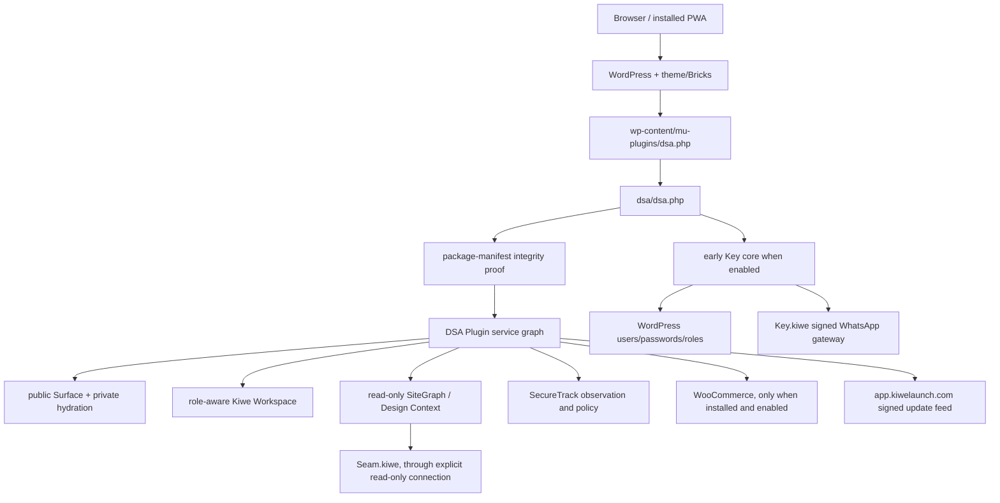
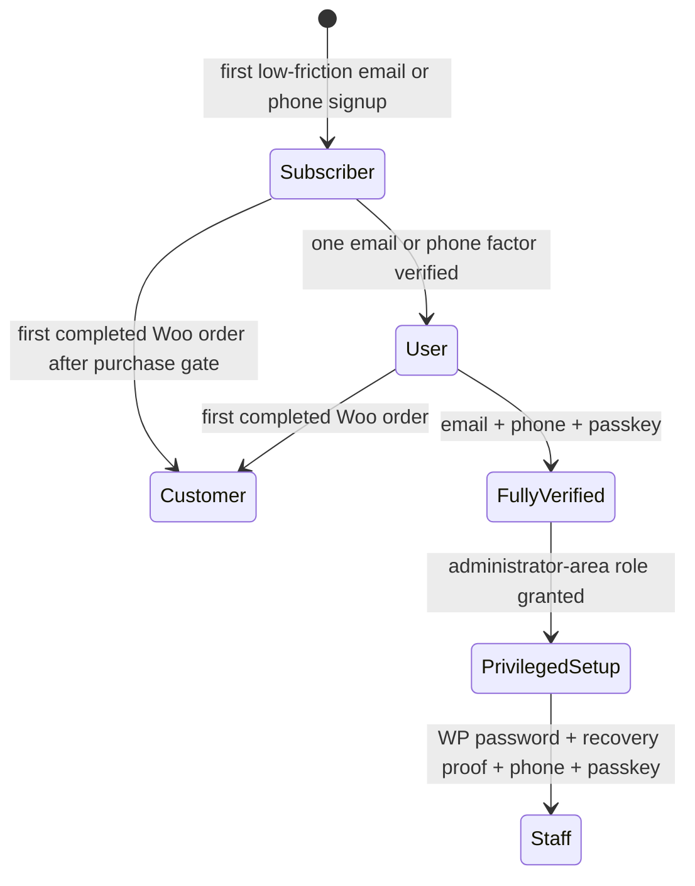

24 October — Complete authoring-context independence is accepted on signed RC425 on the lab. Core retains the full Design Context, guided setup, Site Graph/MCP/Start handoff and Seam/Bricks bindings with SEO off. Fourteen context families and ten complete hashes match across three native boot modes; inactive full exports load no SEO namespace files/hooks. Composed 177 source gates, native/client review and 1,150 final retirement checks pass; zero owned helpers/jobs, eight protected inputs and exact RC424 recovery remain. Production stays National/Dharwad RC421 and Ascendants RC55.5 with Rank Math retained. Actual-source Ascendants recovery/provider qualification is next; CSS/shared-host work and Ecommerce extraction follow later. No production upload is authorized. [Evidence and limits](CONTEXT-INDEPENDENCE-RC425-2026-10-24.md).

24 October — Founder-approved RC421 is live on National and Dharwad. Each passes 651 installation/seven boot checks and 574 final native preservation checks; exact content, settings, plugin choices, stock and role rows remain. Six current routes and both signed public assets pass; actual guest Add/Cart/Checkout/removal passes with both original carts restored empty. Retirement 1,289, independent zero-helper/sole-original-cron inventory and 16 protected inputs pass. Exact immediate RC417 rollback remains per site. This release and inherited conditional-commerce publication are closed; large inline CSS/shared-host waits and prior National outlier remain open. Ascendants/Rank Math, SEO isolation, Apps and Google/MCP stay separate. [Live acceptance and limits](PERFORMANCE-RC421-LIVE-2026-10-24.md).

24 October — APP118 final signed RC421 is accepted on the lab, including original-source Bricks 2.3.4/2.3.11 qualification. Three fixed serial pairs per case preserve exact CSS/content/state and reduce median Home CPU 7.9–13.3%, Shop 15.6–23.4%; every outlier is retained. Composed 175 baseline plus nine current gates, 651 install/seven boot/42 cart,133 native runtime checks and 569 final preservation pass. Actual guest Add/Checkout/removal passes. Final 5,948 retirement checks, 2,180 fixture/1,125 obsolete code removals, 20 protected inputs and independent zero-helper/sole-original-cron inventory pass. Both stores remain RC417 pending named approval; shared-host waits/large inline CSS remain unresolved. Ascendants/Rank Math, SEO isolation, Apps and Google/MCP stay separate. [Final candidate and limits](PERFORMANCE-APP118-RC421-2026-10-24.md).

23–24 October APP118: native invariant Bricks-loop CSS reuse is signed RC419 and accepted on the modern-Bricks lab, with exact native state/CSS and reduced measured CPU. Production remains RC417. Actual live Bricks2.3.11/2.3.4 compatibility is now being qualified before a rollout recommendation; long shared-host waits remain separate. [Evidence and limits](PERFORMANCE-APP118-RC419-2026-10-23.md).

23 October — Signed RC418 conditional commerce is accepted on the lab. Resolve Woo after plugins_loaded, retain lazy shared dependencies, core account/bookmark/inbox behavior and automatic Woo capture. Non-Woo attaches zero Woo callbacks and starts generic analytics only when configured/requested.164 native feature/568 preservation and real guest browser checks pass; helpers/jobs are retired and RC417 recovery remains. Production rollout and broad performance/SEO isolation retain separate gates. [Decision](decisions/2026-10-23-conditional-commerce-runtime.md), [acceptance](CONDITIONAL-RUNTIME-RC418-2026-10-23.md).

23 October — APP117 RC417 accepted: one-use early private hydration and confirmed-guest Saved skip are live on all three targets. Full173 current gates, actual native identity/cart and browser checks pass; exact owners and immediate RC416 recovery remain. Zero helpers/jobs after independent inventory. Overall cold/personalized page response is not solved. [Evidence and limits](STARTUP-OVERLAP-APP117-2026-10-23.md).

23 October APP116: native public caching on National and original-byte Home Media delivery on Dharwad are accepted, with exact CSS-trial reversal and complete helper/job cleanup. RC416 remains current. Next performance gate is cold/private frontend profiling and design-preserving CSS delivery; no capacity or complete speed claim. [Native delivery evidence](NATIVE-PAGE-DELIVERY-APP116-2026-10-23.md).

**23 October — APP115 signed RC416 accepted on all three sites:** Shared screen activation is independent of pending private hydration, with stale-lifecycle cancellation and explicit retry. Startup and native Woo work are bounded without caching private responses or guessing totals. Exact package/native/browser evidence, RC414 lab failure/repair, physical input limits and immediate recovery are in the [current report](APP115-RESPONSIVENESS-RC416-2026-10-23.md). APP116 native page/cache/media work remains separate.

**23 October — APP114 install/transition update accepted live:** Signed RC413 is on the lab, National and Dharwad. Shared install actions explain Home Screen installation, remove redundant Android OK and retain browser confirmation; iPhone help leaves delivery choices separate. Transitions start real navigation immediately and release at readiness, with four nonrepeating site facts each. Delayed Home stays recurring at ten seconds. Public bootstrap defers the large Admin source; native admin/cart and browser review pass. Composed173 source gates, lab/native/live preservation and final cleanup pass. Zero owned helpers/jobs remain; immediate RC412 and typed settings recovery are retained. Physical-device installation is not claimed. Google/MCP25+2 stays queued, zero accepted; four Ascendants milestones are deferred and Woo is closed. [Acceptance](INSTALL-TRANSITIONS-RC413-2026-10-23.md).

**23 October — APP113 Home correction accepted live:** The founder explicitly requests restoring the earlier Home text style and recurring inactivity, and authorizes the live update. Signed RC412 is installed on the lab, National and Dharwad. Only the optional immediate entry welcome is session-limited; Home returns after each idle interval (10 seconds), with a fresh wait on dismissal and existing protected-task guards. Original differentiated text colours, transparent glass and the upward cue remain. Composed 173-gate source acceptance, native lab/live preservation, actual Chrome recurrence/scroll checks and 2,558 retirement checks pass. Zero owned public helpers/jobs remain; immediate RC411 rollback and signed offline custody are retained. Zero Home correction steps remain. Google/MCP25+2 remains queued, zero accepted; four Ascendants milestones are deferred and Woo remains closed. [Current acceptance](HOME-INACTIVITY-RC412-2026-10-23.md).

**23 October — APP112 approved rollout accepted:** Founder “Approve both live sites” publishes the exact signed RC411 App update on National and Dharwad, with nine native footer install elements each and Home once per session after 10 seconds of inactivity. Each site passes 648 installation/12 boot; native after checks615/611 and fresh571 each preserve159 authored records,515 settings and all captured roles/taxonomy except the exact approved delta. Actual Home/Shop/footer actions pass, Dharwad390px fits, and the original carts remain5/1 without cart/order mutations. Final2,966 and independent27-root-entry/sole-original-cron checks pass; zero owned helpers/jobs,10 protected inputs and each immediateRC392/footer/settings preimage remain. Typed native preimages are preserved after a refused JSON-model preflight;1,112 oldRC390 files retire only after offline signature authentication. **Zero App implementation/publication steps remain. Next queued development: G01 Google/MCP foundation;25+2 remains zero accepted, four Ascendants milestones deferred, Woo remains closed.** [Acceptance and evidence](APP-RC411-ROLLOUT-2026-10-23.md).

**22 October — APP110 lab accepted:** Signed RC411 passes 648 installation, 12 boot and 101 native App checks, composed source qualification and actual desktop/390px Chrome review. App owns Dock/Appearance, per-menu page contents belongs to Navigation, and Media/Users/Backups move to Work/Daily/Organize. Users is a verified-colour newest-first stack with role/object-scoped shared inbox arrivals. Separate Pill radii, side handles, 500ms movement, readable Menu text, real swatches, referenced-user review, pulse/title placement and settled scroll pass. Final 3,011 checks and independent 27-entry/sole-original-cron inventory pass; original settings/10-second Home and both live RC392 pairs/footers remain exact. Zero owned helpers/jobs; 22 protected inputs, original RC392 and immediate RC409 recovery remain. **Only new named approval/publication of this exact App/footer/10-second handover remains.** Google/MCP25+2 stays queued, zero accepted. [Review and evidence](APP-CONTROL-CLARITY-2026-10-22.md).

**22 October — APP109 before Google/MCP:** Signed RC400 is native-tested on the lab (648 installation, 12 boot, 54 App checks; 48 recovery checks). Home has one visibility choice, an independent before-load introduction and a 10-second inactivity default. Plain settings and stacked Daily/notification cards replace the inconsistent layouts; saved-cart notifications retain the full collection. Start9.6 is public. The revised browser review remains pending because tools report disabled after the founder enabled them. National/Dharwad stay signed RC392; no new live approval or Google/MCP acceptance. [Current evidence and continuation](APP-WORKSPACE-AND-ADOPTION-2026-10-22.md).

**22 October — DAILY108 accepted, work run108:** Founder-approved signed RC392 is live on National and Dharwad. Saved-cart capture is core without a switch; both native owners have schema4/hourly maintenance. Forms and all six Daily destinations have role-scoped arrivals; green/yellow cards show actual contact and truthful checkout stages. Lab37 native/15 acceptance plus responsive review, each live644 install/11 boot, exact159-document/515-control/all-role/taxonomy preservation, six current public routes and actual private UI pass. National's Forms badge shows2; Dharwad preserves99 cart rows. Retirement4,695 and independent27-root-entry/sole-original-cron checks pass; zero owned helpers/jobs or lab examples remain. Four offline originals authenticate before1,668 superseded runtime files retire; immediate RC390 code recovery and20 protected local inputs remain. **Zero Daily/capture batches and zero Woo launch milestones remain. Next queued development: G01 Google connection foundation; four Ascendants milestones remain deferred.** No order/send/feed/third-party upgrade/commit/push. [Acceptance and limits](DAILY-ARRIVALS-AND-CART-JOURNEY-2026-10-22.md).

**22 October — WO107/task22 accepted:** The founder-approved signedRC390 is live on Dharwad and National; each passes644 installation/seven boot and independent native preservation of159 authored records,515 settings and all captured roles/taxonomy/configuration. Fourteen public routes and both actual private checkout redirects pass after cache invalidation. The actual-source native restore/exact preboot reversal/51 paused Store checks and complete newer-state offline custody are accepted; strict guards remain intact. Live retirement5,718 and independent zero-helper/job/sole-original-cron checks pass; one exactRC389 rollback per site remains and1096 superseded runtime files retire after original offline signature verification. **Zero Woo launch milestones remain; next batch G01 Google connection foundation.** Four Ascendants milestones remain deferred; Google/MCP25+2 stays separate, zero accepted. [Acceptance and limits](KIWE-RC390-ROLLOUT-2026-10-22.md).

**22 October — WO107 restore rehearsal and RC390 lab qualification accepted:** Actual-source native staging, migrated database/ownership, isolated activation, exact preboot reversal and51 paused Store checks pass. Newer-state inspection/reversal correctly refuse after boot; complete postboot custody authenticates on server and laptop before explicit disposable-fixture retirement. All178 pre-existing tables/83 lab authored records remain;118 test tables retire. Final3,378 and independent27-root-entry/sole-original-cron checks pass; zero owned helpers/jobs and15 protected inputs. SignedRC390 passes171 source gates and644 lab installation/seven boot checks; both live sites remain signedRC389. **Next: approve the exact RC390 live recovery-fix handover, then final task22 monitored-pilot disposition.** One Woo/four deferred Ascendants milestones remain; Google/MCP25+2 stays queued. [Evidence](WOO-RESTORE-REHEARSAL-2026-10-21.md), [live review](KIWE-RC390-LIVE-REVIEW-2026-10-22.md).

**21 October — SC106 rollout accepted:** The founder approves both named sites. Dharwad and National now run the same signedRC389, SHA25617ba2f89c4ee200a828d0957e4ff3f7ad73101b119d80387d4350388c93d1588. Each passes644 install/seven boot checks; independent native comparisons preserve159 authored records,515 controls and all captured role/capability rows. Actual desktop/390px Search/cart/Checkout checks, both native Shop-link clicks and12 anonymous routes pass after per-site cache invalidation. Original carts remain4/1 items; no order/email is submitted. Retirement4,443 and independent sole-original-cron/27-entry lab checks pass; six inputs are protected. SC01–SC04, CL105 and this approved runtime handover are closed. **Next: freshly qualify capacity for the remaining Woo restore rehearsal; the separate template-reference rename, Google/MCP and Ascendants gates remain open.** [Scope, recovery and limits](KIWE-RC389-ROLLOUT-2026-10-21.md).

**21 October — SC04 and CL105 accepted:** Start9.5-149215b8bfd9 and compiler2.18.0/v38 are public. Exact source26ab3d6 completes Hostinger build01a15e97 and Sites version44; actual two-page exports pass310 cross-host checks with distinct native palettes and the real image. Lab RC389 passes119 native recovery checks after importer/Bricks/responsive review;83 original records and all original style/settings/role owners recover. CL105 removes182 obsolete private roots (111,922 entries;4,522,479,049 raw bytes) after authenticated offline recovery. Fresh File Manager confirms72,475 free entries and16.29 GiB free. All owned helpers/jobs retire. Dharwad remainsRC379 and NationalRC384. **Next: named approval for the exact reviewed RC389 runtime; no page rewrite is required.** [Release and limits](SEAM-DEPENDENCY-CONSOLIDATION-2026-10-21.md), [live review](KIWE-RC389-LIVE-REVIEW-2026-10-21.md).

**21 October — SC103 continuation:** Signed RC389 is lab-only. Fresh171 source gates,644 deployment/seven boot,118 native import/interruption/reuse/undo and102 untouched compiler-ZIP roundtrip checks pass, with exact original content/style/settings/role recovery. Independent retirement confirms26 original root entries and zero owned transport/jobs; private recovery remains. Start9.5-149215b8bfd9 source/kit, compiler372/two builds and44-document style inventory are verified. Both production sites/public tools are unchanged. **Next: SC04 current-design lab review, clean snapshot sync and release qualification.** Browser use is disabled; no new UI/responsive acceptance is claimed. [Current evidence](SEAM-DEPENDENCY-CONSOLIDATION-2026-10-21.md).

**18 October — Contact WhatsApp and National FSSAI accepted, work run 85:** [Shared correction, source and custody](CONTACT-WHATSAPP-RC381-2026-10-18.md). Signed RC381 is on the lab and National. The separate WhatsApp card follows the saved public-phone choice through the existing native projection, renderer and writer; both paths and restoration pass in Chrome. National’s existing invoice-footer FSSAI number is saved in its current Design Context field, with validity unverified and public product-display choices retained. One complete 167-gate baseline, exact signed package/delta, native boots, client readbacks, exact context/settings preservation and zero-helper/sole-original-cron retirement pass. Private recovery has verified DPAPI custody; immediate RC380 reversal remains available. **Zero batches remain for these two corrections. Next: National dependency and Dock/account review.** Dharwad stays RC379; the external Woo restore, four deferred Ascendants milestones and Google/MCP remain separate. No feed, compiler/Start publication, commit or push.

**18 October — National Chikki onboarding accepted, work run 83:** [Runtime, snippet retirement and ownership](NATIONAL-CHIKKI-ONBOARDING-2026-10-18.md). National now runs signed RC380 and WordPress 7.1.3. All 21 legacy snippets and their evaluator are natively removed after recovery and coverage; existing Munaf ID1 is Kiwe technical Super Admin without a password change. Optional native weight shipping and Bricks filter images preserve the existing storefront; six previously inert bestseller flags are cleared across three exact documents. The composed 167 source gates, actual lab qualification, 2,361 install checks, 17+469 uninstall and 17+15 final native checks pass. Live cart/quantity/checkout and the signed-in dashboard pass; no order or test email is sent. All 34 retirement checks and independent zero-helper/sole-original-cron inventory pass; 60 private inputs have verified DPAPI custody. **Zero onboarding batches remain. Next batch: qualify National’s Bricks/Woo updates and review site/Dock setup.** Existing public Dock remains disabled; its Account launcher needs review. Dharwad stays RC379; separate Woo restore/Ascendants/Google work is unchanged. No feed, compiler publication, commit or push.

Native compatibility ownership: [18 October decision](decisions/2026-10-18-native-legacy-commerce-compatibility.md). Preserve optional per-instance delivery rules and server-rendered public category images; no new image resolver, observer or business store.

**17 October — approved Start/Forms rollout accepted:** [Live Start 9.2 and Dharwad RC379](START-FORMS-RC379-ROLLOUT-2026-10-17.md) complete the reviewed command/library and native owner-only Forms additions. Dynamic Contact recipient/save order, actual served/browser evidence, exact preservation, offline previous-state recovery and retirement pass. Zero batches remain for this scope; National Chikki discovery follows. Keep native Bricks storage/mail authority and all separate Woo/Ascendants/Google limits.

17 October — the founder-approved [Dharwad RC378 rollout](DHARWAD-FRAMEWORK-RC378-ROLLOUT-2026-10-17.md) is accepted. F1–F4 leave zero framework batches; preserve fresh immediate-prior code/native custody and reverse the owned native/global delta before checked runtime reversal. Do not restore customer/order state or infer a deployment approval for another site. Earlier dated checkpoints below remain historical.

17 October F4 local preparation: [Source-runtime dependency contract](SEAM-F4-RUNTIME-CONTRACTS-2026-10-17.md) separates JavaScript delivery from native style ownership and keeps explicit import validation separate from executable-code permission. RC378 source is unsigned/uninstalled. [F3 RC377 lab acceptance](NATIVE-REUSE-F3-2026-10-17.md) and independent cleanup now pass after Hostinger recovery. One framework batch remains: F4 combined acceptance, distribution and concrete review; new production approval is still required.

17 October F2: [lab RC374 acceptance](LEAN-RUNTIME-F2-2026-10-17.md) keeps canonical metadata in a generated versioned public catalog, sparse native values in HTML, synchronous consumer hydration and compatible lazy registry inspection. Regenerate with `tools/runtime/build-public-contract.cjs`; keep critical asset/dependency/order guards. Requested diagnostics use the existing loader; classic Search shares one scroll-owner contract with Sheets. Exact original theme/cart state is restored. Two framework batches remain, F3 next; Dharwad stays RC372.

16 October F1: the [accepted private foundation](WORKSPACE-FOUNDATION-F1-2026-10-16.md) has one central native build owner and complete scoped tokens. Run `generate-workspace-tokens.cjs` when its PHP owners change, then build through `build-workspace.cjs`; existing wrappers remain supported. Do not hand-edit generated route/foundation CSS or weaken native selected-handle dependencies. Lab RC373 is accepted; Dharwad remains RC372. Three framework batches remain, F2 next.

**16 October — approved D03 live deployment, work run 70:** [Evidence and remaining gates](DYNAMIC-CONTENT-DELIVERY-2026-10-15.md). D03 remains one open batch, not accepted as a whole. The founder explicitly approved the reviewed lab candidate: “i have reviewed the lab you can go ahead”. Dharwad now runs signed RC368: runtime 624+7, v9 preflight 396 and apply 678 pass. Nineteen documents change through 20 native field writes; 17 documents, endpoints, globals, site choices and both manual Home loop roots are preserved. The first 237-check apply failed and rolled back; all 36 originals were independently confirmed before retry. Two read-only edit-lock preflight failures remain failed; no roles change. Live desktop five moods/five pairs and phone five moods pass after preview readiness, with visible hero and no overflow; instant startup is not established. Seam/Start publication and earlier source/native-handler proof retain their documented scope. Production retirement passes 144 checks, lab retirement seven and final approved cleanup 85, all with cleanup; the final helper self-retires and removes the two remaining capture/reversal helpers. Independent inventory confirms 26 lab/30 live root entries, zero owned helpers/jobs and the sole original WordPress cron preserved. Private reversal custody and active lab review fixtures remain retained. All 24 new approved-deployment authentication/configuration inputs are DPAPI-protected with verified readback and plaintext removed; the earlier 28 protected inputs remain separate historical custody. External Sites/cross-runtime parity and actual Chrome editing/save remain open. One external Woo restore gate, four deferred Ascendants milestones and Google/MCP 25+2 remain separate.

15 October RC364 — [D02 acceptance](DYNAMIC-CONTENT-DELIVERY-2026-10-15.md): Commerce_Binding_Service projects original Woo relationships and normalized Store_Analytics pair configuration. Stable source-product tags, strict public/variation-parent/image boundaries and native post-query controls add no business store/session/job/provider work. Catalogue/chooser enumeration alone scans at most 100 configured source IDs, invalidated per native write; current/exact rendering does not scan. Native text is escaped after entity decoding. Complete records bind visible/accessibility fields together through the guarded canonical/Seam contract. Next D03: current-page native authoring and public compiler/Start deployment.

15 October RC362 — [D01 acceptance](DYNAMIC-CONTENT-DELIVERY-2026-10-15.md): `Bricks/Design_Context_Binding_Service` owns the public binding vocabulary, not business storage. Profile/Identity owns strict activity choices and optional asset IDs; native WordPress/Woo/service/user owners remain authoritative. Static enumeration performs no owner queries; declared scalar resolution shares request-local approved context, invalidated on native writes. Private assets stay excluded; new optional image references use existing backup guards and do not add mandatory progress work. Complete native editing-home/commerce binding and public Seam/Start work in D02/D03.

**14 October — Design Context SEO and Dharwad Rank Math handover accepted on signed RC360, work run 66:** [Behavior, evidence and recovery](SEO-CONTEXT-RC360-2026-10-14.md). Publication identity enables bounded News XML; Design Context owns the shared SEO goal, its review card is in SEO, and Story has no site-wide indexing writer. Dharwad imports 31 supported defaults and 11 empty metadata fields without overwriting 39 native choices; Rank Math is removed with exact private recovery and historical data retained. The composed 153-gate baseline, 114 native lab checks, live rollout, Chrome and final 3,338 core/533 signed-file checks pass. A temporary operator core-file collision was repaired against the official checksum and documented. All owned helpers/jobs are retired. **66 actual work runs; five launch milestones remain: one Woo task22 recovery/performance and four deferred Ascendants, including its own SEO handover. Next batch: task22.** Ascendants remains RC55.5 with Rank Math active. No feed, commit or push.

**14 October — core inbox and Daily saved carts accepted on signed RC358:** [Behavior and evidence](SAVED-CART-INBOX-RC358-2026-10-14.md). Role-eligible Kiwe updates are always on; preferences choose optional delivery only. Private saved carts show known shopper identity or Unknown, separate readable amounts and stacked status cards. Daily owns their arrival badge and first-abandonment admin notice. The composed 152-gate baseline, 31 native checks, 15 lab acceptance checks, 82 live rollout checks plus 7 boot checks and Chrome acceptance pass. Exact RC357 rollback and external choices are retained; all owned helpers/jobs are retired. Fixture failures and isolated PhoneKey/SecureTrack schema warnings are explicitly scoped in the report. **64 actual work runs; one Woo reliability/recovery milestone and four deferred Ascendants milestones remain. Next: task22 current recovery/running-destination and public cache/performance acceptance.** No order/payment/send, Ascendants change, feed, commit or push.

**14 October — shared DSA, Checkout and private preferences accepted on signed RC357:** [Behavior and evidence](CHECKOUT-PREFERENCES-RC357-2026-10-14.md). Shared Sheet refreshes preserve chrome, focus and scroll. Checkout hides/disables unused shipping fields, retains the separate draft, serializes saves and follows Cart amount policy. Alert choices use fresh private role catalogs; inbox defaults stay separate from external delivery and saved opt-outs. PhoneKey step layout is source-bound verified without sending a code. 151 composed release gates, 53 native feature checks, 13 lab acceptance checks, 40 live rollout checks plus 7 boot checks, and desktop/phone Chrome flows pass. Original cart, shipping choice, preferences and exact RC356 recovery pair are preserved; owned helpers/jobs are retired. **63 actual work runs; one Woo reliability/recovery milestone and four deferred Ascendants milestones remain. Next: task22 fresh recovery/running-destination and public cache/performance acceptance.** No order/payment/send, Ascendants change, feed, commit or push.

**14 October — automatic product offers and actionable Notifications accepted on signed RC356:** [Behavior and live acceptance](AUTOMATIC-OFFERS-NOTIFICATIONS-RC356-2026-10-14.md). Companions/discounts follow product configuration; Cart FBT defaults on with a separate display choice. Notifications share deduplicated pending-action badges and native-checkout reminders across Dock and custom icons. Both continuity defects found in RC355 are repaired. 146 release gates, 38 native lab cases, 28 live rollout checks and focused Chrome flows pass; unchanged responsive evidence is reused explicitly. Original latest cart/settings, RC355 rollback custody and owned-job/helper cleanup are verified. **62 actual work runs; one Woo reliability/recovery milestone and four deferred Ascendants milestones remain. Next: task22 fresh recovery/running-destination and public cache/performance acceptance.** No order/payment/send, Ascendants change, feed, commit or push.

**14 October — cart clarity:** Cart, Profile and Saved use compact horizontal summary metrics at phone and desktop widths. Cart exposes products, applied coupon/credits, fees, selected delivery and exclusive tax from native Woo components; inclusive tax is descriptive and never added twice. Item prices use Woo’s native pre-discount cart tax basis so products and deductions remain understandable. Unknown delivery is pending, not free; confirmed rates may change at checkout. No browser resumming, rate/tax setting change, address disclosure, new persistence, schema, job or transaction owner. [Scope and acceptance](CART-CLARITY-RC352-2026-10-14.md).

**13 October — owner dashboard admission accepted on signed RC344:** [Acceptance and recovery](DASHBOARD-ACCESS-RC344-2026-10-13.md) corrects the designated owner’s Home denial and default wp-admin entry without changing roles or granting permissions. An owner-only Setup shortcut preserves WordPress technical work. One 142-gate baseline, 262 native lab checks, owner Chrome entry/return and exact lab/live inventory/custody pass; all owned helpers/jobs are retired. **56 actual work runs; two Woo milestones and four deferred Ascendants milestones remain. Next batch: task 21 live buying/operations and wider-role UI; then task 22 reliability/monitoring.**

**13 October — status, visibility and role-safe Trash accepted on signed RC343:** [Acceptance and recovery](STATUS-VISIBILITY-RC343-2026-10-13.md) completes Media Public/Private views, scoped Trash entrances and semantic stacked Orders/Campaigns/Feedback, and repairs the Products render failure. The composed 142-gate baseline, 187 native lab checks, desktop/390/320px Chrome and exact signed lab/live inventory/custody pass. Settings and original profile choices are preserved; all owned helpers/jobs are retired. **55 actual work runs; two Woo milestones and four deferred Ascendants milestones remain. Next batch: task 21 live buying/operations and wider-role UI; then task 22 reliability/monitoring.**

**13 October — Media and Trash accepted on signed RC342:** [Acceptance, tests and recovery](MEDIA-CONTEXT-TRASH-RC342-2026-10-13.md) completes inherited-image locks, explicit upload selection and readiness, and Organize → Trash with native restore and reviewed deletion. Final affected checks, 107 native lab checks, signed lab/live installation, desktop/390/320px Chrome and exact cleanup pass. Original profiles/configuration and previous live RC338 recovery remain intact. **54 actual work runs; two Woo milestones and four deferred Ascendants milestones remain. Next batch: task 21 live buying/operations and wider role UI; then task 22 reliability/monitoring.**

**12 October — Design Context journey accepted on signed RC338:** [Acceptance and recovery](DESIGN-CONTEXT-JOURNEY-RC338-2026-10-12.md) adds shared persistent saved progress and Resume, links canonical brief/content families to their original editors, supports optional/later choices and retained Services/Team applicability, and includes native Woo products/store review. The composed 140-gate local baseline, final affected checks, 81 native lab cases, signed lab/live installation and desktop/390/320px Chrome checks pass. Exact lab browser-test profile restoration and all 527 signed members are verified; all owned helpers/jobs/overrides are retired. Dharwad shows 94% (18/19), with Store review remaining; Services/Team stay off and optional Media/Testimonials stay for later. **53 actual work runs; two Woo milestones and four deferred Ascendants milestones remain. Next batch: task 21 buying/operations and role UI acceptance; then task 22 reliability/monitoring.**

**12 October — header launchers accepted on signed RC335:** [Acceptance and recovery](HEADER-LAUNCHERS-RC335-2026-10-12.md) makes the saved cosmetic Search open DSA and gives external Cart icons the Dock’s live count, without authoring edits or frontend code. All 139 baseline gates, 51 native lab checks, signed lab/live installation and desktop/390/320px Chrome mouse, keyboard and touch checks pass. Exact header/configuration custody is preserved; original cart contents are restored and all owned helpers/jobs and local fixtures are retired. **52 actual work runs; two Woo milestones and four deferred Ascendants milestones remain. Next batch: task 21 buying/operations and role UI acceptance; then task 22 reliability/monitoring.**

**12 October — Add to Cart styling verified on existing signed RC334:** [Chrome discovery and controls location](BRICKS-STYLE-CONTROLS-2026-10-12.md) confirms automatic styling groups in fresh and existing Bricks sessions. The original editor remains open at Style → Kiwe Add To Cart styles, without reload, save or field changes. No runtime update or upload was needed. **51 actual work runs; two Woo milestones and four deferred Ascendants milestones remain. Next batch: task 21 buying/operations and role UI acceptance; then task 22 reliability/monitoring.**

**Current priority, 12 October — Cart and native Bricks loops accepted on signed RC334:** [Acceptance and recovery](CART-AJAX-RC334-2026-10-12.md) fixes mobile Cart refresh/reopening, native plus-only loop actions, homepage overflow and disabled-button keyboard focus. The composed 138-gate baseline, final affected gates, 38 Chrome fixture checks, 43 final native lab checks, signed lab/live installs and live 320/390px/desktop interactions pass. Original configuration and code recovery remain protected; all owned public helpers/jobs and local fixtures are retired. Bricks is 2.3.11 with global AJAX enabled; downloaded latest is 2.4.2. **50 actual work runs / 31 planned acceptances plus two accepted repairs; two Woo milestones and four deferred Ascendants milestones remain. Next batch: task 21 live buying/operations and role UI acceptance; then task 22 reliability and monitoring.** This accepts the reported UI subscope. No feed, commit or push.

**Prior accepted checkpoint, 12 October — Dock and Links on signed RC331:** [Acceptance and recovery](DOCK-LINKS-RC331-2026-10-12.md) fixes Dock separation, uses Place order for Checkout, preserves complete social names and opens missing social links in the existing native dashboard field for authorized admins. The composed 137-gate baseline, final affected checks, 108 native lab checks, signed lab/live installation and live desktop/320px Chrome checks pass. Exact prior code/configuration is recoverable; all owned rollout helpers/jobs and local fixtures are retired. **49 actual work runs / 31 planned acceptances plus two accepted repairs; two Woo milestones and four deferred Ascendants milestones remain. Next batch: task 21 live buying/operations and role UI acceptance; then task 22 reliability and monitoring.** This accepts a task 21 UI subscope; the prior RC328 continuity scope remains accepted. No feed, commit or push.

**11 October accepted runtime — signed RC318:** [Frontend recovery and save acceptance](BRICKS-FRONTEND-REPAIR-RC318-2026-10-11.md) records exact header recovery, restricted builder preservation, native role/code/nonce regressions, signed rollout and full retirement. Existing permissions and native authoring remain authoritative.

**Prior accepted runtime — signed RC317:** [Bricks dynamic tags and identity bindings](BRICKS-DYNAMIC-TAGS-RC317-2026-10-11.md) records native chooser access, Services/Team/category coverage, dashboard binding, role/privacy checks, preserved recovery and exact retirement. Seam compiler work remains deferred.

**11 October — Bricks dynamic data contract:** Public authoring tags are independent of the retired enable switch. Base catalog comes from Bricks_Integration; native tag categories provide current-record/name/all-public bindings with stable IDs. Services use the configured public native type, Team uses explicit native public membership, and object/draft boundaries remain enforced. No builder or technical capability is granted. Seam compiler changes are deferred. [Decision](decisions/2026-10-11-bricks-public-dynamic-tags.md).

**Current priority, 11 October — Dharwad design accepted:** [Native authored migration](DHARWAD-DESIGN-MIGRATION-2026-10-11.md) publishes the preserved R49B/R52 layouts and enables the existing requested Munaf account through native Kiwe ownership. Product/article bindings, shop filters, homepage recommendations/pairings and phone/header behavior pass scoped native/Chrome checks; original business hashes and recovery custody remain intact. Signed RC311 is unchanged, and all migration helpers/jobs are retired. **39 actual attempts / 25 accepted tasks; two Woo milestones and four deferred Ascendants milestones remain. Next batch: task 21, live store operations and role/UI acceptance; task 22 follows with reliability and monitoring readiness.** Lab RC277 and Ascendants RC55.5 remain unchanged. No customer charge/send, feed publication, commit or push.

**Earlier implementation notes retain their dated scopes:**

**10 October — bounded native recovery and reviewed file coverage:** Existing encrypted receipt/lease owners remain authoritative. RC308 sizes the inactive namespace to authenticated suffixes within MySQL's 64-character limit, retains legacy prefixes and returns the actual prefix. RC309 reuses a five-second same-connection heartbeat while preserving the caller budget and refusing lost authority. RC310 reapplies an authenticated inventory's reviewed exclusion coverage; included diagnostics still receive exact drift checks. No ordinary visitor query, hook, schema or job is added. [Current evidence](LAB-DHARWAD-NATIVE-RECOVERY-2026-10-10.md), [namespace](decisions/2026-10-10-bounded-recovery-table-names.md), [continuity](decisions/2026-10-10-recovery-native-session-keepalive.md), [coverage](decisions/2026-10-10-reviewed-recovery-file-coverage.md).

**10 October — operational Woo diagnostics:** [Decision](decisions/2026-10-10-operational-woo-logs-and-recovery.md) keeps exactly uploads/wc-logs outside consistent recovery while preserving media drift checks. Private CLI tooling separately encrypts bounded diagnostic initial extents and retires plaintext; it adds no visitor work, schema or product job. Native member authentication and whole-site/offline/restoration acceptance remain distinct.

**10 October — minimal native source state capture:** [Decision](decisions/2026-10-10-minimal-native-source-state-capture.md) loads only pinned source core definition libraries for real wpdb, reuses the existing portable database/cipher owners and separates database capture from full file/source/restore acceptance. Private CLI operators add no visitor work or persistent product job; independent local key readback precedes server plaintext-key retirement. Duplicate active/interrupted invocations cannot overwrite an existing namespace.

**9 October — bounded original-code preparation:** [Private custody decision](decisions/2026-10-09-previous-code-custody.md) uses CLI-only operators and the existing portable inventory/archive/cipher and release-verification owners. Actual installed code is preserved without forcing its old manifest, and separate local RSA/DPAPI readback precedes server plaintext-key retirement. No runtime authority, visitor hook, query, table, provider request, public transfer endpoint or persistent product job is added; server code custody, full-site/state/offline recovery and web/FPM remain distinct acceptance scopes.

**9 October — RC306 inactive Store extension recovery:** The [ownership decision](decisions/2026-10-09-inert-store-extension-recovery.md) separates provider identities from native shipping configuration, disables copied provider instances and explicitly excludes invalid zero-parent tax locations only from the inactive destination. Positive missing parents still refuse; original encrypted records remain exact. HPOS retains transaction authority while detached CPT history is preserved without synchronization or replay. This adds no ordinary visitor work. Qualification and rollout are separately recorded in the [RC306 report](WOO-INERT-EXTENSION-RECOVERY-RC306-2026-10-09.md) and [Dharwad rollout plan](DHARWAD-ROLLOUT-PLAN-2026-10-09.md).

**Earlier compatibility checkpoint, task 19 attempt 11 — historical scope:** [Native compatibility preparation](DHARWAD-COPIED-COMPATIBILITY-2026-10-10.md) accepts exact copied-source PHP syntax (9,668 files on PHP 8.2), actual target web signatures (57 checks) and independent retirement. Six reviewed legacy Kiwe methods are unchanged; preserve original snippets/current choices. **36 actual attempts / 22 accepted planned tasks; four active Woo milestones and four deferred Ascendants milestones. Next batch: isolated cart/Bricks/plugin runtime coexistence.** Full actual-source restore/reversal still needs a faster qualified Linux destination before upgrade. Mobile reservation is 1.100 GB, within 2 GB. Signed RC307, Dharwad RC10, lab RC277 and Ascendants RC55.5 are unchanged. [49-check closure](generated/kiwe-woo-copied-compatibility-closure-rc307-l.json); no deployment, feed publication, commit or push.

**RC299 native order boundary:** Order_Workspace_Service extends the private Commerce owner without adding a visitor hook, table, job or transaction mirror. Native Woo CRUD owns both CPT and HPOS orders, payment/status hooks and stock. Exact native capabilities, fresh bounded projections, nonblocking locks and authenticated snapshots protect operations. Core offline receipts are explicitly reviewed; unknown extensions and oversized orders remain review-only. Hook failures use honest saved-state refresh without financial replay or pretend database rollback. Refund/provider operations remain task 14; complete Store recovery remains task 17/B3. [Contract](WOO-ORDER-OPERATIONS-CONTRACT.md).

**RC298 per-product native boundary:** Product_Variation_Workspace_Service extends the existing Commerce owner; it creates no catalog, table, public hook or job. Woo owns parent/child CRUD and derived prices/lookup synchronization; WordPress owns capabilities, media and assignments. Parent-scoped locks, current authenticated snapshots, native transaction/readback and explicit rollback protect guarded changes. Disabled Woo exits before capability/database work; ordinary visitors never initialize this workspace owner. Shared content capture covers existing choices/children while complete Store recovery remains task 17/B3. [Contract](WOO-PRODUCT-VARIATION-CONTRACT.md).

**RC297 native attribute boundary:** Woo owns global definitions; WordPress owns value taxonomies, metadata and relationships. The private workspace uses native CRUD, capability-derived controls, fresh authenticated snapshots and nonblocking transactional readback. The common configuration backup uses a virtual typed existing-label adapter, merging newer values in both preview and apply; it never recreates missing identities or replays product/transaction state. Native display-label aliases remain valid. No schema, visitor hook or job is added. [Contract](WOO-PRODUCT-ATTRIBUTE-CONTRACT.md), [decision](decisions/2026-10-08-native-product-attributes-and-label-recovery.md).

**Prior capture/cleanup and original forecast checkpoint — historical subset:**

**8 October — current run 7 preparation:** [Deferred Ascendants task 7 / RC296 preparation](ASCENDANTS-RELEASE-PREPARATION-RC296-2026-10-08.md) is in progress at attempt 2. Private signing and current inert source/recovery metadata review are complete. Original AH pre-cleanup recovery and RC284 preparation evidence remain protected; the current candidate is signed RC296. The previous ciphertext body/manifest remain exact after separate ctime revalidation; the original fixed binding and failed A stay unchanged. The local partial is 5,860,491,264 bytes and remains deferred until the founder reports faster connectivity. Current account quota cannot fit the actual-source restore/reversal; use an independently capacity-qualified destination. Ascendants stays RC55.5 with Rank Math active, lab RC277. [Prior authorized cleanup](ASCENDANTS-CLEANUP-2026-10-06.md) and all eight STSEO source tasks retain their accepted scopes. No live Rank Math handover test, deployment, feed publication, commit or push. Counts and remaining work are in the current ledger.

**6 October — run 6 accepted:** [Run 6 / RC277](COMBINED-NONWOO-RC277-2026-10-06.md) is accepted and installed on the authorized lab, unsigned. One full 113/113 release baseline, 506 native feature checks in eight composed scopes, 17 Chrome observations and independent 73-check retirement pass. Known PhoneKey/SecureTrack choices and native revisions/autosaves survive controlled recovery; copied authority, providers and consent require fresh destination enrollment. The real media archive permission defect is fixed. Current cold complete upgrade proves 688 option tuples except two identified LiteSpeed cache values, all ten original authored tables and exact connection/salts. First RC277 and historical aggregate failures remain failed; this is separate current qualification, not retroactive reconstruction. Six work runs/six accepted tasks leave 16 planned runs, two through Ascendants upload; four repair slots unused. Run 7 qualifies actual Ascendants source/dependencies, saves its independent offline recovery set and previous Kiwe pair, and prepares release; run 8 is the reversible upload. Full-site readiness remains false until target qualification. Lab RC277, recorded Ascendants RC55.5 and Key/Seam unchanged outside the lab; no commit, push or signing.

**Current continuation discipline, 5 October:** [Delivery run plan](DELIVERY-RUN-PLAN-2026-10-05.md) and [actual-attempt ledger](generated/kiwe-delivery-run-ledger-2026-10-05.json) own future run counts and next action. Read [concise ecosystem handoff](../HANDOFF.md) and the affected owner sections; historical release summaries below need not be reread on every continuation. RC270 remains verified source only; no runtime/package/deployment change accompanies this documentation cleanup.

**5 October continuation — RC270 native inactive database writer:** [Completed unit and remaining work](INACTIVE-DATABASE-RECOVERY-RC270-2026-10-05.md). Supported table definitions are parsed and rebuilt, exact cells recover into a fresh inactive prefix, encrypted receipts bind state, and locked retirement refuses unknown/newer data. Current PHP 8.2.33/MariaDB proof passes 35 SQL checks, 56 parser checks and nine original-state checks; the first surrounding readback failure remains separate. All 109 local release gates pass in one run; the immutable 486-file/489-entry candidate and complete native fixture/helper/cron retirement are verified. Candidate not installed; lab stays RC268, Ascendants recorded RC55.5, Woo paused. Next: serialized URL/prefix mapping and copied-state quarantine, then combined file/database activation and full interrupted reversal. Earlier original-site offline/source-policy/capacity/preservation and combined launch acceptance remain. No commit, push or signing.

**Earlier completed private preparation boundary:**

**5 October continuation — RC269 source candidate, independent private destination preparation:** [Completed implementation and remaining acceptance](PRIVATE-RECOVERY-STAGE-RC269-2026-10-05.md). All 108 local baseline gates pass in one run; 38 local staging checks, 39 Linux/PHP 8.2.33 preflight checks and 440 affected parser/capture checks pass. Preparation works without WordPress booting and preserves the prepared public root, with matching archive/observation authentication, inert private files/records, expanded-capacity checks, nonblocking leases and changed/unknown-data refusal. This is not website activation, URL/prefix migration or full rollback. The candidate is not installed; lab remains RC268 with its earlier partial acceptance, Ascendants remains recorded RC55.5, and Woo stays paused. Continue reviewed destination activation/quarantine and reversal; earlier preservation, verified original-site offline delivery/source policy/capacity and combined non-Woo acceptance remain open. No fresh release-batch countdown is inferred. No commit, push or signing.

**Earlier installed lab boundary (still applicable):**

**Current continuation, 5 October 2026 — RC268 installed lab test, partial acceptance:** [Installed capture, exact remaining work and retained failures](PROTECTED-CAPTURE-RC268-2026-10-05.md). The actual client-created native capture and independent verification pass (179,051,622-byte recovery / 843-byte encrypted report). Authenticated HTTP headers and missing/invalid-nonce denial pass; a saved Chrome file was not verified. The installation's options aggregate failed, while six native account/content/taxonomy tables remain exact. Cache-owner observation reproduces two LiteSpeed housekeeping changes without reconstructing or resetting either aggregate failure. All 107 baseline gates have combined coverage from 99 original passes plus eight corrected reruns; this is not one full green RC268 run. Main retirement passes 510 checks; a retained heartbeat readback failure is followed by a 21-check quiet-cycle retirement. Final API readback restores the original twenty-five root entries and sole WordPress cron, with default-off preview. RC266's complete previous code pair is private; Ascendants was not changed and remains recorded RC55.5. No commit, push or signing.

**Progress reporting:** L1–L5 are five broad acceptance conditions, not five new code batches. Report completed pieces and concrete blockers rather than an unchanged countdown. Remaining: aggregate/owner readiness; verified local delivery plus accepted source/dependency policy, capacity and original-site offline set; independent live destination activation (inactive database writer accepted; complete migration/reversal unimplemented); complete reversal/failure recovery; combined non-Woo acceptance. Source-policy and destination staging/recovery are the next implementation work. Optional website-owned Drive/history/deletion follow the protected pilot; Woo #4–8/B3 remain paused. [Named-target sequencing](ASCENDANTS-PILOT-AND-PORTABLE-RECOVERY-2026-10-04.md).

## Earlier dated checkpoints — superseded for current status and countdown

**Current RC265 account profile backups, 4 October:** [Accepted scope and evidence](BACKUPS-ACCOUNTS-RC265-2026-10-04.md) add editable native names, biographies, public links and team details to the encrypted settings task. Existing Users writers, identity/role checks, field review, before-copies and automatic rollback preserve newer people and current credentials, consent, verification and access. Chrome found and RC265 corrected lost focus during asynchronous popup transitions through the common WorkspaceDialog; the coverage sentence also distinguishes profiles from full account/security state. All 106 current local gates, 41 native checks, 20 Chrome observations, thirty exact served assets, 59 preservation/retirement checks and public health pass. Both RC264 and current RC265 prove actual downloaded-file changed-data recovery, with separate attribution; current Chrome also verifies the corrected popup. Original authored settings/content/terms/all account state remain intact, owned records/copies/helpers/replicas/jobs are retired, and previous code pairs remain private. **B4 stays partial; four non-Woo Backup units remain (B4/B5/B6/B7), five including paused B3.** Configuration, consent and history adapters, reviewed complete recovery, website-owned Drive and combined acceptance remain. The overlapping launch estimate stays about six preparation batches (five to eight), plus two live passes. Woo #4–8/B3 remain paused; Ascendants RC55.5 and Key are untouched. RC242 remains the last complete browser baseline.

**Historical RC263 organization backups, 4 October:** [Accepted scope and evidence](BACKUPS-ORGANIZATION-RC263-2026-10-04.md) add Tags, custom User groups and existing-menu policy to the encrypted settings task, with detailed review, native permissions, preservation of newer memberships and automatic rollback. RC262 passes all 105 local gates and 33 behavior checks; RC263 passes six affected gates, 39 current native checks, 18 current Chrome observations, thirty exact served assets, 45 preservation/retirement checks and public health. RC262 separately proves actual browser download/upload and changed menu recovery. Original authored settings/content/terms/all account state are intact; owned copies/helpers/replicas/jobs are retired, exact previous code pairs are private, and only the original WordPress cron remains. **B4 stays partial; five Backup units remain overall, four non-Woo** (B4/B5/B6/B7). Continue accounts/configuration/consent/history scope, then complete recovery, website-owned Drive and combined acceptance. The overlapping launch estimate remains about six preparation batches (five to eight), plus two live passes; it is not a one-unit/one-release promise. Woo #4–8/B3 remain paused. Ascendants RC55.5 is untouched. RC242 remains the last complete browser baseline.

**Historical RC261 combined Bricks design package, 4 October:** [Accepted scope and evidence](BACKUPS-DESIGN-PACKAGE-RC261-2026-10-04.md) closes bounded B2: one native same-site design package, copy recovery before separate live settings review, and corrected shared client REST/download access. RC260 covers all 104 local gates after metadata repair; RC261 passes eight affected gates, 41 installed native checks, 16 current Chrome observations, thirty exact served assets and 94 preservation/retirement checks. RC260 design/font regression retains its 38/51 attribution. Public health and complete helper/job retirement pass; original authored settings/content/client/activation are intact, previous code pairs are private, and only the original WordPress cron remains. Continue B4/B5/B6 and combined B7 non-Woo acceptance. **Five Backup units remain overall, four non-Woo**; launch forecast about **six preparation batches (five to eight), plus two live passes**. Woo #4–8/B3 paused; Ascendants RC55.5 untouched. RC242 remains the last complete browser baseline. Earlier checkpoints are historical.

**Historical RC260 combined design package candidate, 4 October:** [Scope and pending acceptance](BACKUPS-DESIGN-PACKAGE-RC260-2026-10-04.md) add one same-site package around native settings, templates and referenced images/fonts, with copy recovery before a separate live settings review. Native candidate preflights pass 36/37 checks and preserve original data; they do not prove an RC260 installation. Six Backup units remain overall, five non-Woo until B2 acceptance. Woo stays paused and Ascendants RC55.5 untouched.

**Historical RC259 native design dependency recovery, 3 October:** [Accepted scope and evidence](BACKUPS-DESIGN-RECOVERY-RC259-2026-10-03.md): RC258 covers all 103 local gates across one full run and two corrected metadata gates; 34 actual non-Woo recovery, 38 design regression and 51 font/context native checks pass. RC259 changes one coverage sentence and release metadata only: all five affected checks, 43 native maintenance/retirement checks, 9 current Chrome observations, thirty exact served assets, 33 public endpoints and 15 homepage resources pass. Eight earlier dialog/phone/scroll observations retain RC258 attribution. Original authored data/client/activation are preserved; helpers/jobs are retired, previous pairs are private, and only the original WordPress cron remains. Continue the B2 composite design package, B4/B5/B6 and combined B7 non-Woo acceptance. Six Backup units remain overall, five non-Woo; launch forecast remains about seven preparation batches (six to nine), plus two live passes. B2 remains partial, Woo #4-8/B3 paused and Ascendants RC55.5 untouched. RC242 remains the last complete browser baseline. Earlier checkpoints are historical.

**Historical RC257 Media, Feedback and native font recovery, 3 October:** [Accepted scope and evidence](CONTEXT-FONTS-RC257-2026-10-03.md): 102 local gates in one run, 51 native font/context checks, 38 native design checks, nine current Chrome observations, thirty exact served assets and 69 retirement checks pass. The 21 actual disposable Chrome marking/phone checks retain RC256 attribution. Original data/client/activation are preserved; owned records/files/helpers/jobs are retired, previous code pairs are private, and only the original WordPress cron remains. Continue B2 general composite design/dependency mapping, then B4/B5/B6 and B7 combined non-Woo acceptance. Six Backup units remain overall, five for non-Woo; launch forecast remains about seven preparation batches (six to nine), plus two live passes. B2 stays partial, Woo #4–8/B3 paused and Ascendants RC55.5. RC242 remains the last complete browser baseline. Earlier checkpoints are historical.

**Historical RC255 bounded native Bricks design settings, 3 October:** [101 local gates, 38 actual non-Woo WordPress/Bricks checks, eleven bounded Chrome observations, thirty exact served assets, 119 retirement checks, forty public endpoints and fifteen homepage resources pass](BACKUPS-DESIGN-RC255-2026-10-03.md). Original large registries and native duplicate-class IDs retain their exact order; current Chrome downloads/uploads review thirteen settings with zero changes. Original design/client/activation are intact, RC252/253/254 recovery pairs verify privately, and all owned files/helpers/jobs are retired; only the original WordPress cron remains. Closed-dialog dashboard scrolling works in observed desktop/390px Chrome states; the earlier user lock is not reproduced. Changed-settings browser restores, broad confirmations/date-input and physical-device acceptance remain open. Continue B2 font transport/dependency mapping, B4 Kiwe/accounts/consent, B5 complete reviewed recovery, B6 website-owned Drive and B7 combined non-Woo launch acceptance. Six Backups units remain overall, five in this non-Woo phase; B2 stays partial and Woo #4–8/B3 paused. Ascendants stays RC55.5. RC242 remains the last complete browser baseline. Earlier checkpoints are historical.

**Historical RC252 bounded B1 media recovery, 3 October:** [101 local gates, 50 actual non-Woo WordPress checks, 15 bounded Chrome observations, 41 saved-data checks plus 18 retirement-continuation checks, 30 exact served assets, 98 final retirement checks, 33 public endpoints and 15 normal-homepage resources pass](BACKUPS-MEDIA-RC252-2026-10-03.md). Actual Chrome downloads/uploads restore one media copy and reconnect it only in a new draft. Original settings/client/activation and private accepted RC249 recovery are verified; all owned synthetic data, files, helpers and jobs are retired, with only the original WordPress cron retained. Date-input browser interaction and native JavaScript confirmations remain unverified; this is not full browser or whole-site acceptance. Continue B2 global Bricks, B4 Kiwe/accounts/consent, B5 reviewed complete recovery, B6 website-owned Drive and B7 combined non-Woo launch acceptance. The [launch ledger](ASCENDANTS-NON-WOO-LAUNCH-2026-10-03.md) estimates about seven further pre-deployment batches (six to nine), plus two live passes. Woo #4–8 and B3 remain paused; Ascendants stays RC55.5. RC242 remains the last complete browser baseline. Earlier dated checkpoints are historical.

**Historical RC249 non-Woo checkpoint, 3 October:** Woo #4–8 and Store backup B3 remain paused. [RC249 Service writing history](SERVICE-HISTORY-RC249-2026-10-03.md) is installed on the lab: all 100 local gates are covered across the full run and two corrected metadata gates; 57 native checks, 21 bounded Chrome observations, 30 served assets, 83 retirement checks, 24 public endpoint checks and 15 homepage resources pass. Native recovery/restore/discard and exact editor proof are accepted; browser confirmation actions remain unverified because affected Chrome targets stalled. Original lab activation is retained, synthetic data/helpers/jobs are retired, and only the original WordPress cron remains. RC246/247/248 recovery pairs verify privately. Continue B1/B2/B4/B5/B6 and combined non-Woo acceptance, including RC244 confirmations, RC246 conversion interactions and common taxonomy/role/public/menu checks. The [launch ledger](ASCENDANTS-NON-WOO-LAUNCH-2026-10-03.md) estimates about eight further pre-deployment batches (seven to ten), plus two live passes. Ascendants remains RC55.5 without a named production go. RC242 remains the last complete browser baseline; earlier dated checkpoints are historical.

**Current RC242 native shipping classes accepted on the lab, 3 October:** [Lifecycle, tax disposition and evidence](WOO-SHIPPING-CLASSES-RC242-2026-10-02.md) close Woo launch batch #3. All 98 local gates, 47 native checks, 23 focused React and 27 current Chrome checks, the exact 456-file/459-entry pair, twelve served assets and 70 public checks pass. Native cleanup, existing client/Profile/identity preservation, whole PHP refresh and helper/job retirement pass; only the original WordPress cron remains and RC241 recovery stays private. [Remaining work](BACKUPS-REMAINING-BATCHES-2026-10-02.md): five Woo backend within thirteen launch batches, and seven Backups units estimated at six to eight releases. Next is native attributes #4 before remaining Woo and operational/composite recovery. Product archives explicitly exclude shipping/tax configuration pending B3. Ascendants remains RC55.5; no production rollout, real provider/payments/messages, Key deployment, signing, commit or push.

**Current RC241 backup expansion continuation, 2 October:** [Accepted graph repair and evidence](BACKUPS-COVERAGE-RC241-2026-10-02.md) supersede RC240's later dependency stress gap. Each dependency is validated once in request-local state; native owners, permissions, schemas and writers remain authoritative. All 97 local gates, 140 native checks, fresh Chrome/phone checks, exact package/assets and complete cleanup passed. [The extension contract](BACKUP-EXTENSION-CONTRACT.md) requires native capture/recovery acceptance when adding features; [the plan](BACKUPS-REMAINING-BATCHES-2026-10-02.md) retains seven Backups units and six Woo batches within fourteen launch batches. Next is native shipping-class lifecycle, then remaining Woo before transactional/composite recovery. RC240 remains private recovery and Ascendants stays RC55.5.

**RC240 accepted lab continuation:** [Backup coverage evidence](BACKUPS-COVERAGE-RC240-2026-10-02.md) records 97 accepted local gates, 137 native checks, 24 Chrome checks and complete cleanup. `Backup/Unit_Catalog_Service` is the single read-only collection/coverage definition consumed by the protected Backups task and existing archive configuration. Native getters, writers and permissions remain authoritative; no new persistence or capability is introduced. Follow the [extension contract](BACKUP-EXTENSION-CONTRACT.md) when adding modules: strict declarations identify a gap, and native adapters plus recovery evidence close it. [The next sequence](BACKUPS-REMAINING-BATCHES-2026-10-02.md) is the six existing Woo backend batches, then remaining transactional/composite Backups work. RC239 is retained recovery; Ascendants stays RC55.5. Older checkpoint entries are historical.

**Current RC239 connected Service backups accepted on the lab, 2 October:** [Scope, proof and remaining units](BACKUPS-SERVICES-RC239-2026-10-02.md) supersedes older lab-version notes. Individual Services, native Service categories and date-selected collections use the shared encrypted Download/Import and resumable progress dialogs. Imports create native drafts, preserve originals and reconcile hierarchy across parts; the explicit Profile source and registered public scalar fields remain authoritative. All 96 local release gates, 116 self-cleaning native checks, 21 Chrome checks, 37 actual saved-data/cleanup checks, twelve matching served asset bodies and 48 public health checks passed. Exact 454-file/457-entry RC239 installation, complete PHP refresh, existing Profile/identity/client preservation and synthetic record/term/job/helper/package/receipt retirement passed; only the original WordPress cron remains. The accepted RC238 pair is retained privately. Overall Backups remains partial: missing binary/global design dependencies, reviewed deletion/whole-site recovery, chunked media and website-owned scoped Drive/provider operations remain implementation units. Client-only provider/channel tests are separate. The launch queue remains 14 overall, six Woo backend and zero non-Woo backend. Ascendants stays RC55.5; no production rollout, real notifications/provider actions, Key deployment, signing, commit or push.

**Current RC238 resumable native content backups accepted on the lab, 2 October:** [Scope, proof and remaining units](BACKUPS-RESUMABLE-RC238-2026-10-02.md) supersedes older lab-version notes. Encrypted collections freeze up to 1,000 primary records, retain bounded durable checkpoints and share Pause/Resume, full import review and compact saved-progress dialogs. Native draft imports preserve originals and reconcile Page/grouped-product relationships across parts. All 96 local release gates, 91 self-cleaning native checks, 16 Chrome checks, 21 actual saved-data/cleanup checks, twelve matching served asset bodies and 34 public health checks passed. Exact 454-file/457-entry RC238 installation, PHP refresh, identity/client preservation and all synthetic record/job/helper/package/receipt retirement passed; only the original WordPress cron remains. RC235 is the last accepted private recovery pair; RC237 is a separate failed immediate candidate. Overall Backups remains partial: remaining Service/design dependencies and reviewed deletion/whole-site recovery, chunked media, and website-owned scoped Drive/provider operations remain implementation units. Client-only provider/channel checks stay documented separately. The separate launch queue remains 14 overall, six Woo backend and zero non-Woo backend. Ascendants stays RC55.5; no production rollout, real notifications/provider actions, Key deployment, signing, commit or push.

**Current RC235 date-selected content and Bricks template archives accepted on the lab, 2 October:** [Scope, proof and remaining units](BACKUPS-DATE-TEMPLATES-RC235-2026-10-02.md) supersedes older lab-version notes. The shared download dialog selects all eligible content or inclusive website creation dates; Posts, Pages, Products and Templates expose collection actions, and Backups has a Content tab. Template records retain native types/layouts/tags/bundles and import as new drafts with display conditions removed. All 95 release gates, 66 self-cleaning native checks, two real Chrome file round trips, five actual saved-data readbacks, 13 browser checks and twelve matching asset bodies passed. Exact 453-file/456-entry installation, previous RC234 recovery, identity/client preservation, public health, synthetic/archive/helper/receipt retirement and sole original cron passed. Date-selected Post/Page/Product/category collections and native Bricks template records are accepted. Larger durable jobs, Service collections, binary dependencies, full Bricks global styles/components/fonts, reviewed deletion, website-owned Drive and whole-site/VPS recovery remain implementation work. Overall Backups remains partial. Client-only provider/channel tests remain documented separately. The separate launch queue remains 14 overall, six Woo backend and zero non-Woo backend. Ascendants stays RC55.5; no production rollout, real notifications/provider actions, Key deployment, signing, commit or push.

**Current RC234 content archives and hosting backup tickets accepted on the lab, 2 October:** [Accepted scope, expanded native proof and remaining units](BACKUPS-CONTENT-RC234-2026-10-02.md) supersedes older lab-version notes. Shared Download beside SEO and collection Import cover Posts, Pages, supported Woo Products and complete bounded Post/Product categories; imports create native drafts. RC234 reuses the Page workspace's owner authority and preserves grouped product dependencies despite frontend filters. All 95 release gates in one run, 47 self-cleaning native checks, exact 453-file package, fresh Backups assets/current dialog and ten unchanged matching UI asset bodies passed. Earlier compatible browser round trips and phone observations keep their original version attribution. Public health, preserved identity/client, private RC233 recovery, helper/receipt retirement and sole original WordPress cron passed. [Client-owned channel/provider tests](CLIENT-BACKUP-ACCEPTANCE.md) are deferred as authorized. Drive transfers, media binaries, large/date-selected jobs, standalone Bricks collections, reviewed deletion and whole-site/VPS recovery remain implementation units; overall Backups is partial. The separate launch queue stays 14 overall, six Woo backend and zero non-Woo backend. Ascendants stays RC55.5. No production rollout, real notifications/provider actions, Key deployment, signing, commit or push.

**Current media deletion authority, 2 October:** [RC225/Ascendants RC55.5 evidence](MEDIA-DELETION-RC225-2026-10-02.md). WordPress attachment object capability and nonce remain the delete authorities. Kiwe's client AJAX guard admits only authorized POST `delete-post` media requests; Store Manager/Web Designer own uploads map through `upload_files`, without other-file or post deletion. Current Media task uses the native REST media DELETE and a capability-derived control. RC225 is installed on the lab; only the narrow RC55.5 backport is installed on Ascendants. Complete manifests, lab live deletion, cleanup, production source readback and public health passed. The original Ascendants client's signed-in action was not observed.

**Current RC223 lab authority, 28 September:** [Recovered acceptance and exact limits](LAB-ACCEPTANCE-RC223-2026-09-28.md) records the narrow shared Home-tab wrapping fix, 91 passing release gates and the installed 437-file package. The Administrator Campaigns/Users journey and Editor, Author, Subscriber and Shop Manager Home/Campaigns/Users permission tours passed in signed-in Chrome. All four temporary accounts, private credentials, entry helpers, fixture directory and temporary cron were removed; only the original WordPress cron remains. RC222 is private recovery. Native-confirmation completion remains unverified; live provider, AI/Rank Math, public DSA/Service and remaining task-specific role acceptance retain their documented boundaries. Batch #17 remains partial: **14 overall**, **six Woo backend**, **zero non-Woo backend**. Ascendants remains RC55.4 without a separately named production go; no production deployment, signing, commit or push. Earlier release entries below are historical and do not override this current evidence.

**RC221 current disposable-lab package, 28 September:** [Accepted scope and continuation](USERS-RECOVERY-TAG-CATEGORIES-RC221-2026-09-28.md) covers native article formatting, in-editor tag categories/bundles, saved/unsaved Timeline actions and capability-bound Users. Post/Page/Timeline share the revision proof and native date-preserving restore helper; Pages retains its narrow recovery permission. Full baseline and 601 self-cleaning native checks passed, with ten exact assets and retired helpers/jobs. RC220 is private recovery. The late browser navigation test remains open, alongside partial #17's existing-plan/public and full-field Product/Service history boundaries. Six Woo/zero non-Woo backend and 14 named launch batches remain. Ascendants RC55.4 is untouched; no commit, push or signing.

**RC215 accepted on the disposable lab, 28 September:** [Contextual journey and proof](DASHBOARD-CORE-TABS-RC215-2026-09-28.md) opens the read-only Revisions route under the same native capability check as its menu and timeline, and adds shared search and `+ New` native Woo category/tag pickers to Product Organize. The complete baseline, 136 focused workflow browser checks, 557 self-cleaning native checks, seven served-asset hashes and signed-in tour passed. RC214 is private recovery and one-use helpers/jobs are retired. Ascendants RC55.4 remains separate and untouched.

**RC214 superseded lab checkpoint, 28 September:** [Contextual dashboard journey](DASHBOARD-CORE-TABS-RC214-2026-09-28.md) added Post/Product task steps, native in-editor Post term creation, the fifth SEO Home tab with category context, and a bounded read-only Organize revisions timeline. The signed-in Revisions route required RC215's correction.

**Current RC211 accepted baseline, 28 September:** [Dashboard contract, Organize and native tags](DASHBOARD-ORGANIZE-TAGS-RC211-2026-09-28.md) adds the fourth Home tab for Navigation/Categories/Tags, brings Products into the shared tabs/discovery/card grammar, saves native Woo product tags, and adds bounded Kiwe folders around native Post/Product tags. [The dashboard UI contract](DASHBOARD-UI-CONTRACT.md) is the extension checklist. The 90-gate baseline, 160 focused React checks, 557 self-cleaning native checks, 20 live tag-folder checks, 434-file package, ten served assets and signed-in browser tour passed. RC210 is the lab recovery point; public helpers and temporary jobs are retired. Ascendants stays RC55.4 and separately approval-gated. No commit/push/signing.

**Prior RC210 private-workspace contract, 27 September:** [Shared navigation and content-card acceptance](WORKSPACE-NAVIGATION-CARDS-RC210-2026-09-27.md) makes `WorkspaceHeader` the clean/dirty/save-aware exit owner and shares the status/action, discovery-row and record-footer grammar across Posts and Pages. Preserve native result ordering whenever a sort is selected; RC209's client-side priority pass violated Title A–Z and RC210 corrected it. Eight exact served assets and signed-in Chrome were accepted on the disposable lab. Ascendants remains RC55.4 pending a separately named production go; #17 is partial with 14 named launch batches. No commit/push/signing.

**RC208 accepted on the disposable lab, 27 September:** [Workspace presentation and route acceptance](WORKSPACE-UI-RC208-2026-09-27.md) passed the 90-gate baseline, focused suites, exact package/served-asset readback and signed-in Chrome Posts/SEO/Products/Categories checks. The `viewUrl` SEO and taxonomy projections use published native permalinks without adding a record authority. RC207 is private recovery. AI/provider, Rank Math, visitor DSA, Services conversion and other-role acceptance remain open in partial #17; Ascendants is still RC55.4 and separately approval-gated. No commit/push/signing.

**RC202 accepted on the disposable lab, 27 September:** [Category move label](CATEGORY-MOVE-LABEL-RC202-2026-09-27.md) passed the 13-check taxonomy/menu fixture, full baseline, exact 433-file package, served taxonomy asset, public health, cleanup and signed-in client confirmation. RC201 is private recovery. Other-role and visitor-DSA acceptance remain in partial batch #17. Ascendants is still RC55.4 and separately approval-gated. No commit, push or signing.

**RC201 activated on the disposable lab, 27 September:** [Contextual post preview correction](CONTEXTUAL-PREVIEW-RC201-2026-09-27.md) passed the 36-check posts fixture, full local baseline, exact 433-file package, served posts asset and public health. A signed-in client tour followed. RC200 was private recovery before RC202. Ascendants is still RC55.4 and separately approval-gated. No commit, push or signing.

**RC200 activated on the disposable lab, 27 September:** [Work/Daily and unified Categories](WORK-CATEGORIES-RC200-2026-09-27.md) passed the full local baseline, exact 433-file package and served-asset readback. Public health passed; signed-in role, mutation and visitor-DSA acceptance are pending because the browser opens WordPress login. RC199 was private recovery before RC201. Ascendants is still RC55.4 and separately approval-gated. No commit, push or signing.

**RC199 accepted on disposable lab, 27 September:** [Home and Frontend navigation acceptance](HOME-NAVIGATION-RC199-2026-09-27.md) adds native menu-group rename/confirmed delete, scoped Add, Daily/Setup Home tasks and direct permitted Products/Orders. Full local baseline, 14 self-cleaning native WordPress checks, client Chrome task/shortcut checks, served assets, public health and helper/cron retirement passed. RC198 is private recovery. Ascendants stays RC55.4 without a named production go; 14 launch batches remain.

**RC197 accepted on disposable lab, 27 September:** [Dashboard dialog Close acceptance](DASHBOARD-DIALOG-CLOSE-RC197-2026-09-27.md) adds a top exit to the remaining Categories creation dialog while preserving native create authority. Full baseline, client Chrome exit check, served assets and release cleanup passed; RC196 is private recovery. [RC196 navigation behavior](FRONTEND-NAVIGATION-RC196-2026-09-26.md) is otherwise unchanged. Ascendants is RC55.4 without a named production go; 14 launch batches remain.

**RC196 accepted on disposable lab, 26 September:** [Frontend navigation client repair](FRONTEND-NAVIGATION-RC196-2026-09-26.md) fixes the exact client group REST boundary, top Close, confirmed existing-link removal, fresh shared card choices and title-only source search. Full baseline, client browser mutation acceptance, eight served asset hashes and one-use QA cleanup passed. RC195 is private recovery; `Main Menu` retains eight links and its original visitor selection off. Public visitor DSA rendering remains unverified because the lab homepage does not load that Surface. Ascendants stays RC55.4 without a named production go; 14 launch batches remain.

**RC179 accepted on disposable lab, 25 September:** [Product navigation and Shop Manager Home](WORKSPACE-PRODUCT-NAVIGATION-RC179-2026-09-25.md). RC179 retains RC178 shared product draft state and repair the Shop Manager Home SEO class import. The full baseline, 530 self-cleaning native role checks, 428-file package, reproducible 431-entry archive, public/REST health and staging retirement passed. RC178 is private recovery; Ascendants stays RC55.4 without a named production go. Signed-in Shop Manager browser/phone and longer task journeys are still open; Woo backend remains paused (5–7 batches). Earlier entries below are historical.

**RC177 accepted on disposable lab, 25 September:** [Readable native order review](WORKSPACE-ORDER-REVIEW-RC177-2026-09-25.md) keeps the existing Woo order projection and completion guard while adding labeled Metro summary, address and item cards in the Commerce-only bundle. Full baseline, 103 React checks, signed-in client desktop/390px review and reproducible archive passed. RC176 is private lab recovery; Ascendants remains RC55.4 pending a separate production go. Woo backend stays paused (5–7 batches); allow 2–3 focused UI role/task passes.

**RC176 accepted on disposable lab, 25 September:** [Store access boundary](WORKSPACE-PRODUCT-ACCESS-RC176-2026-09-25.md) keeps the native product editor URL only in the owner projection. Client roles see Kiwe tasks and read-only guidance for unsupported product details. PHP/React boundary checks, full baseline, signed-in client browser, immutable archive and public health passed. RC175 is private recovery; Ascendants remains RC55.4 pending a separate production go. Woo backend stays paused (5–7 batches); allow 2–3 focused UI acceptance passes.

**RC163 accepted on the disposable lab, 25 September:** [Presentation and Design Context navigation](WORKSPACE-BRAND-RC163-2026-09-25.md) use one Site Identity projection across the PHP and React client headers, a proportional medium logo, WordPress tagline, capability-derived identity edit route and one Home context entrance. Seam's canonical layout tokens are projected only into private app documents. The green baseline, served-asset hashes and signed-in browser checks passed. Ascendants remains RC55.4 pending a distinct production go. Woo backend remains paused at RC158. No commit/push/signing.

**RC160 editorial pilot accepted on the disposable lab, 24 September:** [Visual Posts, native term editing and media/SEO readback](ASCENDANTS-EDITORIAL-PILOT-RC160-2026-09-24.md) passed authenticated client Administrator create/edit, 20 self-cleaning WordPress checks, public rendering and served-bundle integrity on PHP 8.2.33. Normal caching is restored. Rank Math is absent on lab; confirm its original meta on Ascendants only in the separately approved rollout. Ascendants remains RC55.4. WooCommerce resumes from RC158 with 5–7 backend batches. No commit/push/signing.

**RC158 accepted on the disposable lab, 24 September:** [Tax classification and deletion](TAX-CLASSIFICATION-RC158-2026-09-24.md) presents Woo-owned tax classes, saved-rate deletion and product status/class in Commerce React. The first native fixture exposed a missing outer role-guard route; the corrected 426-file package passed local baseline, 78 responsive checks, 23 self-cleaning native Woo checks and authenticated client-role browser acceptance on PHP 8.2.33. RC157 recovery is private; public staging/jobs are retired and the original WordPress cron remains. Ascendants remains RC55.4. Remaining backend: **0 non-WooCommerce, 5–7 WooCommerce, 5–7 total**; production deployment remains separately approval-gated.

**RC157 accepted on test site, 21 September:** [Provider readiness and reversible SEO metadata migration](AI-SEO-PROVIDER-MIGRATION-RC157-2026-09-21.md) close the remaining non-WooCommerce backend package without automatic provider calls or SEO writes. The complete local baseline, focused AI/migration/browser suites and all 21 isolated native checks passed. Lab RC157 retains RC156 private recovery. A premature Ascendants move was immediately reversed from private recovery: RC55.4's 355-file manifest and 17 captured Kiwe option rows were restored and public probes passed. Ascendants remains RC55.4; deployment is a separate explicitly approved batch. [Backend forecast](LAUNCH-BATCH-FORECAST.md): 0 non-WooCommerce, 6–8 WooCommerce, 6–8 total. No commit/push/signing. Earlier checkpoints follow.

**RC156 accepted on test site, 21 September:** [Category-aware publisher alerts](NOTIFICATION-PUBLISHER-ALERTS-RC156-2026-09-21.md) connect saved new-post preferences to bounded first-publication delivery through selected account routes and exact anonymous PWA subscriptions. Publication never calls a provider; one locked worker rechecks topic, category and channel consent in three-recipient passes. All 86 local gates, 40 focused notification checks, 71 synthetic browser checks and 29 native lab checks passed. Lab RC156 with RC155 private recovery; Ascendants recorded RC55.4 untouched. [Backend forecast](LAUNCH-BATCH-FORECAST.md): 1 non-WooCommerce, 6–8 WooCommerce, 7–9 total. No commit/push/signing. Earlier checkpoints follow.

**RC155 accepted on test site, 21 September:** [Consent-aware notification campaigns](NOTIFICATION-CAMPAIGNS-RC155-2026-09-21.md) reuse the notification preference authority for bounded private audience previews and explicitly queued marketing messages. One active campaign runs in three-recipient cron batches and rechecks consent before each handoff. Automatic category-aware post alerts remained until RC156. All 86 local gates, 70 synthetic browser checks and 22 native lab checks passed. Lab RC155 with RC154 private recovery; Ascendants recorded RC55.4 untouched. No commit/push/signing. Earlier checkpoints follow.

**RC154 accepted on test site, 20 September:** [Notification delivery history](NOTIFICATION-DELIVERY-HISTORY-RC154-2026-09-20.md) reuses the bounded per-user inbox for role-derived, on-demand history and recipient-safe delivery outcomes. All 85 local gates and 18 native lab checks pass, including real preference persistence, intercepted WordPress email acceptance/refusal, unavailable channels, private REST output, read-state CAS and cleanup. Lab RC154 with RC153 private recovery; Ascendants remains recorded RC55.4 untouched. [Backend forecast](LAUNCH-BATCH-FORECAST.md): 2 non-WooCommerce, 6–8 WooCommerce, 8–10 total. No commit/push/signing. Earlier checkpoints follow.

**RC153 accepted on test site, 20 September:** [Guest editorial lifecycle and default client app](GUEST-EDITORIAL-LIFECYCLE-RC153-2026-09-20.md) completes the bounded application-to-publication path, exact private notification links and rollback-safe native role/category writes. React is now the default client backend, and activation/rollback refresh PHP timestamps and available opcode entries. The 85-gate baseline and 19 final real WordPress checks pass. Lab RC153 with RC152 private recovery; public helpers/jobs retired; Ascendants remains recorded RC55.4 untouched. [Backend forecast](LAUNCH-BATCH-FORECAST.md): 2–3 non-WooCommerce, 6–8 WooCommerce, 8–11 total. No commit/push/signing. Earlier checkpoints follow.

**RC149 accepted on test site, 20 September:** [Per-object SEO, post tags and no-dock repair](SEO-OBJECT-ASSISTANT-RC149-2026-09-20.md) passed the 85-gate local baseline and 15 final real WordPress checks. The client document is role-scoped and makes no provider request on open; native Posts tags are saved with readback and stale protection; the empty DSA dock is suppressed. Lab RC149 with RC148 private recovery; Ascendants remains recorded RC55.4 untouched. [Named forecast](LAUNCH-BATCH-FORECAST.md): 9–13 backend, 17–27 overall. No commit/push/signing. Earlier checkpoints follow.

**RC148 accepted on test site, 20 September:** [AI workspace acceptance](AI-WORKSPACE-RC148-2026-09-20.md) connects the dedicated client/owner React document to the original AI policy, preference and allowance authorities. Credentials remain on the protected technical setup page. The 422-file package passed local, responsive and native WordPress role/privacy/stale-write acceptance with cleanup and settings preservation. The lab retains one intentional server WordPress cron; temporary jobs/helpers are retired and recovery packages remain private. Ascendants remains recorded RC55.4 untouched. [Native receipt](generated/ai-workspace-rc148-2026-09-20.json); [named forecast](LAUNCH-BATCH-FORECAST.md): 10–14 backend, 18–28 overall. No commit/push/signing.

# Kiwe MU-plugin developer handoff

**Snapshot:** 5 September 2026

**Repository:** `https://github.com/Museintel/kiwe`

**Canonical branch:** `main`

**Reviewed promotion baseline:** `981459327a8207d470a76505e3f63d2d8fc6ba68`

**Release code commit:** `19634ec`

**Local/lab accepted:** `8.0.0-rc.160` editorial pilot; **Ascendants production:** restored `8.0.0-rc.55.4`, separate rollout approval required

**Supported floor:** WordPress 7.x, PHP 8.2, HTTPS; Bricks and WooCommerce are optional integrations

This is the implementation map for the WordPress product. It explains ownership and wiring so a maintainer can work from architecture and contracts rather than reverse-engineering individual files. Historical decision detail remains in [DSA-ARCHITECTURE.md](DSA-ARCHITECTURE.md); this document is the current operational truth.

## 1. Product boundary

Kiwe is a must-use WordPress application layer. It keeps normal WordPress pages server-rendered and indexable, then adds one lazy, persistent **Dual Surface Area (DSA)** for app-like navigation, search, identity, saved items, notifications, trust, commerce and protected actions.

Kiwe is not:

- a replacement theme or client-rendered SPA;
- the central WhatsApp transport service—that is Key.kiwe;
- the public HTML/CSS/JS-to-Bricks compiler—that is Seam.kiwe;
- a second owner of WordPress users, passwords, posts, pages or WooCommerce orders;
- an Ascendants-specific fork.

The plugin is intentionally generic. Ascendants is the first live proving site and its settings/data remain in that WordPress installation.

## 2. Runtime topology



### Boot sequence

1. `wp-content/mu-plugins/dsa.php` is the only WordPress-discovered loader.
2. The loader recovers an interrupted update transaction before loading anything else.
3. `dsa/dsa.php` enforces PHP 8.2+, loader/package version equality and autoloading.
4. If Key login is enabled, `includes/PhoneKey/phonekey-core.php` loads before the wide service graph. An already-open sign-in journey therefore keeps its REST routes even during a slow or partially copied wider boot.
5. `Runtime/Package_Manifest.php` verifies release integrity. Blocking drift disables Kiwe for that request while keeping WordPress alive.
6. Memory-sensitive media generation can take the lean Incident Guard path and skip the large graph.
7. `includes/Plugin.php` creates the dependency graph and registers services on `muplugins_loaded`.

Do not create a second bootstrap or load the nested `dsa/dsa.php` as a normal plugin. Loader and package versions must always match.

## 3. What owns what

| Concern | Authority | Kiwe's role |
| --- | --- | --- |
| Users, email address, password, roles, capabilities, sessions | WordPress | Adds bounded authentication/verification state and stricter policy; never replaces WordPress identity |
| Phone verification, passkeys, trusted devices | Kiwe Key module in the WordPress site | Stores local factor/credential state and asks Key.kiwe only to deliver WhatsApp messages |
| WhatsApp account, linked-device connection, per-site transport credentials | Key.kiwe service | Calls its signed, origin-bound API through the shared channel layer |
| Posts, pages, media, comments, taxonomies | WordPress | Presents simpler role-aware workflows and read-only Design Context projections |
| Products, orders, checkout, payment, shipping, tax | WooCommerce | Adds optional DSA presentation, identity gates, analytics and notifications; Woo remains transactional authority |
| Site identity, story, contact, brand, services, conditional store context | Native WordPress/Woo data plus Kiwe Design Context fields | Gives nontechnical administrators one safe business workspace and exposes a bounded SiteGraph |
| Bricks content/templates/settings | Bricks | Adds dynamic tags, attributes and guarded integration; only the Super Admin may use the builder under the ownership policy |
| Search ranking/index data | WordPress queries; optional SecureTrack aggregate views | Provides cached live Search UI and sort choices |
| Security observations and blocks | SecureTrack inside Kiwe | Records evidence independently of whether a notification is delivered |
| Notifications | Shared Kiwe notification router | Sources publish topics; one preference/channel system sends inbox, email, WhatsApp, SMS or app push |
| Compiler output | Seam.kiwe | Kiwe validates SiteGraph connections and controlled import/deployment, but never asks browser AI to manufacture Bricks JSON |

## 4. Service graph and feature gates

`includes/Plugin.php` is the composition root. Constructors wire services; `register_services()` decides which hooks and REST controllers exist for the request.

### Always or policy-critical

- settings migration and package/runtime diagnostics;
- atomic rate limiter;
- signed updater;
- site-owner and role policy;
- Guest application policy;
- shared notification ingress;
- WordPress 7 feature-detected adapters;
- site identity and Design Context services;
- SecureTrack loader;
- read-only SiteGraph and settings controllers.

These remain available even if the public Surface or Key login is disabled because ownership, recovery and business data cannot depend on a front-end feature switch.

### Explicitly gated

| Gate | Services attached only when true |
| --- | --- |
| `dsa_settings.enabled` | public assets, Surface renderer, private hydration, Search, Saved, editorial envelope, PWA-facing permission UI |
| `phonekey.enabled` | Key core, account controller and Woo purchase-identity lifecycle |
| active Woo + cart/checkout setting | cart/checkout controllers and checkout hooks |
| notification preferences enabled | preference routes, admin/order event consumers and inbox delivery |
| push enabled | push storage/delivery routes |
| metrics, abandoned carts or linked products enabled | analytics tables/hooks/controllers |
| AI Studio + Bricks companion enabled | Bricks Studio controller |
| Schema/GEO enabled + public Surface | schema output |

The fresh-install profile recursively disables optional booleans and enables only read-only SiteGraph. Do not infer runtime cost from the broad `defaults()` tree; `fresh_install_defaults()` is the install authority.

## 5. Feature map

| Area | User-visible responsibility | Primary implementation |
| --- | --- | --- |
| DSA lifecycle | One Screen/Sheet surface, history, focus, scroll preservation, close semantics, safe-area geometry | `Public_Endpoint/Surface_Renderer.php`, `assets/js/surface.js`, `assets/js/surface-panels.js`, `assets/css/*` |
| Dock/Menu | Configurable launchers, WordPress menus/categories, current route/category and H1-H3 table of contents | `Modules/`, Dock settings, Surface runtime |
| Search | Fast default/latest/popular results, posts/products conditionality, cached bounded queries | `Search/Search_Service.php`, `Rest/Search_Controller.php` |
| Profile | WordPress profile fields, avatar, email/phone verification state, password handoff, Guest badge | `PhoneKey/PhoneKey_Bridge.php`, `Rest/Account_Controller.php`, Surface panels |
| Key authentication | Email/phone identification, OTP, progressive verification, passkeys, new-device recovery, privileged strict flow | `PhoneKey/phonekey-core.php`, `PhoneKey/PhoneKey_Core_Loader.php`, Surface runtime |
| Saved | Bookmarks and Woo wishlists using user meta; logged-out intent resumes after authentication | `Saved/Saved_Items_Service.php`, `Rest/Saved_Items_Controller.php` |
| Cart/Checkout | Optional cart sheet and field collection; final validation/payment/order stay with Woo | `Commerce/*`, `Rest/Cart_Controller.php`, `Rest/Checkout_Controller.php` |
| Purchase identity | Guest/subscriber gate, one verified factor for purchase, Customer transition after first order | `Commerce/Purchase_Identity_Gate.php` |
| Trust | Deterministic SSL, payment, Key and security signals; no invented badges | `Trust/Trust_Service.php` |
| Notifications | Topic registry, role-aware policy, inbox, email/WhatsApp/SMS/push dispatch | `Notifications/*`, `Communications/*`, `docs/notification-architecture.md` |
| SecureTrack | IP/session/event tracking, rate limits, trusted IPs, monitor/enforce, severity and flood control | `Secure/*` |
| Guest contributions | Opt-in application, approval/denial, create-once post/product proposal, immutable author copy | `Access/Guest_Contribution_Service.php` |
| Client workspace | Native wp-admin restyled and route/capability constrained per role | `Access/*`, `Admin/Workspace_Admin_Service.php`, `assets/css/workspace-admin.css` |
| Design Context | Identity, Story, Contact, Brand, Website plan, opt-in Services, conditional Store and public team data | `Onboarding/*`, `docs/design-context-native-records.md` |
| SiteGraph | Bounded, cacheable public/business graph plus authenticated external-client read connection | `AI/Site_Graph_Service.php`, `Rest/Site_Graph_Controller.php` |
| Bricks | Dynamic tags, DSA launcher attributes, guarded controls and clean conversion validation | `Bricks/*` |
| PWA/Push | Install journey, service worker, permission state, subscriptions and bounded delivery | `PWA/*`, `Notifications/Push_Service.php`, `Rest/Push_Controller.php` |
| Metrics/Rewards | Aggregate surface events, store events, game/reward authority and abuse bounds | `Metrics/*`, `Rewards/*`, `Commerce/Store_Analytics_Service.php` |
| AI | Credential-blind broker, admin copilot and controlled mutation boundary | `AI/*`, `WP7/*` |
| Update/recovery | Signed stable/candidate release install, staging, atomic swap and loader rollback | `Runtime/Update_Service.php`, root loader, `tools/release/*` |

### Stable launcher attributes

Theme or Bricks controls open modules by attribute, not custom JavaScript:

```html
data-dsa-open-module="profile"
data-dsa-open-module="search"
data-dsa-open-module="menu"
```

In Bricks, add an attribute with **name** `data-dsa-open-module` and **value** `profile`, `search`, or `menu`. Do not store `data-dsa-open-module="profile"` as the value of an unrelated `profile` attribute.

## 6. Identity and role lifecycle

The product name is **Key.kiwe**. Internal directories, function prefixes, database tables and compatibility metadata still use `PhoneKey`/`pk_*`. That is intentional migration continuity. A cosmetic mass rename can orphan users, factors, encrypted data, routes and trusted devices.

### Front-end account states



- `subscriber`: lowest-friction front-end account; no wp-admin.
- `kiwe_user` (displayed as **User**): verified front-end account; no wp-admin.
- `customer`: Woo lifecycle role after a real order; no wp-admin by default.
- Full verification is a security state, not a WordPress role.
- Customer conversion changes only pure Subscriber/User accounts and never overwrites staff roles.

### Administrator-area roles

| Role | Effective workspace |
| --- | --- |
| `kiwe_super_admin` | Singleton full owner. All WordPress/plugin/Bricks/Kiwe controls and ownership transfer |
| `administrator` | Client workspace: posts, media, comments, users, bounded Pages and business sections; technical Kiwe/Bricks dashboards remain hidden and capability-blocked |
| `editor` | Edit/publish existing posts, including others'; cannot create a new post |
| `author` | Create/edit/publish own posts |
| `contributor` | Kiwe Guest compatibility role only after approval; create-once contribution workspace, no native editor |
| `shop_manager` | Only when Woo is active; product/media authoring, not Woo settings, orders or unrelated wp-admin areas |

Menus are only presentation. `WordPress_Role_Access_Service`, object-level capabilities, admin route guards, AJAX allowlists and REST pre-dispatch rules are the real boundary.

### Privileged authentication

Any role with administrator-area access must complete the strict flow:

1. own a WordPress password; Key-created users elevated later receive WordPress's one-time set-password link;
2. prove that password;
3. verify an email or phone recovery factor;
4. bind and verify a phone number;
5. assert an existing passkey or enroll one;
6. only then receive the privileged WordPress session and trusted-device/IP advancement.

Password creation/reset remains WordPress authority. Kiwe restyles the isolated `wp-login.php` document with Design Context/site branding and keeps reset bearer keys away from public themes, advertising and analytics. Existing or synced passkeys are asserted before enrollment; embedded mail/app webviews are directed to a full browser.

## 7. Persistence map

Table prefixes below use the site's actual `$wpdb->prefix`.

| Namespace | Important records | Notes |
| --- | --- | --- |
| WordPress core | users, usermeta, posts, postmeta, terms, options | Canonical account/content authority |
| `dsa_settings` | main nested settings option | Merge through `Settings`; never replace unknown branches during a partial save |
| `dsa_shell_manifest` | generated public shell manifest | Cache/build artifact, not business authority |
| `kiwe_access_policy_v1` | singleton owner, role migration and client policy | Network option on Multisite |
| `dsa_*` tables | atomic rate limits, store events, abandoned carts/reminders, notification preferences, push subscriptions | Created lazily by owning services |
| `pk_*` tables | challenges, credentials, factors, trusted devices, visits, activity | Local Key identity state; do not rename casually |
| `pk_*` user meta | anchor hashes, verification, password/privileged setup, passkey/TOTP state, trust | Sensitive; use existing helpers and revocation paths |
| `stp_*` tables | IPs, sessions, events, profiles, pages, alerts, subnets, brain, AI queue, rate limits | SecureTrack evidence and enforcement |
| WooCommerce | products/orders/sessions/HPOS and lookup tables | Woo owns writes and transactional validation |

Secrets belong in Kiwe's encrypted Secret Store or host configuration. Never put SMTP passwords, Key tenant secrets, VAPID private keys, tokens, Glass Door paths or account credentials in Git, screenshots, fixtures or handoff files.

## 8. Notifications

All current and future modules use one architecture:

```text
source event -> kiwe_notification_event(topic, payload)
             -> authorization + user preference
             -> bounded inbox
             -> configured Email / WhatsApp / SMS / app-push adapters
```

Security evidence is never deleted merely because delivery is disabled. SecureTrack applies severity, suppression and hourly budget before publishing. Administrators can choose yellow/informational topics as well as high-risk alerts, subject to channel availability. Add future notifications by registering one topic and publishing through the router; do not call `wp_mail()` or a WhatsApp webhook directly from a feature module.

## 9. Performance and cache model

The non-negotiable target is no material tax on sites that do not enable a feature.

- Public HTML stays SSR and cacheable.
- Personalized identity, nonce, cart and authority state never enters shared page HTML; `/dsa/v1/runtime/hydrate` returns it privately with no-store semantics.
- The Surface has one shared resident runtime. Large panels and commerce modules are lazy.
- Woo hooks are attached only after Woo exists; editorial sites do not run commerce queries merely because commerce code ships in the package.
- Search uses bounded WordPress queries and object-cache identities; Popular asks SecureTrack only when selected.
- Admin publishing must not synchronously send notification floods, scan the whole site or call slow providers. Background-capable work uses the existing cron/Action Scheduler adapters.
- Diagnostics and runtime profiling are off by default.
- The lean media path avoids booting the wide graph during image sub-size work.
- Never solve performance by caching personalized REST responses or weakening capability checks.

Before accepting a performance change, measure anonymous front page, authenticated DSA hydration, wp-admin post publish, Search, Key identification and a non-Woo site. See `tools/runtime/securetrack-publish-performance-contracts.cjs` and the release baseline.

## 10. Public and extension contracts

Primary REST namespace is `dsa/v1`; the legacy Key namespace remains `phonekey/v1` for compatibility. Important controller families:

- private runtime hydration;
- Search, Saved, account/profile, cart and checkout;
- notification preferences/inbox and push;
- metrics, rewards and permission journeys;
- settings, SiteGraph, AI access and Bricks Studio;
- editorial envelope and APEX profile;
- Key identify/verify/resend/recovery/passkey/TOTP/backup/account-factor routes.

Every mutation must retain:

- a specific permission callback or signed flow token;
- `X-Kiwe-Mutation`/nonce ownership where the existing controller requires it;
- same-origin/fetch-metadata protections;
- bounded input and rate limiting;
- server-authoritative role/object validation.

Public SiteGraph is intentionally read-only and redacted. Seam's external connection uses a short-lived bearer token and an allowlisted read/convert/validate surface; it gains no arbitrary WordPress mutation authority.

## 11. Admin ownership

- Full technical settings belong to the singleton Super Admin.
- Client Administrators use the Kiwe Workspace and top-level business sections: Identity, Story, Contact, Brand, Website plan, Services when enabled, and Store only when commerce exists.
- WordPress Media is the Design Context resource library; there is no parallel resource store.
- Public Team uses selected eligible WordPress users and safe public profile fields. Passwords, roles, security metadata and private plugin data are never exported.
- Pages remain native. Client Administrators can list them, create a title-only draft and set indexing; they cannot edit/delete the built page or open Bricks.
- Bricks full/edit/code/SVG/submission access is clamped to the Super Admin under active ownership policy.
- Do not expose **Users → Access & ownership** to a client Administrator. Its capability is owner-only.

## 12. Release and deployment

### Canonical source

Only these are deployable source:

```text
wp-content/mu-plugins/dsa.php
wp-content/mu-plugins/kiwe-incident-guard.php   # when present in the release
wp-content/mu-plugins/dsa/
```

`dist/`, `.tmp/`, `tmp/`, downloaded ZIPs and old Hostinger archives are not editable source.

### Release gate

```powershell
node tools/release/verify-green-baseline.cjs
node tools/release/build-package-manifest.cjs
node tools/release/verify-package.cjs
node --check tools/release/build-signed-update.mjs
```

The release process must:

1. bump root loader, nested package and cache-visible version references together;
2. update `CHANGELOG.md` and relevant contracts;
3. rebuild and verify `dsa/package-manifest.json`;
4. run the full green baseline and appropriate browser/live probes;
5. build the Ed25519-signed archive with `build-signed-update.mjs`;
6. publish immutable release archive/manifest first and the channel pointer last;
7. install the nested package first and root loader(s) last;
8. purge caches, then independently read the installed manifest and versioned assets;
9. record deployment evidence in `docs/`.

The WordPress updater supports `stable` and `candidate`, manual update and optional automatic update. The feed is `https://app.kiwelaunch.com/updates/kiwe/v1/`; its public verification key is pinned in source. Never bypass signature, archive or inner-manifest verification.

For Hostinger, the reusable scoped uploader is `tools/release/upload-mu-plugin-tus.mjs`. Follow [RELEASE-RUNBOOK.md](RELEASE-RUNBOOK.md) and [INSTALL-HOSTINGER.md](INSTALL-HOSTINGER.md), including package-first/loader-last ordering.

### Recovery

- Interrupted installer: root loader reads `kiwe-update-transaction.json` and restores the verified backup.
- Bad first boot: loader catches Kiwe failures, leaves WordPress available and rolls back an `awaiting_boot` transaction.
- Emergency disable: rename only `wp-content/mu-plugins/dsa.php` to `dsa.disabled.php` after confirming the exact path. Do not delete tables/options as routine rollback.
- Ownership recovery: use the documented WP-CLI option patch; never delete the owner or policy blindly.

The per-site Glass Door URL is a recovery secret. Discover it from that site's authorized configuration at the time of an incident; do not commit it to this repository.

## 13. Verification map

| Change touches | Minimum targeted evidence |
| --- | --- |
| Any production PHP/JS/CSS | full `verify-green-baseline.cjs`, package verification, syntax/lint |
| Key flow | progressive, strict, role-commerce, route-resilience and WordPress-identity contracts; real browser when WebAuthn changed |
| Surface geometry/history | profile/menu geometry, mobile overlay/AdSense contracts, Playwright at phone/tablet/desktop |
| SecureTrack | lockout and publish-performance contracts plus monitor/enforce live session |
| Roles/admin | client workspace, owner handoff, Guest/notification contracts and real accounts per role |
| Woo | non-Woo isolation plus classic and Store API checkout/order lifecycle |
| Notification | channel availability, preference authorization, flood budget and failure isolation |
| Update system | signed-update contracts, staged swap, interrupted transfer and rollback drill |
| SiteGraph/Seam | client, adapter, Design Context and task-capsule contracts; no mutation expansion |

Current live proof for RC55 is [rc55-deployment-2026-09-05.md](rc55-deployment-2026-09-05.md).

## 14. Common change recipes

### Add a DSA module

Register it through `Module_Registry`; declare visibility, data, render/bind behavior, dismissal and protected-flow escalation. Reuse the shared Surface. Do not add a second overlay root, global runtime or independent geometry system.

### Add a notification

Register/authorize one topic and emit `kiwe_notification_event`. Reuse channel readiness and user preferences. Never embed gateway credentials or dispatch directly from the source module.

### Add a commerce feature

Prove active WooCommerce before registering hooks or querying Woo tables. Keep payment/order authority in Woo, add a non-Woo isolation test, and preserve staff roles during Customer transitions.

### Add a user field

Choose the existing native owner first (WordPress user/user-meta or Woo billing field), add a narrow sanitizer and permission check, project only safe public data into SiteGraph, and update Profile without creating a second account store.

### Add an admin capability

Define object/action authority first, then menu visibility. Cover direct URL, REST, AJAX and metadata bypasses. Check Super Admin, client Administrator, each editorial role and front-end-only roles.

### Change Key.kiwe integration

Preserve internal `pk_*` continuity, WordPress password authority, origin-bound signed delivery and revocation on privilege/contact changes. Coordinate API changes with the separate Key.kiwe repository before releasing either side.

## 15. Known state and handoff risks

1. Kiwe `main` was safely fast-forwarded through the reviewed RC55 and handoff history on 5 September 2026. The historical `codex/phonekey-whatsapp-rc1` pointer remains for audit only. New work starts from `main`; never reset it to the former base or use the old branch as a competing source of truth.
2. The tracked `public/start.kiwelaunch.com` registry is contract `9.0`, while the live registry returned `8.8` on 5 September 2026. This is deployment drift, not a reason to regenerate or edit `/ideate` ad hoc.
3. The separate Seam.kiwe repository still pins the pre-promotion Kiwe `main` commit `1211c394...`. Synchronize only through `npm run check:kiwe-drift` and the declared snapshot paths after reviewing the exact delta.
4. The main Kiwe repository contains next-generation `packages/seam-*` compiler libraries while the deployed Seam Studio has its own current converter implementation. Treat convergence as an explicit architecture project; do not silently swap one into the other.
5. Hostinger's outer website-cache purge endpoint has intermittently returned HTTP 500 even when LiteSpeed accepts a purge and live cache-keyed assets update. Verify the actual live manifest/assets instead of treating that API response alone as release truth.
6. Baileys is an unofficial WhatsApp linked-device transport. Preserve explicit email fallback, health/reconnect UX and bounded use; never promise guaranteed delivery.
7. Historical documents describe earlier RC boundaries. This handoff, current code, current changelog and executable contracts take precedence over an older milestone note.
8. A fresh `npm ci` in `kiwe-ai-toolkit` reported no high or critical advisories and one moderate transitive `qs` advisory. Triage its lockfile update in a dedicated tested commit; do not run a broad automated dependency rewrite during an unrelated release.

## 16. First-day maintainer sequence

1. Clone all three canonical repositories from Git; do not copy build directories from this workstation.
2. Start each project from its canonical branch in the ecosystem `HANDOFF.md`; for Kiwe that is now `main`.
3. Read this file, `docs/notification-architecture.md`, `docs/client-workspace-ownership.md`, `docs/RELEASE-RUNBOOK.md` and `docs/SECURITY-AUDIT.md`.
4. Run `npm ci --prefix kiwe-ai-toolkit` so the SiteGraph/MCP contract dependency comes from the committed lockfile.
5. Run the Kiwe green baseline without changing source.
6. Confirm the Kiwe worktree tracks `origin/main`; treat `codex/phonekey-whatsapp-rc1` as historical release evidence.
7. Use a disposable WordPress/Woo/Bricks test installation for role, Key, checkout or updater changes.
8. Never begin with a live Ascendants edit or an unversioned File Manager copy.

If an implementation appears duplicated, first identify the authority and adapter. The architecture deliberately keeps compatibility shims around Key/PhoneKey, WordPress/Woo ownership and compiler generations; deleting one because names look similar can break live continuity.
**RC165 accepted on disposable lab, 25 September:** [Client canvas and explicit Profile DSA entry](WORKSPACE-NAVIGATION-RC165-2026-09-25.md) correct RC164's lab finding: Account reached the public query but clean-conversion mode suppressed its Surface. The exact private Profile document now registers the existing Surface with no-cache policy. Bell count two, branded Notifications, Profile sheet and published-card/editor permalink passed 14 signed-in browser checks. The contributor Profile tile also leaves WordPress. Public helpers/jobs are retired; RC164 recovery is private. Ascendants remains verified RC55.4 without a production go.
**RC169 accepted on disposable lab, 25 September:** [Private-screen canvas acceptance](WORKSPACE-DESIGN-SYSTEM-RC169-2026-09-25.md) unifies 11 React task headers and Seam-derived geometry, carries the same viewer's recent website-alert count through Home into both `admin.php` and `edit.php` documents, and keeps the Profile DSA link. Full baseline, 427-file package proof, 39 focused synthetic browser checks and signed-in Home/Categories/Team/Notifications evidence pass. Native writers and capabilities remain owned by WordPress/WooCommerce/Kiwe services. RC168 is private lab recovery; Ascendants remains RC55.4 and needs a separate production go. Card-level design convergence and broader role/device acceptance remain.
**2 October media deletion correction:** [RC225 and Ascendants RC55.5 report](MEDIA-DELETION-RC225-2026-10-02.md) records the native `delete-post` guard defect, the own-upload Store Manager/Web Designer boundary and the private Media task's confirmed REST Delete. The 119-check current policy fixture, eight-check older-line backport, full-package verification and installer dry run passed. Ascendants uses only an RC55.5 backport of RC55.4; the RC225 dashboard must not be copied there. Exact live deployment/readback and client-role acceptance are recorded in that report.

## Content archives and hosting requests

[Content_Archive_Service](../wp-content/mu-plugins/dsa/includes/Backup/Content_Archive_Service.php) projects an allowlisted native content manifest, preserves complete category membership, checks actor/native create permissions, and imports reviewed drafts through WordPress/Woo writers. Its short-lived encrypted files share the settings vault and Archive_Cipher; no raw metadata, user/order state or media binary is copied. Page imports use the existing `kiwe_create_page_drafts` capability without granting generic WordPress page creation.

Backup_Request_Service owns private WordPress request records, while Site_Owner_Service remains the recipient authority and Channel_Service remains the transport authority. Plugin supplies its existing channel instance. PhoneKey adapts the local hosting-backup topic to the deployed Key general-notification purpose and uses a stable signed request identifier. No Key protocol or credential ownership changes. [Decision](decisions/2026-10-02-content-archives-and-backup-requests.md), [VPS plan](VPS-BACKUP-ADAPTER.md).
